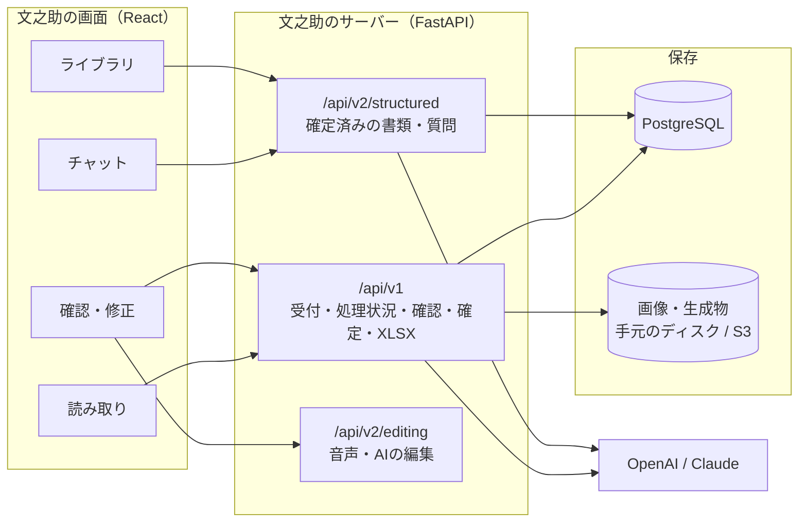
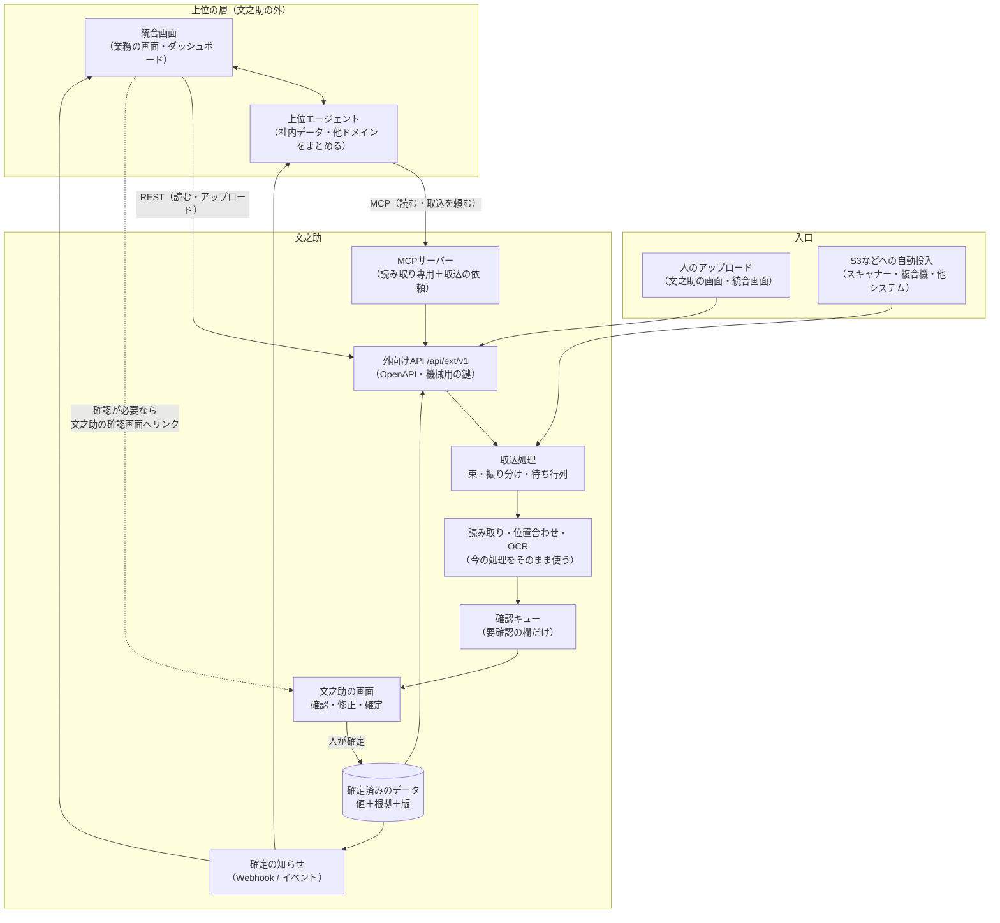
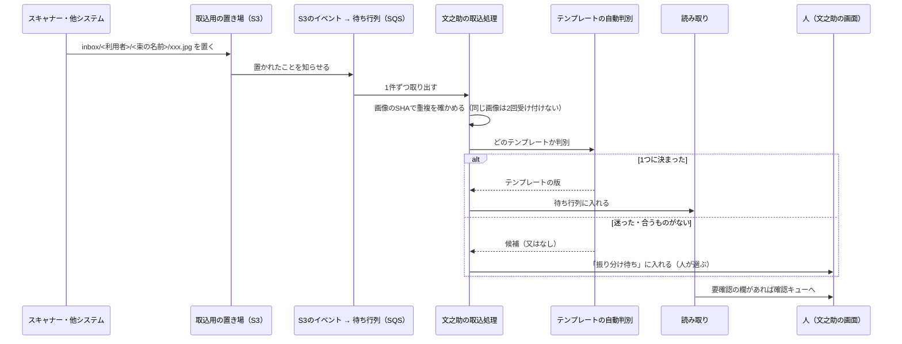
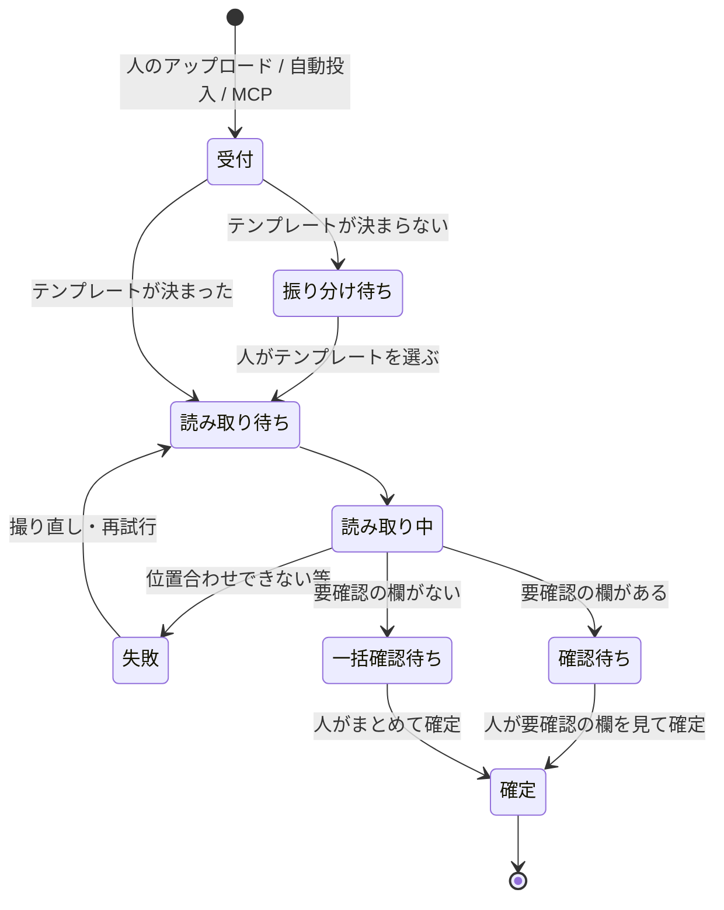

# 文之助を上位エージェントにつなぐ設計図（2026-11-07）

文之助を「帳票を、人が保証したデータに変える部品」とし、その上にいる統合エージェントと統合画面から使えるようにするための設計方針。[業務向けの方向性](https://github.com/abeouga/agorack-document/blob/main/fuminosuke/history/docs/strategy/business-direction-2026-11-07.md)の続き。

この文書は設計の方針。実装するときは、変える契約ごとに [OCR Safety Contract](../ocr-safety-contract.md) を更新する。

---

## 1. 目指す姿（ひとことで）

- 文之助は **読み取り・確認・確定** を受け持つ。値を決めるのは常に文之助の中の人間の確認。
- 上位エージェントは **確定済みの値を取り出して使う** だけ。値を作らない、直さない、確定しない。
- 入口は3つ：**人のアップロード**、**S3などへの自動の投入**、**上位エージェントのMCP**。
- 今の文之助の画面（チャット・読み取り・ライブラリ）は残す。確認・修正の画面は今後も文之助が持つ。

---

## 2. 今の構成（2026-11-07時点）



### 今あるもので使えるもの

| 機能 | 今の場所 | 上位エージェント向けに使えるか |
| --- | --- | --- |
| 画像の受付（読み取りの開始） | `POST /api/v1/ocr-jobs`（画像＋テンプレートの版） | 中身は使える。入口は画面向け |
| テンプレートの自動判別 | `POST /api/v1/template-classifications` | 自動投入の振り分けにそのまま使える |
| 処理の待ち行列・並列 | サーバーの待ち行列、Lambdaでの画像処理 | 使える |
| 確認・修正・確定 | `/api/v1/ocr-jobs/...` と確認画面 | 人だけが使う。外には出さない |
| 確定済みの書類の一覧・1件 | `GET /api/v2/structured/documents`、`/documents/{id}` | 中身はほぼそのまま使える |
| 根拠（元の画像の欄の位置・切り抜き） | 構造化の書類の `box`・`cropUrl` | 使える。外向けの形に整える |
| 書類の版（更新の履歴） | 書類の系列（前の版・次の版） | 使える。「最新の版だけ」を返す規則がある |
| 質問応答（計算はサーバー） | `POST /api/v2/structured/questions` | 考え方は使える。外には計算の道具として出す |

### 今の足りないところ

1. **APIが画面専用になっている**：`/api/v2/structured` などは `local_request`（手元の画面からのアクセスか、クラウドの入口でログイン・CSRFを確かめた要求か）しか受け付けない。機械（別のサーバーやエージェント）からの呼び出しを想定していない。
2. **機械用の認証がない**：ログインはCognitoの利用者（人）とクッキーだけ。上位エージェントや取り込み処理に渡す、範囲を絞った鍵がない。
3. **確定の知らせがない**：上位エージェントが「新しく確定した書類」を知るには、一覧を何度も取りに行くしかない。
4. **大量処理の単位がファイル**：束（月次の分など）や、振り分けに迷った書類を人に回す仕組みがない。
5. **仕様書がない**：外向けのOpenAPIと、MCPの道具の定義がない。

---

## 3. 目指す構成



### 層ごとの役割

| 層 | やること | やらないこと |
| --- | --- | --- |
| 統合画面 | 確定済みの値を業務の画面に出す、集計を見せる、書類をアップロードする | 値を直す、確定する |
| 上位エージェント | 確定済みの値を探す・計算させる・他のデータと組み合わせて答える、取込を頼む | 値を決める・推測で埋める・直す・確定する |
| 文之助の外向けAPI・MCP | 確定済みの値と根拠を返す、取込を受け付ける、確定を知らせる | 確定前の値を返す（例外は§6.4） |
| 文之助の中（今の処理） | 位置合わせ、OCR、確認キュー、人の確認・修正・確定 | — |
| 人 | 確認キューの欄を見て直し、確定する | — |

---

## 4. 守る約束（不変条件）

設計のどこを変えても、次は崩さない。

1. **値を確定するのは文之助の中の人だけ。** 上位エージェント・統合画面・MCP・外向けAPIには、修正・確定・再編集の操作を出さない。
2. **外へ出す値は確定済みだけ。** 確定前の読み取り値（AIの候補）は、上位エージェントには渡さない。渡すのは「処理の状態」と「確認待ちの件数」まで。
3. **すべての値に根拠を付ける。** どの書類の、どの版の、どの欄か。元の画像の位置と切り抜き。いつ誰が確定したか。
4. **計算は文之助のサーバーで行う。** 合計・件数・平均・期間の絞り込みは文之助が計算し、計算に使った書類と欄を一緒に返す。上位エージェントに数字を足し算させない。
5. **書類の版は最新だけを既定にする。** 更新された書類は最新の版を返し、古い版は明示して頼んだときだけ。
6. **利用者（会社・組織）ごとにデータを分ける。** 鍵は1つの利用者の範囲だけ。今の利用者ごとのDB・保存場所の分け方をそのまま使う。
7. **今のOCRの対応関係（欄・保存先・切り抜き・版）は変えない。** 外向けの層は今の確定済みのデータを「読み替える」だけで、作り直さない。

---

## 5. 入口の設計

### 5.1 人のアップロード（今の延長）

- 文之助の画面からのアップロードは今のまま。
- 統合画面からも同じことができるよう、外向けAPIに受付を用意する（§6.2 の `POST /ingestions`）。
- 1枚ずつでなく **束（バッチ）** として受け付けられるようにする。束は「2026年10月分の点検表」のような業務の単位。

### 5.2 S3などへの自動投入

スキャナー・複合機・他のシステムが、決まった場所に画像を置くだけで取り込まれる仕組み。



決めること：

| 項目 | 方針 |
| --- | --- |
| 置き場所 | 利用者ごとの取込用の場所（例：`inbox/<利用者ID>/<束>/`）。文之助の業務データの保存場所とは分ける |
| 束の決め方 | フォルダ（接頭辞）を束とみなす。任意で `manifest.json`（束の名前、テンプレートの指定、期間）を置ける |
| テンプレートの指定 | manifest で指定されていればそれを使う。なければ自動判別（今の `template-classifications`） |
| 重複 | 画像の内容のSHAで判定。同じ画像は新しい読み取りを作らず、既存の受付を返す |
| 前の版との照合 | 既にある「確定済みの書類の更新」の照合（同じ紙の書き足し）を自動投入にも使う |
| 振り分けに迷ったとき | 推測で読まない。「振り分け待ち」として文之助の画面に出し、人がテンプレートを選ぶ |
| 失敗 | 位置合わせの失敗などは失敗のまま残し、理由を見えるようにする。黙って捨てない |
| 処理後の画像 | 取込用の置き場からは消すか移す（`processed/`）。正本は文之助の保存場所に入る |

### 5.3 上位エージェントからの取込依頼（MCP）

- 上位エージェントが「このファイルを読み取りに回して」と頼める道具を用意する（§7 の `submit_documents`）。
- 返すのは **受付番号と処理の状態だけ**。読み取り値は返さない。確定したら知らせ（§8）で伝わる。

---

## 6. 外向けAPI（`/api/ext/v1`）

画面用のAPI（`/api/v1`・`/api/v2`）とは分ける。画面用はこれまでどおり自由に変えてよく、外向けは **版を付けて安定させる**。

### 6.1 認証と権限

| 項目 | 方針 |
| --- | --- |
| 人（統合画面の利用者） | 今の Cognito のログインを使い、統合画面から OAuth で文之助のトークンを取る |
| 機械（上位エージェント・取込処理） | Cognito の機械用のクライアント（client credentials）で発行したトークン。利用者1つに固定 |
| 権限（scope） | `documents:read`（確定済みを読む）、`ingest:write`（取込を頼む）、`events:read`（知らせを受ける）。**修正・確定の権限は作らない** |
| MCPの認証 | MCPの遠隔接続の標準（OAuth 2.1）に合わせ、同じ Cognito を使う |
| 記録 | 外向けの呼び出しはすべて記録する（誰が・いつ・どの書類を） |

### 6.2 主な入口（案）

| 方法 | パス | 内容 |
| --- | --- | --- |
| GET | `/templates` | 使用中のテンプレートの一覧（名前、種類、書類の件数） |
| GET | `/templates/{id}/schema` | そのテンプレートの欄・表・列の定義（名前、型、選択肢、版）。上位エージェントが最初に読むもの |
| GET | `/documents` | 確定済みの書類を探す。テンプレート、確定日・記入日の期間、欄の値、識別値で絞る。ページ送りあり |
| GET | `/documents/{id}` | 1件の確定済みの値（欄・表）と根拠 |
| GET | `/documents/{id}/history` | 版の履歴（明示して頼んだときだけ古い版） |
| GET | `/documents/{id}/fields/{fieldId}/crop` | 欄の切り抜き画像（根拠の表示用） |
| POST | `/aggregations` | 合計・件数・平均・最大・最小・期間ごとの集計。サーバーが計算し、使った書類と欄を返す |
| POST | `/ingestions` | 束を作り、画像を受け付ける（テンプレートの指定は任意） |
| GET | `/ingestions/{id}` | 束の状態：受付・振り分け待ち・読み取り中・確認待ち・確定済み・失敗の件数 |
| GET | `/review-links/{documentId}` | その書類の文之助の確認画面へのリンク（人を誘導するため） |
| — | Webhook（§8） | 確定・更新・削除の知らせ |

**出さないもの**：修正、確定、再編集、廃棄、テンプレートの編集、確定前の読み取り値。

### 6.3 返す値の形（案）

今の構造化の書類（`structured-document.v1`）を元に、外向けに整える。

```json
{
  "contractVersion": "fuminosuke.ext.v1",
  "document": {
    "id": "doc_93fca593",
    "seriesId": "series_2b9963b1",
    "version": 2,
    "isLatest": true,
    "template": { "id": "tpl_1021", "name": "繁殖台帳1021", "schemaVersion": "3" },
    "name": "はじめ",
    "confirmedAt": "2026-10-26T13:05:00+09:00",
    "confirmedBy": "user_xxxx",
    "sourceImage": { "url": "...", "sha256": "..." }
  },
  "fields": [
    {
      "fieldId": "f_kemono",
      "label": "毛色",
      "path": ["母牛"],
      "type": "choice",
      "value": "黒",
      "storedValue": "黒2",
      "status": "confirmed",
      "corrected": false,
      "evidence": {
        "page": 1,
        "box": { "x": 120, "y": 340, "width": 80, "height": 30 },
        "cropUrl": "/api/ext/v1/documents/doc_93fca593/fields/f_kemono/crop"
      }
    }
  ],
  "tables": [
    {
      "tableId": "t_calves",
      "label": "売却子牛一覧",
      "columns": [{ "columnId": "c_price", "label": "価格", "type": "number" }],
      "rows": [
        { "row": 1, "cells": { "c_price": { "value": 540000, "text": "540,000", "evidence": { "...": "..." } } } }
      ]
    }
  ]
}
```

決めておくこと：

- **値は2つ持つ**：画面に出す `value`（「黒」）と、保存されている `storedValue`（「黒2」）。数値は数と元の文字の両方。
- **空欄と「読めない」は区別する**：確定済みでは「読めない」は残らないはずだが、空欄はnullではなく `status: "blank"` で示す。
- **人が直したか**（`corrected`）を出す。AIの読み取りがそのまま確定したのか、人が直したのかが品質の指標になる。

### 6.4 確定前の書類の扱い

- 上位エージェントには **件数と状態だけ** 見せる（「確認待ち12件」）。値は見せない。
- 統合画面で「確認待ち」を押したら、文之助の確認画面へのリンク（§6.2 `review-links`）で人を誘導する。
- 確認待ちを外の画面で直せるようにはしない（修正の画面と規則を2か所に持たないため）。

---

## 7. MCPサーバー

外向けAPIの上に乗せる薄い層。中身の規則は外向けAPIと同じ。

### 7.1 置き方

| 段階 | 置き方 |
| --- | --- |
| 最初（手元） | 手元のPCで動かすMCPサーバー（標準入出力）。Claude Desktop などからつなぐ。外向けAPIへは機械用の鍵で接続 |
| その後 | 遠隔のMCPサーバー（HTTP）。認証は OAuth 2.1（Cognito） |

### 7.2 道具（tools）

| 道具 | 内容 | 権限 |
| --- | --- | --- |
| `list_templates` | どんな書類があるか、件数 | `documents:read` |
| `get_template_schema` | 欄・表・列の定義 | `documents:read` |
| `search_documents` | 確定済みの書類を条件で探す（最大件数を決めて返す） | `documents:read` |
| `get_document` | 1件の値と根拠 | `documents:read` |
| `aggregate` | 合計・件数・平均などをサーバーで計算 | `documents:read` |
| `get_ingestion_status` | 束の処理の状態 | `ingest:write` |
| `submit_documents` | 画像を取込に回す（値は返さない） | `ingest:write` |

### 7.3 読み物（resources）

- `fuminosuke://templates/{id}/schema`：テンプレートの定義
- `fuminosuke://documents/{id}`：確定済みの書類

### 7.4 上位エージェントへの指示（MCPの説明文に入れる）

- 書類の値は `get_document`・`search_documents`・`aggregate` の結果だけを使う。推測で埋めない。
- 数字の計算は `aggregate` に任せる。
- 答えには書類名と欄名（根拠）を添える。
- 値が違いそうなときは、直そうとせず、利用者に文之助の確認画面での確認を勧める。

---

## 8. 確定の知らせ（イベント）

上位エージェントや統合画面が、一覧を何度も取りに行かずに済むようにする。

| 知らせ | いつ |
| --- | --- |
| `document.confirmed` | 書類が確定した |
| `document.updated` | 確定済みの書類の新しい版が確定した（書き足し・再編集） |
| `document.deleted` | 書類が削除された・ごみ箱へ移った |
| `ingestion.progressed` | 束の中の件数が変わった（受付→確認待ち→確定） |
| `ingestion.needs_triage` | 振り分け待ちが出た |

- 送り方は Webhook（署名付き）から始める。AWSで動かすなら EventBridge に流す形も選べる。
- 知らせには **書類IDと版だけ** を入れ、値は入れない（受け取った側が `get_document` で取りに行く）。権限の確認を一か所にまとめるため。

---

## 9. 大量処理の流れ（業務の単位）



- **確認キュー**：束の中の「要確認の欄」だけを集めて順に見せる画面を作る。人は書類を1枚ずつ開かず、迷った欄だけを見る。
- **一括確認**：要確認の欄がない書類は、一覧で見てまとめて確定できる。**まとめて確定も人の操作**であり、自動では確定しない。
- **束の進み具合**：束ごとに「100枚中、確定80・確認待ち15・振り分け待ち3・失敗2」を出す。統合画面にも同じ数を出せる。

---

## 10. 見せ方の分担

| 見せ方 | どこで | 何を |
| --- | --- | --- |
| 探す | 文之助のチャット、上位エージェント | 単発の質問。根拠の欄を強調・リンク |
| 見る | 統合画面（又は文之助の一覧画面） | 一覧・集計・時系列の固定画面 |
| 渡す | 外向けAPI、MCP、CSV/XLSX | 他のシステム・エージェントへ |
| 直す | 文之助の確認画面だけ | 要確認の欄、確定、再編集 |
