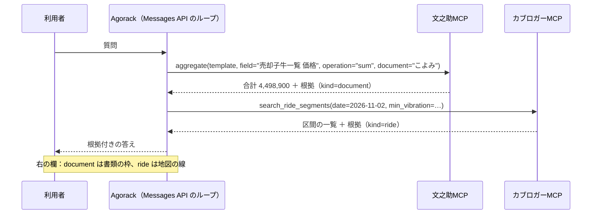

# Agorack（アゴラック）の計画（2026-11-09）

文之助やカブロガーなどの部品を、MCP を通して呼び分ける親エージェントのチャット「Agorack」の計画。リポジトリを作る前に決めたことと、作り始めるときに決めることをまとめる。

関連：[上位エージェントにつなぐ設計図](agent-integration-architecture-2026-11-07.md)（守る約束・入口・外向けAPI）、[文之助×カブロガー 統合エージェント 設計メモ](fuminosuke-cub-agent-2026-11-08.md)（根拠の形）、[文之助MCPサーバーの設計](fuminosuke-mcp-design-2026-11-08.md)。

---

## 1. 位置づけ

```
Agorack（チャット：入口・横断の質問・取込の受付窓口・処理状況の表示）
 │  ├─ MCP → 文之助（帳票：確定済みの値を読む・取込を頼む）
 │  ├─ MCP → カブロガー（走行：区間を読む）
 │  └─ 右の欄：根拠の種類ごとの表示（あとで各サービスの埋め込み画面を iframe で）
 │
文之助（自分のGUIを持つ）            カブロガー（自分のGUIを持つ）
  テンプレート作成・確認・確定           走行の一覧・地図・グラフ
```

- 名前は agora（人と情報が集まる広場）＋ dock（つなぐ所）。
- Agorack は処理をほとんど持たない。持つのは会話のループと、MCP の結果を画面に出すことだけ。業務の規則（確定済みだけを返す、数を数える・足す、値を照合する）は各部品が持つ。
- 値を確定するのは文之助の中の人だけ。Agorack には修正・確定の操作を作らない（[設計図 §4](agent-integration-architecture-2026-11-07.md#4-守る約束不変条件)）。

## 2. 決めたこと

| 項目 | 決定 |
|---|---|
| 部品のつなぎ方 | 各部品は自分のGUIとREST APIを持ち、AI用の入口として MCP サーバーを持つ。中身の処理は1つで、REST API と MCP はどちらもそれを呼ぶ入口 |
| 画面の分け方 | チャットは入口と横断の質問だけ。確認・修正・確定、テンプレート作成は文之助の画面に残す。画像のアップロードはチャットで受け付けてよいが、判別・読み取りは文之助が行う |
| 画面の埋め込み | 各サービスが「埋め込み用の画面」をURLで公開し、Agorack は iframe で右の欄に表示する。1つの React のビルドにまとめない（サービスごとに別々に直せるように） |
| チャットの作り | 文之助のチャット画面を流用する |
| リポジトリ | Agorack 用に新しく作る（例：`abeouga/agorack`）。チャットのコードは、Agorack がある程度できてから文之助から切り出す |

## 3. 進める順番

1. **文之助の MCP を Claude Desktop で確かめる**：文之助の MCP サーバー（6つの道具）は main にある。Claude Desktop につなぎ、帳票の質問に根拠付きで答えられるか確かめる（Epic #56 の段階4）。
2. **カブロガーの MCP 化**：別の作業で進める（`abeouga/drive-logger`）。
3. **Agorack のリポジトリを作る**：1 の結果がよければ作り、Git で管理して進める。

## 4. カブロガーの MCP 化で合わせておくこと

あとで Agorack が2つの部品を同じ仕組みで扱えるよう、次をそろえる。

- **根拠の外枠**：`kind`・`source_id`・`label`・`location`・`value`。文之助は `kind: "document"`、カブロガーは `kind: "ride"`。`location` の中身は種類ごとに違ってよい（[統合設計メモ §5-1](fuminosuke-cub-agent-2026-11-08.md)）。
- **読み取り専用**：最初は読む道具だけにする。
- **計算は部品の中で**：平均・最大などは MCP の道具の中のコードではなく、部品の本体（APIの側）で行う。
- **データの読み先**：走行データが S3 に移る作り直しが進んでいるので、MCP サーバーが手元の CSV・API・S3 のどれを読むか決める。手元のPCだけでも動く形にしておく。

## 5. Agorack を作り始めるときに決めること

| 決めること | 案 |
|---|---|
| チャットの画面をどう流用するか | 文之助の `AskPage` まわり（`frontend/src/pages/AskPage.tsx`・`structured/askStore.ts`・`ask.css`・`components/Markdown.tsx` など）を**コピーして**始める。文之助側と共通の部品にするのは後にする（いきなり共通化すると、文之助の画面まで直すことになる） |
| サーバー | 小さな FastAPI（又は Node）。Messages API のツール使用のループと、MCP の利用側（文之助とカブロガーの MCP サーバーを標準入出力で起動）を持つ |
| 道具の定義 | 自分で書き直さず、MCP サーバーが公開する道具をそのまま Messages API に渡す。Claude Desktop と Agorack が同じ部品を使う形にする |
| 右の欄 | 根拠の `kind` で出し分ける。最初は文之助の書類画像に枠を描くだけにし（ページ画像のURLと `box` を使う）、iframe の埋め込みは次の段階にする |
| 会話の保存 | 最初は保存しない（ブラウザーの中だけ）。文之助のような DB への保存は後にする |
| ログイン | 最初は手元のPCだけで動かすので不要。遠隔で使うときに、各部品の外向けAPIの機械用の鍵と一緒に考える |

iframe で埋め込む段階になったら、文之助とカブロガーのそれぞれに「埋め込み用の画面」を作る。その作業は、それぞれのリポジトリの Embed の Issue にする。

## 6. 呼び分けの流れ（例）

「こよみの売却子牛の価格の合計と、11月2日の走行で振動が大きかった区間は？」



- Agorack は数字を自分で計算しない。部品が返した値と根拠をそのまま使う。
- 値が違いそうなときは、直そうとせず、文之助の確認画面へのリンクを示す。
