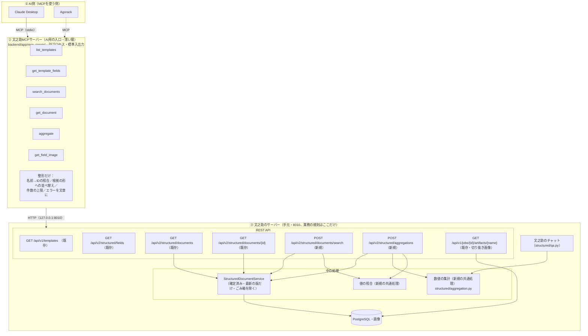
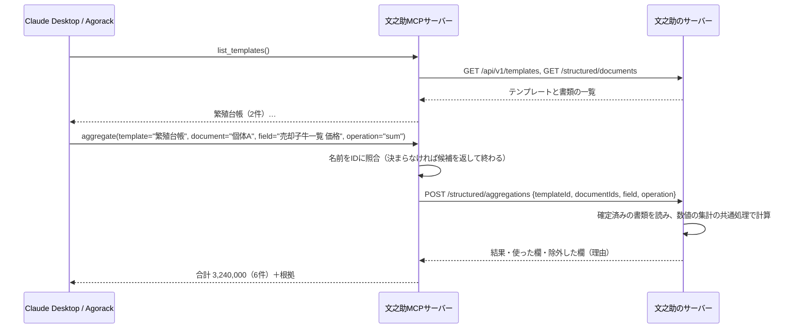

# 文之助MCPサーバーの設計

親エージェント「Agorack（アゴラック）」や Claude Desktop などのAIが、文之助の**確定済みの帳票データ**を読むための MCP サーバーの設計。

実装は `backend/app/mcp_server/` にある。

関連：[上位エージェントにつなぐ設計図](agent-integration-architecture-2026-11-07.md)（§4 守る約束、§7 MCP）。

---

## 1. 目的と範囲

**目的**：AIが、文之助で人が確認・確定した帳票の値を、根拠（どの書類のどの欄か）付きで取り出せるようにする。

**作ったもの（6つの道具）**

| 道具 | 内容 |
|---|---|
| `list_templates` | 書類の種類（テンプレート）と件数 |
| `get_template_fields` | その種類の欄・表・列の名前 |
| `search_documents` | 確定済みの書類を探す |
| `get_document` | 1件の値と根拠 |
| `aggregate` | 数値の欄の合計・平均・件数・最大・最小（サーバーで計算） |
| `get_field_image` | 欄の切り抜き画像（AIが元の文字を見て確かめる・利用者に見せる） |

**まだ作っていないもの**

- 取込の依頼（`submit_documents`）：画像を受け取って読み取りに回す道具。Agorack の受付窓口を作るときに足す。
- 遠隔からの接続（HTTP）と認証：手元のPCで動かす間は不要。
- 外向けAPI（`/api/ext/v1`）：今は画面用のAPIを手元から呼ぶ。外向けAPIを作ったら、MCPの呼び先をそちらへ切り替える。
- 画面を返す拡張（MCP Apps）：書類の画面の埋め込みは、まず Agorack の iframe で行う。

---

## 2. 守る約束

[設計図 §4](agent-integration-architecture-2026-11-07.md#4-守る約束不変条件) をそのまま守る。MCPで特に効くもの：

1. **読み取り専用**：修正・確定・再編集・削除・テンプレートの編集の道具は作らない。
2. **確定済みだけ**：今の構造化のAPIは確定済みの書類だけを返すので、それだけを呼ぶ。確定前の読み取り値（AIの候補）を返す経路を作らない。
3. **根拠を必ず付ける**：値を返すときは、書類ID・欄ID・欄名・位置を一緒に返す。
4. **計算は文之助のサーバーで**：合計などは文之助のサーバーの集計API（§3.3）が、チャットと同じ数値の読み方で計算する。MCPサーバーは計算しない。読めない値は推測せず、除外して理由を返す。
5. **書類は最新の版だけ**：今の一覧は系列の最新の版だけを返す。古い版を返す道具は作らない。
6. **OCRの対応関係は変えない**：MCPは今の確定済みのデータを読み替えるだけ。文之助の保存形式・APIの形は変えない。

---

## 3. 置き方

### 3.1 3つの層

MCPサーバーの中にあるのは「API」ではなく**道具（tool）**。AIは道具を呼び、道具は**稼働中の文之助のサーバーのAPIをHTTPで呼ぶ**。計算や絞り込みのような業務の規則は、文之助のサーバーの中だけに置く。



- **②の役目**：AIが使いやすい形にすることだけ。業務の判断（どの値を数として読むか、どの書類が条件に合うか）はしない。
- **③に足すもの**：APIを2つと、共通の処理を2つ（§3.3）。どちらも今ある処理を取り出して共通にするもので、新しい規則は作らない。
- 文之助のチャットも、同じ集計の共通処理を使うように直す。これで「チャットとAgorackで合計が違う」ことが起きない。

### 3.2 道具と、呼ぶ文之助のAPI

| MCPの道具（②） | 呼ぶ文之助のAPI（③） | ②でやること |
|---|---|---|
| `list_templates` | `GET /api/v1/templates`（既存）、`GET /api/v2/structured/documents`（既存） | テンプレートごとに件数を数える |
| `get_template_fields` | `GET /api/v2/structured/fields`（既存） | テンプレートの名前→IDの照合 |
| `search_documents` | `GET /api/v2/structured/documents`（既存）。欄の値・確定日で絞るときは `POST /api/v2/structured/documents/search`（新規） | 名前→IDの照合、件数の上限 |
| `get_document` | `GET /api/v2/structured/documents/{id}`（既存） | 書類名→IDの照合、根拠の形への並べ替え、欄の絞り込み |
| `aggregate` | `POST /api/v2/structured/aggregations`（新規） | 名前→IDの照合、根拠の形への並べ替え |
| `get_field_image` | `GET /api/v1/jobs/{id}/artifacts/{name}`（既存） | 画像を縮めてMCPの画像の形式で返す |

1回の質問の流れの例（「個体Aの売却子牛の価格の合計は？」）：



### 3.3 文之助のサーバーに足すもの

**共通の処理（`backend/app/structured/`）**

| 処理 | 中身 | 今どこにあるか |
|---|---|---|
| 数値の集計（`aggregation.py`） | 値の一覧を数にし（`number_value`、ほかの値が整数なら「762.300」の「.」を千の区切りとして読む規則を含む）、合計・平均・件数・最大・最小を出す。読めなかった値・区切りとして読んだ値を、理由付きで返す | チャットの `QuestionEngine._numbers`（`structured/qa.py`）の中に、回答文と一緒に書かれている。計算の部分だけを取り出し、チャットは回答文を作るだけにする |
| 値の照合 | 欄の値が条件に合うか（全角・半角、カタカナ・ひらがな、空白を無視した一致） | チャットの値の照合（`_fold` など）。同じ規則を共通にする |

チャットの計算を取り出すときは、**チャットの答えが変わらないこと**を確かめる（§8）。

**新しいAPI（`/api/v2/structured`、今の構造化のAPIと同じ扱い）**

`POST /api/v2/structured/documents/search`：欄の値・確定日で書類を絞る。

```json
// 要求
{
  "templateId": "…",
  "query": "個体A",
  "fieldEquals": [{ "label": "毛色", "value": "黒" }],
  "confirmedFrom": "2026-10-01",
  "confirmedTo": "2026-10-31",
  "limit": 20
}
// 応答
{ "items": [ /* 今の一覧と同じ書類の要約 */ ], "total": 1, "truncated": false }
```

`POST /api/v2/structured/aggregations`：数値の欄（又は表の列）を集計する。

```json
// 要求
{
  "templateId": "…",
  "documentIds": ["…"],
  "field": { "label": "価格", "tableTitle": "売却子牛一覧" },
  "operation": "sum",
  "fieldEquals": [],
  "confirmedFrom": null,
  "confirmedTo": null
}
// 応答
{
  "operation": "sum",
  "result": "3240000",
  "countUsed": 6,
  "used": [ { "jobId": "…", "fieldId": "…", "value": "540,000", "number": "540000" } ],
  "excluded": [ { "jobId": "…", "fieldId": "…", "value": "826-100", "reason": "数として読めない" } ],
  "readAs": [ { "jobId": "…", "fieldId": "…", "value": "762.300", "number": "762300", "note": "「.」を千の区切りとして読んだ" } ],
  "documents": 1,
  "truncated": false
}
```

- どちらも確定済みの書類だけを対象にする（`StructuredDocumentService` を通す）。
- 欄（`field`）が複数の欄・列に当てはまるときは、計算せず 409 と候補を返す。
- 名前→IDの照合（「個体A」→書類ID）はMCP側で行い、このAPIはIDで受け取る。外向けAPI（`/api/ext/v1`）を作るときに、照合もサーバー側へ移すか決める。

### 3.4 決めたこと

| 項目 | 決定 | 理由 |
|---|---|---|
| 動かし方 | 文之助のサーバーとは**別のプロセス**。Claude Desktop などが起動する（標準入出力） | MCPの利用者ごとに起動・停止されるため、文之助のサーバーの中には置けない |
| データの取り方 | 文之助のサーバーへ **HTTPで問い合わせる**（`http://127.0.0.1:8010`） | DBに直接つながず、文之助のサーバーを唯一の入口に保つ。確定済みだけを返す規則・ごみ箱の除外・版の扱いを、二重に書かずに済む。あとで外向けAPIに切り替えるときも、呼び先を変えるだけで済む |
| コードの置き場所 | `backend/app/mcp_server/`（文之助のリポジトリの中、文之助の部品として） | 文之助のAI用の入口なので文之助と一緒に保守する。文之助の中の処理は直接呼ばず、HTTPだけで話す。Agorack のコードとは分ける |
| 起動の入口 | `python -m app.mcp_server`（`backend` で実行、仮想環境の python を直接使う） | 稼働中のサーバーがあるときに `uv run` を使わないため |
| ライブラリ | MCP の公式 Python SDK（`mcp`）の FastMCP | 道具の型から入力・出力のスキーマを作れる。出力を構造化データ（structuredContent）と文章の両方で返せる |
| 呼び先の設定 | 環境変数 `FUMINOSUKE_API_URL`（既定 `http://127.0.0.1:8010`） | 手元の別ポートや、あとで外向けAPIへ切り替えるため |

文之助のサーバーの構造化APIは、同じPCからの要求（Host が 127.0.0.1、Origin なし）を受け付ける（`api/editing_transport.local_request`）。文之助側の変更は要らない。ただし、構造化の機能が有効（`STRUCTURED_DATA_ENABLED=true`、通常の `.env` で有効）で、文之助のサーバーが動いている必要がある。

### 3.5 依存の追加

- `backend/pyproject.toml` に `mcp` を足す。
- 入れるときは、通常の 8010/5180 を止めてから行う（稼働中に仮想環境を入れ替えると壊れる）。入れた後に再起動する。

---

## 4. 共通の決まり

### 4.1 返す形

各道具は、**構造化データ**（structuredContent、Agorack が画面に使う）と、**短い文章**（Claude Desktop などがそのまま読む）の両方を返す。

値・欄名・書類ID・欄IDは両方で同じ。文章の方は、位置（box）とURLを省いた短い形にした。構造化データをそのままJSONの文章にすると、表の多い書類1件の全部で約100KBになり、AIが読む量が大きすぎるため。位置とURLは構造化データの `location` にあり、切り抜きは `get_field_image` で見られる。

### 4.2 根拠の形

根拠は、外枠（`kind`・`source_id`・`label`・`location`・`value`）をそろえた次の形で返す。同じ親エージェントにつなぐ他の部品のMCPも同じ外枠にすると、親が根拠を1つの形で扱える。

```json
{
  "kind": "document",
  "source_id": "93fca593-…",
  "label": "繁殖台帳「個体B」の毛色",
  "location": {
    "template_id": "…",
    "template_name": "繁殖台帳",
    "document_name": "個体B",
    "field_id": "…",
    "field_label": "毛色",
    "section": "母牛",
    "table_id": null,
    "table_title": null,
    "row_number": null,
    "column_id": null,
    "page_id": null,
    "box": { "x": 120, "y": 340, "width": 80, "height": 30 },
    "crop_url": "http://127.0.0.1:8010/api/v1/jobs/…/artifacts/fieldCrop.….alignedColor",
    "image_url": "http://127.0.0.1:8010/api/v1/jobs/…/artifacts/…"
  },
  "value": "黒"
}
```

- `value` は画面に出す値（選択欄の同じ名前の番号を外したもの。例：保存値「黒2」→「黒」）。保存値は `stored_value` として別に持つ（違うときだけ）。
- 空欄は `value: null` と `status: "blank"`。
- URL は文之助のサーバーの住所を付けた絶対URLにする（Agorack の画面で使うため）。
- 構造化の書類が今持っている項目（`fieldId`・`label`・`section`・`tableId`・`rowNumber`・`columnId`・`pageId`・`box`・`cropUrl`・`value`・`status`・`choiceLabels`、表の `title`・`columns`、書類の `pages[].imageUrl`）から作る。新しい情報は作らない。

### 4.3 名前で指定できるようにする

AIは ID を知らないので、テンプレート・書類・欄は**名前でも指定できる**ようにする。

| 対象 | 照合の順 | 決まらないとき |
|---|---|---|
| テンプレート | ID の一致 → 名前の完全一致 → 名前に含まれる | 候補が複数なら、候補の名前の一覧を付けて「どれか指定してください」と返す |
| 書類 | ID の一致 → 書類名・識別値の完全一致 → 含まれる（今の一覧の検索 `q` と同じ規則） | 同上（書類名・テンプレート名・識別値・確定日を付ける） |
| 欄 | 欄ID → 欄名の完全一致 → 欄名に含まれる。表の列は「表名 列名」でも指定できる | 同上（見出し・表名を付ける） |

照合では全角・半角、カタカナ・ひらがなの違いを無視する（文之助の今の照合と同じ）。**推測で1つに決めない**。決まらなければ候補を返し、AIに選び直させる。

### 4.4 量の上限

| 項目 | 上限 |
|---|---|
| `search_documents` の件数 | 既定20、最大50 |
| `get_document` の欄 | 欄を指定しなければ全部（表は行ごと）。表の行は最大100行で、超えたら超えたことを返す |
| `aggregate` で読む書類 | 最大200件。超えたら超えたことを返す |

### 4.5 エラー

AI が次の手を決められるよう、文章で返す。

| 場合 | 返す内容 |
|---|---|
| 文之助のサーバーが動いていない | 「文之助のサーバー（http://127.0.0.1:8010）に接続できません。起動しているか確かめてください。」 |
| 構造化の機能が無効（503） | 「文之助の確定済みデータの機能が無効です。」 |
| 見つからない | 何が見つからなかったかと、探した条件 |
| 決まらない | 候補の一覧（§4.3） |

---

## 5. 道具の仕様

### 5.1 `list_templates`

使用中のテンプレートと、確定済みの書類の件数を返す。AI が最初に呼ぶ想定。

- 入力：なし
- 処理：`GET /api/v1/templates`（使用中の版があるもの）と `GET /api/v2/structured/documents?limit=1000`（テンプレートごとに件数を数える）
- 出力：

```json
{
  "templates": [
    { "template_id": "…", "name": "繁殖台帳", "document_count": 2, "latest_confirmed_at": "2026-10-26T13:05:00+09:00" }
  ]
}
```

- 書類が0件のテンプレートも返す（件数0）。ごみ箱のテンプレートは返さない。

### 5.2 `get_template_fields`

その種類の書類にある欄・表・列の名前を返す。AI が欄名を正しく指定するため。

- 入力：`template`（名前又はID、必須）
- 処理：`GET /api/v2/structured/fields?templateId=…`（直近の確定済みの書類に実際にある名前、今のAPIの規則のまま）
- 出力：

```json
{
  "template": { "template_id": "…", "name": "繁殖台帳" },
  "fields": ["名号", "生年月日", "統一耳標"],
  "tables": [ { "title": "売却子牛一覧", "columns": ["産次", "日令", "体重", "価格"] } ]
}
```

- 確定済みの書類が1件もないテンプレートは、欄の名前を出せない（今のAPIの規則）。その旨を返す。

### 5.3 `search_documents`

確定済みの書類を探す。値は返さず、書類の一覧（名前・識別値）を返す。

- 入力：
  - `template`：名前又はID（任意）
  - `text`：書類名・識別値で探す語（任意。今の一覧の `q` と同じ）
  - `field_equals`：欄の値で絞る `[{ "field": "毛色", "value": "黒" }]`（任意、最大3つ。値が一致する書類だけ）
  - `confirmed_from`・`confirmed_to`：確定日の範囲（任意、YYYY-MM-DD）
  - `limit`：既定20、最大50
- 処理：絞り込みが `template`・`text` だけなら `GET /api/v2/structured/documents`（`templateId`・`q`）。`field_equals` や確定日の範囲があるときは `POST /api/v2/structured/documents/search`（§3.3）。MCP側では絞り込まない。
- 出力：

```json
{
  "documents": [
    {
      "document_id": "…",
      "document_name": "個体B",
      "template_name": "繁殖台帳",
      "version": 2,
      "confirmed_at": "…",
      "identity": [ { "label": "名号", "value": "個体B" }, { "label": "統一耳標", "value": "（耳標の番号）" } ]
    }
  ],
  "total": 1,
  "truncated": false
}
```

### 5.4 `get_document`

1件の確定済みの値と根拠を返す。

- 入力：
  - `document`：書類名・識別値又はID（必須）
  - `template`：書類名が複数のテンプレートにあるときの絞り込み（任意）
  - `fields`：欲しい欄の名前の一覧（任意。指定しなければ全部）
- 処理：書類を決め（§4.3）、`GET /api/v2/structured/documents/{id}` を読み、根拠の形（§4.2）に変換する。
- 出力：

```json
{
  "document": { "document_id": "…", "document_name": "個体B", "template_name": "繁殖台帳", "version": 2, "confirmed_at": "…" },
  "fields": [ { "…根拠の形…": "" } ],
  "tables": [
    {
      "table_id": "…",
      "title": "売却子牛一覧",
      "columns": ["産次", "日令", "体重", "価格"],
      "rows": [ { "row_number": 1, "cells": { "価格": { "…根拠の形…": "" } } } ],
      "truncated": false
    }
  ],
  "not_found_fields": []
}
```

- 表は値のある行だけを返す（全部の列が空の行・番号の列だけの行は外す。今のQAと同じ規則）。
- `fields` に指定した名前で見つからないものは `not_found_fields` に入れる。

### 5.5 `aggregate`

数値の欄（又は表の列）を、文之助のサーバー側の決まりで計算する。

- 入力：
  - `template`：名前又はID（必須）
  - `field`：欄名、又は表の列名（「表名 列名」も可）（必須）
  - `operation`：`sum`・`avg`・`count`・`max`・`min`（必須）
  - `document`：特定の書類だけで計算するとき（任意）
  - `field_equals`・`confirmed_from`・`confirmed_to`：`search_documents` と同じ絞り込み（任意）
- 処理：名前をIDに照合し、`POST /api/v2/structured/aggregations`（§3.3）を呼ぶ。計算は文之助のサーバーが行う（チャットと同じ共通処理）。読めない値（「826-100」「1万2千」など）は推測せず除外され、MCPは結果を根拠の形に並べ替えて返す。
- 出力：

```json
{
  "operation": "sum",
  "field": "売却子牛一覧 価格",
  "result": "3240000",
  "count_used": 6,
  "used": [ { "…根拠の形…": "" } ],
  "excluded": [ { "…根拠の形…": "", "reason": "数として読めない" } ],
  "documents": 1,
  "truncated": false
}
```

- 数は文字列で返す（小数の誤差を出さないため）。平均は小数2桁。
- `count` は空欄以外の値の件数。
- 欄名が複数の欄・列に当てはまるときは、計算せず候補を返す（§4.3）。

### 5.6 `get_field_image`

欄の切り抜き画像を返す。AI が元の手書きを見たり、利用者に見せたりするため。

- 入力：`document_id`・`field_id`（`get_document` が返したもの）
- 処理：構造化の書類の `cropUrl` を `GET` し、画像（MCPの画像の形式）で返す。
- 1回に1枚。大きい画像は縮める（長い辺1024px）。

---

## 6. 道具の説明文（AIへの指示）

道具の説明文と、サーバーの説明（instructions）に次を書く。

- このサーバーは、人が確認・確定した帳票の値だけを返す。返した値をそのまま使い、推測で埋めたり言い換えたりしない。
- 数の計算は `aggregate` を使い、自分で足し算しない。
- 答えには、書類名と欄名（根拠）を添える。
- 値が違いそうなときは直そうとせず、文之助の確認画面で確かめるよう利用者に勧める。
- 名前が決まらないと言われたら、候補から選び直すか、利用者に聞く。
- 最初は `list_templates`、欄名が分からなければ `get_template_fields` を呼ぶ。

---

## 7. つなぎ方（Claude Desktop）

`claude_desktop_config.json` の例：

```json
{
  "mcpServers": {
    "fuminosuke": {
      "command": "<リポジトリの場所>\\backend\\.venv\\Scripts\\python.exe",
      "args": ["-m", "app.mcp_server"],
      "env": { "FUMINOSUKE_API_URL": "http://127.0.0.1:8010" }
    }
  }
}
```

Claude Desktop の設定では作業フォルダ（`cwd`）の指定が効くとは限らないため外した。`backend` は仮想環境に編集可能な形で入っている（`uv sync` で入る）ので、どのフォルダから起動しても `app.mcp_server` を読める。仮想環境に `mcp` が入っていない場合は、通常の 8010 を止めてから `backend` で `uv pip install --python .venv\Scripts\python.exe mcp==1.30.0`（開発用の道具を消さない入れ方）で入れる。

- 標準出力は MCP の通信に使うので、ログは標準エラーに出す。
- 文之助の `.env`（AIのキーなど）は読まない。MCPサーバーはAIを呼ばない。
