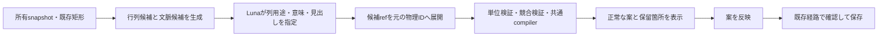

# AIテンプレート作成 フェーズ10：採用審査と設計再評価

2026-10-11。段階の指定開発モデルは **Astra / XHigh**。対象は `C:/Users/hanam/Desktop/llm-ocr-deploy`。
実APIモデルは引き続き **`gpt-6-luna`**。この工程の実API追加は **0回**、台帳は **292/496、残204回**。
製品実装・通常DB移行・通常機能の開放は行っていない。

## 1. 審査結果

**A/B/Cを製品へ採用する条件は満たしていない。Cを第一候補としてそのまま実装する判断も撤回する。**
検証設計を修正した保存応答の再生ではBの改善幅が大きく、前回の比較だけでCが優れているとは結論できない。
一方、検証修正後もB/Cともに品質基準未達である。

次の比較候補は **D：既存セルの行列候補をサーバーが保持し、Lunaがその範囲の意味を指定する方式** とする。
モデルに全セルの役割と行列IDを何度も書き直させず、候補の選択・列用途・見出し・名前・読取方式へ出力を絞る。
これは試作方針の決定であり、Dの精度・速度が実証されたという採用決定ではない。

専門家A（モデル評価、模擬分析）：Bの全ページ拒否には試作側の責任がある。修正後Bを比較対照に残し、同じ入力でDを測る必要がある。新方式の期待値に既存goldを合わせてはならない。

専門家B（編集APIと整合性、模擬分析）：行別ラベルと記号欄の結合は共通APIに必要である。独立した表まで壊れる依存構造は見直すが、誤った親や重複した値所有を採用する救済は行わない。

専門家C（応答時間と操作、模擬分析）：最初の通信通知が約1秒でも、使える案の到着は約15秒だった。全ページを何度も生成させる方式より、固定候補を短く指定させる方式を先に測る。追加のDecisionsを全解析の前段に直列配置しない。

客観的まとめ：検証の欠陥修正と、モデルが生成する情報量・依存範囲の削減が必要という点で一致する。全数分類の効果と候補制約の効果は未確定であり、修正B対Dの比較で判定する。現時点では製品実装に進まず、次の製品外試作に進むのが合理的である。

## 2. 今回確認した証拠

保存先は `D:/llm-ocr-archive/template-ai/20261011-phase10`。
フェーズ9のraw・gold・採点・試作コードを変更せず、別のファイルへ診断を保存した。

### 2.1 主比較の独立再計算

`offline_review.py` で30試行の分類・結合・行・記号選択肢を再計算し、既存集計との一致を確認した。
主比較はA=112/6/8、B=57/14/0、C=77/11/4（分類176、結合78、行14が分母）のままである。
`parent-diagnostics.json` では結合の不一致をさらに分離した。

| 主比較 | 正解 | 欠落 | ラベルは正しく親だけ不一致 | ラベルと親が不一致 |
| --- | ---: | ---: | ---: | ---: |
| A | 6 | 42 | 22 | 8 |
| B | 14 | 59 | 1 | 4 |
| C | 11 | 51 | 8 | 8 |

親見出しも結合の意味の一部なので、親だけの誤りを正解へ変更しない。
元のpromptにも「帳票タイトルしかない場合はparent=null、グループ見出しがある場合だけ指定」と記述されていた。
単にその指示を追記するだけでは新しい対策にならない。

### 2.2 検証側の影響を保存応答で分離

以下は**同じ応答を異なる検証で再生した感度分析**であり、新しいモデル試行ではない。
無効なchecklistをmultipleへ書き換えず、その単位を保留した。
Bの辞書だけにある分類も採用せず、そのセルをunknown・保留として残した。

| 再生条件 | 方式 | 意味案あり / 10 | 分類 / 176 | 結合 / 78 | 行 / 14 | 記号選択肢 / 16 |
| --- | --- | ---: | ---: | ---: | ---: | ---: |
| 主比較 | B | 5 | 57 | 14 | 0 | 12 |
| checklist単位保留 | B | 7 | 78 | 17 | 0 | 12 |
| 上記＋辞書だけの分類をセル保留 | B | 10 | 119 | 39 | 3 | 12 |
| 主比較 | C | 6 | 77 | 11 | 4 | 16 |
| checklist単位保留 | C | 7 | 88 | 14 | 4 | 16 |

表のparent参照を列ラベルの有無にかかわらず検査する追加guardでも、この保存20応答の結果は変わらなかった。
Bの結合39件のほかに欠落25件・不一致14件、Cの結合14件のほかに欠落47件・不一致17件が残る。
保留範囲を狭めるだけでは、残る案の意味的正しさは保証されない。
既存基準の分類148、結合45、行14に届かず、**検証修正だけでの採用も不可**とする。
過去のAPI時間を修正後の利用可能時間として再利用しない。

### 2.3 複雑な表を全く理解できていないわけではない

T2のB/C全4応答には、重点対象「売却子牛一覧」の先頭3行×7列が正しい物理IDの順序で含まれていた。
ただしB-1は表全体で9行しか出さず、C-1/B-2は親を表題でなく帳票タイトルへ接続していた。
C-2は表の親も正しかったが、帳票タイトルを別fieldのラベルとしても使用して分類が衝突した。
見出しへの依存が伝播し、重点表まで保留になっている。

別の下段表では、行番号を値セルにも重複指定し、左右の表が同じ備考セルを所有する出力もあった。
したがって「行列はすべて正しい」「検証が厳しすぎるだけ」という結論も成立しない。
根拠は `raw-table-evidence.json` と、凍結済み `decoded/T2-*.json`・`normalized/T2-C-*.json`。

### 2.4 座標だけの候補生成の予備確認

`geometry_probe.py` は印字・既存役割・goldを使用せず、検出済み矩形の左右境界と上下の連続性だけから候補を作る。
全5入力の候補を保存した後でgoldと照合した。座標・ID・原画像の変更はない。

- T2：見出しを含む11行×7列の候補に、重点3行×7列が正しい順序で含まれた。
- H2：見出しを含む5行×2列の候補に、記号4欄が正しく含まれた。ただし左側の行見出し列は候補から欠けた。
- T1/H1にも幾何的な候補が出たが、そこを繰り返し表と解釈してよいかは未判定。T3は候補なし。
- 単発のローカル処理は各入力約0.03〜3.86ms。これはAPIや画面を含む応答時間でも、性能保証でもない。

**候補生成は意味理解の代替ではない。** H2は隣の説明列を値欄と誤認しないこと、欠けた行見出しを正しく候補に含めることが必要である。
この簡易probeを製品の検出器として採用しない。次の試作では行列の部分重なり、隣接する別表、結合欄を扱い、候補漏れと誤候補を別々に測定する。

## 3. 指摘事項と採否

優先度は製品導入を妨げる度合いであり、現在の通常環境で発生している障害の判定ではない。

| 優先度 | 指摘・根拠 | 修正設計 |
| --- | --- | --- |
| P1 | v2 schemaがchecklist singleを許可し、共通domainのmultiple必須と不一致。H1の3応答を全体拒否 | schemaと単位検証に同じcapability制約を使用。既存domainを緩めない |
| P1 | `phase9/prototype.py:138` の辞書だけの分類がページ全体を拒否 | B対照は該当セルだけ保留。unknownをignoredにせず、独立単位だけ継続 |
| P1 | T2の正常な部分まで共通見出しの誤分類が波及 | 表の局所構造・局所表題と、上位見出しへの接続を明示的な別提案にする。競合を勝手に解消しない |
| P1 | 製品DTOは行別ラベルを表現できず、記号のmeaning.bindを拒否する | フェーズ8 §7の共通API拡張を維持。手動・AI・音声で同じcompilerを使う |
| P1 | 手動adapterでwhole-cell mark仮登録とrole変更が衝突。第1行の複合ラベルを列共通にすると別行へ流用される | フェーズ9 secondaryの方式を候補として採用。製品への移植には実保存・再取得・undo確認が必要 |
| P2 | `prototype.py:84–86` は列ラベルがない表のparentを正規化時に検査しない | 表題参照を表自身の依存として検査。c999で正規化通過→compiler拒否を再現。誤保存の実証ではない |
| P2 | `prototype.py:121` はsnapshot内の保護済み見出しを参照できず、新出力での宣言を要求 | 読取専用の既存見出しで依存を満たす。再宣言・role書換えを要求しない |
| P2 | 試作の保護はrole辞書、physical比較は一部属性だけ。全試行が空の意味状態から開始 | 既存のfacet、同値手動意図、source/confidence、merges、page、保存済み意味を含むsnapshot検査を再利用 |

後二点を含め、プロトタイプをそのまま製品へ移すことは認めない。
`backend/app/template_analysis/snapshot.py` の所有・保護情報とphysical digestを置き換える必要はない。
v2の設計JSONは当時の比較資料として保持する。singleを許すschemaを次のprovider契約へ流用しない。

## 4. 次に比較するD方式

### 4.1 責任の分担



| 層 | 所有する情報 | 所有しない情報 |
| --- | --- | --- |
| Snapshot | resource/page/revision、物理ID、画像SHA、facet保護 | 新しい意味の正解 |
| Candidate builder | 同じセルから成る行列候補、行/列ref、根拠、重複候補 | OCR値、永続mapping、新しい座標 |
| Luna planner | 候補採否、値/行見出し/行番号/説明列、名前、読取方式、表題 | 永続ID、targetPath、保存可否 |
| Resolver/validator | 所有候補の展開、全参照・役割・値所有・依存・capability検査 | 近いセルへの置換、欠けた行の推測補充 |
| Common compiler / MutationCore | 共通操作、revision、原子的保存、receipt、undo | モデル応答を無検証で保存する経路 |

既存の `template_analysis/{snapshot,provider,graph,compose,service}.py` と共通editing層を拡張する。
新規責務は `template_analysis/candidates.py` と候補展開の小さなモジュールへ分離し、providerにgeometryや保存処理を入れない。
新規名は設計案であり、現在ファイルが存在するという意味ではない。

### 4.2 候補を正解扱いしない

- 候補は `snapshotDigest + page + builderVersion + members` に束縛する一時ref。所有サーバー以外でrefから座標を復元しない。
- 正確な行列を1つに決められなければ、上限付きの複数候補と `ambiguous` を返す。上位1件へ黙って絞らない。
- 一部区間だけ行数が一致する列、段違い・結合セル、隣接する二つの表を調べる。無理に長方形へ補完しない。
- データ行の範囲、見出し行、値列、行ラベル列はLunaの明示選択とする。印字や文字の有無だけで記入欄/説明欄を確定しない。
- 候補なしの独立欄は、同じ1回の要求のfieldsで扱う。表への強制変換やセルごとの追加APIを行わない。
- 候補に入らないセルをunknownとして残し、対象総数・候補外・保留数を表示する。候補生成成功を全体解析成功と呼ばない。

### 4.3 モデルへの短い指定形式

次はv2の反復した `rows[].cells` を減らす**v3の設計例**。実API用schemaの完成物ではない。
サーバーが候補内の順序付きmatrixと `rowRef/columnRef` を持ち、モデルは参照と用途を指定する。

```json
{
  "candidate": "grid_1",
  "name": "売却子牛一覧",
  "titleCell": "c4",
  "dataRows": { "first": "r2", "last": "r11" },
  "columns": [
    {
      "column": "k3",
      "use": "value",
      "name": "体重",
      "headerCells": ["c11"],
      "reading": { "kind": "text" }
    }
  ],
  "includeEmptyRows": true
}
```

例は列1件だけの抜粋。正式契約では対象候補の全列について `value / row_label / row_key / context / unknown` の用途を1回指定する。
列ごとに同じ用途を別箇所で重複宣言させない。行ラベル列と行番号列はcolumnsの用途から導出し、別フィールドを二重の正本にしない。
見出しのない列、表外の行ラベル、複合見出しには明示refの別指定を用意し、候補内に存在する/許可された参照だけ展開する。

H2なら判定記号列だけをvalue、点検項目列をrow_label、確認内容列をcontextと指定する。
ラベルを見える名前で検索し直さず、各行のラベル＋指定列見出しを `cellLabelCells` へ展開する。
T2では7列×10行の値IDをモデルが再列挙する必要がなくなる。ただし本当に出力が短く速くなるかは実測する。

候補ref、範囲の両端、列ref、順序、重複、同じsnapshotを検査する。行番号はその候補内だけの一時位置であり、永続row identityにしない。
飛び飛びの行や不規則な表は初回仕様では保留する。行を削って通過させず、手動で直す対象として残す。

### 4.4 表の構造と上位見出しを分離する

表本体の単位は、値セル所有・列/行ラベル・読取設定・局所表題を一貫して持つ。
局所表題のない表は明示nullを必要とし、近くの帳票タイトルを自動的な親にしない。
別枠の `hierarchy` 提案で、表題や見出しを上位見出しへ接続する。

上位接続の不備だけなら、その接続を保留し、独立した表本体の案を表示できる。
これは既存応答のparentを無視して救済する処理ではない。**新しい出力契約で最初から別の編集意図として生成・検証する変更**である。
表自身の必須表題が不明/競合なら表を保留し、parent=nullに差し替えない。
上位接続が未解決なら「階層未完了」を残し、完全な意味付けや正しい結合へ数えない。
表本体の反映が既存の上位関係を消す動作にもならない。

同じ物理値を複数単位が所有した場合は全関係単位を保留する。候補スコアや出力順で勝者を選ばない。
同じ見出しへのread-only参照は共有できるが、別のfieldがその見出しのroleを変更することは別のwriteとして検査する。
全単位のread/write集合を集めてから判定し、不正単位を先に削って競合相手を正解にしない。

### 4.5 API・schemaと保存境界

- 1ページの初回比較は **Responses 1回、gpt-6-luna、low、画像high、streaming**。全体への必須Decisions呼出しは設けない。
- Decisionsは既存の有限候補選択・音声対象決定で維持する。自由な列名や記号選択肢の生成をDecisionsに要求しない。
- providerのschemaとserver validatorは同じ型から生成する。checklistはmultipleのみ、symbolは既存capabilityの許す場合だけ。
- 記号候補数・禁止区切り・文字列長・名前の空白・同一ページなど、既存domainの制約を出力前後で一致させる。
- 異常JSON、未知ref、snapshot/所有不一致、打切り、refusalは要求単位で拒否。JSON断片を先に反映しない。
- セルの保留と表の保留を区別する。表の一部行だけを救済しない。受入可能単位の和集合を共通compilerで再検査する。
- `meaning.bind`の一意mark対応、`RecordRow.cellLabelCells`、manual compilerの変換を共通経路へ実装する。AI専用保存APIを新設しない。
- 反映時/保存時の手動facet、同値再指定、revision、page、interactionEpochを再照合。解析中の手修正を上書きしない。
- 保存済み物理ID・座標・shape・source・confidence・cellMerges・既存targetPath・受付snapshotを変えない。AI分類の由来はfacetに保存する。

Lunaの画像入力・Structured Outputsと、Decisionsの有限候補選択は公式仕様で確認した。
schema適合は意味的正しさの保証ではない。
出典（2026-10-11）：[GPT-6 Luna](https://developers.openai.com/api/docs/models/gpt-6-luna)、[Structured Outputs](https://developers.openai.com/api/docs/guides/structured-outputs)、[Decisions](https://developers.openai.com/api/docs/guides/decisions)。

## 5. 応答と画面

表の選択は任意のままとする。選択時はその表と必要な文脈へ解析範囲を絞り、未選択時はページを対象とする。
自動的に範囲を絞ったことにして未処理セルを隠さない。

- 解析受付直後から対象範囲と進捗を表示する。最初のSSEや解析枠を「案が完成した時間」に数えない。
- 初回はページ1要求で比較する。候補過多・入力上限超過は明示的に止める。性能未検証の分割/並列呼出しを先に実装しない。
- 将来ブロック別に要求する場合も、最初に使える案・ページ全体の完了・API総数を別々に測る。追加要件として審査する。
- AI枠は候補/保留/反映済みを区別し、複数セルを同時表示する。枠の移動・必要時scroll・表名overlayの既存方針を維持する。
- 表/欄ごとの「案を反映」と「確認して保存」、手で枠を描く操作を維持する。画像解析の完了を保存承認にしない。
- 音声の連続訂正・局所録音・直前セルの文脈・値の即時保存契約は今回変更しない。テンプレート案の保存とは区別する。

速度の採用基準は既存の品質条件を通過した上で意味案中央値10.138秒以下を維持する。
次試作の改善目標は**検証済みの最初の案を5秒以内**。現時点の実測保証ではない。
実画面では受付→snapshot→候補生成→送信→最初のevent→応答完了→検証→表示まで分けて測定する。
通信の最初のevent、意味案ゼロの早い応答、後で取り消す未検証案を速度改善に含めない。

## 6. フェーズの改訂

フェーズ8の「11で製品実装」は置き換える。各区切りで停止し、モデル切替後の指示で進む。

| フェーズ | 開発モデル・強度 | 範囲・完了条件 | 実APIの計画上限 |
| --- | --- | --- | ---: |
| 10：審査・再設計（今回） | Astra / XHigh | 保存30試行の再採点、検証感度分析、候補方式と受入条件を確定 | 0 |
| 11：候補方式の製品外試作・比較 | GPT-6.1 Sol / High | 共通検証修正、v3 schema、候補生成と展開、修正B対Dを同一5帳票×2反復。製品組込なし | 24（本比較20＋診断予備4） |
| 12：再採用審査 | Astra / XHigh | 保存応答・候補漏れ・誤結合・時間・API契約を審査。採用/不採用を確定 | 原則0 |
| 13：採用方式の製品接続 | GPT-6.1 Sol / High | 共通API、型、manual保存、既存画面へ接続。短い実HTTP、保存/再取得/undo、build | 原則0 |
| 14：独立監査・回帰 | Astra / High | 保護facet・競合・遅着・復旧・paged制限・保存OCR/出力対応。重い関連回帰をここへ集約 | 原則0 |
| 15：実利用受入 | GPT-6.1 Sol / High | 既知帳票の再測定と別の未使用帳票、人の手直し→保存。必要な実マイク時に利用者を呼ぶ | 初回20以内 |

初期計画枠は計44回。現残204回の範囲内であり、全枠使用しても160回残る。
この計画は枠を先に消費するものではない。工程開始時に共有台帳を照合し、診断予備は具体的な原因を調べる場合だけ使う。
送信前予約、失敗時も消費、自動再試行なしを維持する。上限追加が必要なら実行前に報告する。

### フェーズ11の開始前・採用条件

1. **API送信前の条件**：H2の4行で行見出し/記号列/説明列を区別できる候補入力を用意する。T2の表を含む候補と、隣接する別表の重複を検査する。goldは候補生成へ入力しない。
2. schema/domain一致、未知ref、表幅、重複値、階層cycle、保護済み見出しのread-only参照、同値手動保護を短いオフライン検証で通す。whole-cell記号と行別ラベルが共通manual compilerを通ることも必要。
3. 対照Bはsingle許可・辞書の全ページ拒否・parent検査を修正したB'。Dと同じ共通compiler・capability・厳密な最終採点を使う。過去B/Cの結果は履歴のまま保持する。
4. 入力画像/セル・gold・prompt・schema・候補builder・コードSHA・試行順を送信前に固定する。同じgpt-6-luna/low/high画像、60秒、最大24576出力、無再試行。先に両方式の要求を固定し、途中で結果に合わせて改変しない。
5. 5帳票×2反復×2方式=20送信。反復ごとに順序を反転する。APIエラー・空案も分母に含める。schema差を含む方式全体の比較であり、単一要因の因果実験と呼ばない。
6. 品質下限は分類148/176、結合45/78、行14/14、意味案8/10。比較対照が上回る指標はそちらも下限とする。T2各反復3行21結合、H2各反復4行4結合と記号設定が必須。未解決階層は親一致として数えない。
7. 候補の全行列網羅性と重点goldの採点を別々に報告する。T2の重点3行だけで表全10行の正解を主張しない。H1/H2は既知回帰であり、未知帳票精度ではない。
8. 品質通過後に速度を判定する。既存時間基準10.138秒以下、5秒は改善目標として別表示。少数試行からp95や一般性能を推定しない。
9. 不合格なら製品接続へ進まない。次の再設計を自動的に開始せず、具体的な残因と比較結果を提示する。

初回試作は1ページ・新規意味付けで方式を評価する。既存保護状態・全保存lifecycleへの対応完了は13/14の条件であり、11の空状態dry-runで代替しない。
矩形の新規検出・欠けた線の補完・多角形推定はこの比較に含めない。今回扱うのは**既存矩形の区分と意味付け**であり、AIによる新しい枠の生成が完成したとは報告しない。

## 7. 変更と検証記録

repository変更は本書、AGENTS、Safety Contractの現在地だけ。
製品外には `audit_state.py`、`offline_review.py`、`geometry_probe.py` と、そのJSON結果・再生用normalizerを保存した。

| 検証 | 結果・限界 |
| --- | --- |
| `offline_review.py` | 主比較30試行の重点採点一致。保存B/C20応答を3条件で再生。新API精度試験ではない |
| `boundary-reproductions.json` | ラベルなし表の未知parentを正規化が見落とす境界、保護済み見出し参照の過剰拒否を再現。最終compilerの拒否は維持 |
| `geometry_probe.py` | 全5入力をgeometryだけで候補化し、その後gold照合。T2/H2の行保持とH2の行ラベル欠落を確認。製品候補器未完成 |
| 構文・参照・文書整合 | 対象Pythonの構文、現行ファイルと報告参照、改訂した次工程を確認 |
| `audit_state.py before/after` | 両HEAD・既存製品ソース、両通常DB各37表、schema、API台帳、863 data、781 artifactを比較 |
| `git diff --check` | 成功。今回範囲外の既存差分を保持 |

調査scriptの初回に、未知ref例がschemaのref書式に合わないため再現assertが失敗した。既知形式c999へ訂正して期待境界を再現した。
geometry probeにも初回の構文エラーがあり、訂正後に5件の結果を取得した。これらを製品/モデルの不具合件数に含めない。
保存確認scriptではSQLiteのtupleとJSON再読込後のlistの型差を誤検出したため、同一の配列表現で比較するよう訂正した。保存した開始/終了schemaの内容は一致している。

製品コード・通常設定・通常業務DB・台帳へ書込みを行っていない。通常未移行・無効を継続する。
既存OCR contractを維持した。OCR provider/prompt/model、mapping/crop、受付snapshot、補正revision、確定・XLSX出力対応を変更していない。
今回のmodel/schema誤りは保存済みテンプレート案の分析であり、実OCR文字認識・association mismatchを新たに測定したものではない。
実HTTP・画面・実保存・undo・実マイク・人の修正時間・未知帳票・全件回帰は今回未実施。以前のbackend23失敗/34収集エラーの解消も主張しない。
