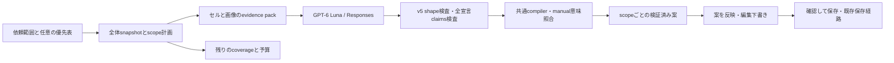

# AIテンプレート作成フェーズ18：局所案を先に返す契約と比較設計

2026-10-11。設計工程Astra / XHigh。対象checkoutは `C:\Users\hanam\Desktop\llm-ocr-deploy`、外部証拠は `D:\llm-ocr-archive\template-ai\20261011-phase18`。

**最初の検証済み小範囲案を全ページ完了から切り離す設計と、GPT-6 Lunaの入力範囲・推論強度を比較する条件を確定した。** 今回は設計だけ。製品実装、v5 runtime、API送信、DB移行は行っていない。現方式の製品採用不合格と通常無効を維持する。

## 1. 判断の根拠

[フェーズ15](template-ai-phase15-2026-10-11.md)と[フェーズ16](template-ai-phase16-review-2026-10-11.md)の保存結果、[フェーズ17](template-ai-phase17-2026-10-11.md)の修復範囲を照合した。

| 確認できる事実 | 設計への影響 |
| --- | --- |
| 全ページE4の検証済み案中央値8.178秒、D13は10.905秒。短縮してもE4の5秒以内は0/10 | 全ページを同じ形で繰り返すだけでは5秒到達の根拠にならない |
| E4は重点結合62/78、行10/14、記号8/16。重点誤結合0でも欠落16 | 出力量を減らしただけの応答を高速成功として数えない |
| provider完了後のローカル処理中央値は約70ms | ローカル処理の微調整を数秒改善の主施策にしない |
| 旧「表選択」比較も全ページ画像/highと全セルtextを送信。E4は9.167秒/5.493秒 | write scopeを狭める効果と、provider入力を狭める効果は別。後者はまだ比較していない |
| E4の62単位でdirectと非空labelsが矛盾。H2ではlabels空＋name:nullで表を保留 | 不正な組み合わせをschemaで分離し、意味guardで拒否する前の生成契約を改善する |
| Phase17の不正form親宣言保持は12/12、保存24応答の意味・採点保持 | この修復を共通境界として引き継ぐ。品質/速度の改善と混同しない |

上表の時間は保存結果の確認であり、新しいAPI実測ではない。旧24件は既知帳票の重点採点で、全欄正解率や未知帳票精度ではない。

異なる専門的観点を模擬して、次の三点を審査した。

専門家A（応答性能）：最初に使える案を小さくし、出力完了の待ち合わせを減らす。推論noneは候補にするが、誤りと保留を含めて同じ条件で測る。全ページを細分化し過ぎると、総時間とAPI回数は増える。

専門家B（意味・対応関係）：小範囲でも親見出し・記号凡例・空行を切り捨てない。shape validと意味正解は別であり、短い応答のために関係を消さない。局所案の正解を全ページ成功へ読み替えない。

専門家C（保守性）：入力pack、生成DTO、意味IR、編集案公開、保存を分離する。手動編集とAIで同じcompiler/保存経路を使う。進捗イベントと案の所有/再取得/反映の責任をUIへ押し付けない。

客観的まとめ：小範囲の先行公開には三者が一致する。一方で細分化の最適サイズとnoneの精度は未確定。固定した局所scopeで入力packと推論強度を比較し、成功した場合だけ汎用planner・製品公開へ進む。全ページ高速化の保証はしない。

## 2. 採用する設計

1. **表の選択は任意。** 選択表・有効な直近表・viewport・ページ順で最初の対象を優先する。全ページ依頼を勝手に局所依頼へ変えず、未着手/保留/失敗を含む全体coverageを保持する。
2. **provider入力をscopeごとに組み立てる。** 編集権限と入力contextを分離する。全体の物理snapshotは保持し、providerには必要なセル、局所crop、全体overviewを渡す。元cRefと元座標を維持する。
3. **生成用v5ではlabel付きとdirectを分離する。** labelsなし＋名前なし、direct＋labelsありなどを形状で排除する。formの親宣言保持と全claims競合検査は維持する。
4. **scope_readyを案の公開単位にする。** 全ページ処理中でも検証済みscopeを下書きへ反映できる契約を設ける。未完了JSONは反映しない。保存は「案を反映」→「確認して保存」。
5. **モデルはGPT-6 Lunaを固定。** 新規意味付けの前段にDecisionsを必須追加しない。自由な意味・名前・複数の関係生成をResponses一回にまとめる。音声編集の既存Decisions/Responses振分けは変更しない。

具体的なschema・prompt、scope/data境界、状態遷移、横断競合、短い受入条件は [focused v5契約](contracts/template-analysis-v5/README.md) に記載した。画像の高速化と矩形自動生成は別であり、今回は既存の物理セルへ意味を付ける実験である。

## 3. なぜbackendの公開契約も必要か

現行 `backend/app/template_analysis/service.py` の `validated_page` はページ単位の案を保存し、`finish` が全体のproposal/digestを確定する。`merge` は親runがREADABLEで全体proposalのdigestが一致することを要求する。`frontend/src/editing/templateAnalysisStore.ts` もpage_validated等で再取得し、全体proposalDigestで反映している。

したがってフロントエンドで早く見せるだけでは、全ページ処理中の局所反映は成立しない。将来の `template-analysis.v2` では、親runとは別にscopeのimmutable artifact、公開状態、read/write set、依存、digest、receiptを持つ。公開済み案の撤回・遅延応答・同値手動変更・保存中の再接続を契約として扱う。現在のguardを緩めてrunningを反映可能にする変更は採らない。

自動分割はまだ未検証。重なる候補を別scopeで同時編集せず、共有見出し・親を依存関係へ組み入れる。後続案が先行案と矛盾した場合、未反映の両側を保留し、反映済みの利用者draftは保護して要確認にする。順番が早いという理由だけで意味を正解にしない。

## 4. 固定した次回の比較

| 方式 | モデル/強度 | provider入力 | 比較する効果 |
| --- | --- | --- | --- |
| F-low | GPT-6 Luna / low | 全ページ画像high＋全セルtext | 同じ局所要求の対照 |
| P-low | GPT-6 Luna / low | 局所crop high＋全体overview low＋固定context | 入力pack全体の差 |
| P-none | GPT-6 Luna / none | P-lowと同じ | 推論強度の差 |

全方式で同じv5、prompt、write pool、allowed候補、出力上限を使用する。5帳票×2反復×3方式、**最大30回**。送信順も [phase20-protocol.json](contracts/template-analysis-v5/phase20-protocol.json) に固定した。並列1、timeout60秒、自動retry・warmup・追加診断なし。画像だけの寄与やv4→v5の寄与をこの比較から分離して主張しない。

| 固定scope | 全セル数 | 書込み対象 | packセル数 | 重点分類/結合/行/記号（1反復） |
| --- | ---: | ---: | ---: | --- |
| T1：法人/代表者の欄と各親見出し | 167 | 10 | 19 | 10 / 4 / 0 / 0 |
| T2：旧選択表g1と表題 | 185 | 78 | 83 | 29 / 21 / 3 / 0 |
| T3：ページ全体 | 12 | 12 | 12 | 12 / 5 / 0 / 4 |
| H1：申込者の住所/氏名/電話番号と親 | 74 | 7 | 22 | 7 / 3 / 0 / 0 |
| H2：旧選択表g2、凡例はread-only | 21 | 15 | 20 | 15 / 4 / 4 / 4 |

既存goldと書込み対象の交差から、各方式2反復で **分類146、結合74、行14、記号16** を採点する。新応答を見る前にscopeと派生goldを固定した。既知帳票でありholdoutではない。T1の旧重点1欄とH1の旧重点1欄が今回の局所scope外なので、旧全ページの176分類/78結合と同じ分母ではない。改善率を混ぜない。

各方式は重点全件正解、重点誤結合0、scope/physical/手動保護を必須とする。その上で、品質条件を満たしたscope-ready中央値5秒以下、5秒以内8/10以上、各帳票最低1/2を要求する。first textやschema validだけを成功時刻にしない。追加書込みの正しさも別途確認し、未確認のまま本番採用しない。

旧全ページ採用基準は保持する。この30回で検証するのは固定局所案だけであり、全ページcoverage完了、自動選択の妥当性、未知帳票、実画面までの応答速度は検証しない。小範囲先行は全ページ総時間と呼出数を増やす可能性があり、後続製品受入で別計測する。

## 5. フェーズの区切り

| フェーズ | 作業モデル/強度 | 成果・終了条件 | API |
| --- | --- | --- | ---: |
| 18（今回） | Astra / XHigh | v5生成契約、入力/反映境界、固定scopeと比較条件の設計 | 0 |
| 19 | GPT-6.1 Sol / High | 製品外v5 adapter/pack builder、既存共通guard維持、短い境界受入、旧24応答保持 | 0 |
| 20 | GPT-6.1 Sol / High | 事前固定hashと共通採点で上記30回を実行。失敗も含めて結果を保存 | 最大30 |
| 21 | Astra / XHigh | 局所方式の採否と、汎用planner/製品接続へ進む条件を判断 | 原則0 |

Phase19の受入前には送信しない。Phase20の全方式が不合格でも追加比較を自動実行しない。製品接続・通常機能の有効化・実マイクは今回の続きとして自動開始しない。各区切りで指示を待つ。実マイク試験の工程では利用者へ参加を依頼する。

## 6. 今回の成果物と検証

repository変更は本書、AGENTS/Safety Contractの現在地追記、`docs/contracts/template-analysis-v5/` のschema・prompt・4例・5つの派生gold・固定scope・比較protocol・README・manifest。実装用ファイルを製品sourceへ追加していない。

外部 `build_design.py` で次を確認した。

- JSON Schemaの15条件を検証。正例、direct/labels矛盾、空label、名前欠落、空行除外を確認。未知参照と列重複がshapeだけでは拒否されないことも明示した。
- root/objectの必須propertyとadditionalProperties、参照先、非対応の条件分岐を使わないことを点検。
- 元入力/画像/gold計15hash、全5scopeの物理ID・行全体・label/parent範囲、派生goldの分母、H2凡例保持、30試行の固定順を照合。
- 文書参照、schema/prompt/fixture/protocolのhashと差分範囲を検査。これは設計整合検査であり、実endpointのschema受理・モデル応答・v5コンパイル成功の確認ではない。

主要コマンドは外部 `audit_state.py before/after`、`build_design.py`、`validate_design.py`、`git diff --check`。すべて通過した。schemaの展開深度は7、相対参照9件、契約ファイル14件のhashを確認。結果は外部 `design-validation.json`、`artifact-validation.json`、`preservation.json`、`diff-check.log` に保存した。

両checkoutのHEAD、両DB各37表とschema、設定、863通常ファイル、781 artifact SHA、Phase11〜17証拠は前後一致した。旧llm-ocrは変更なし。deployの変更は文書2ファイルへの追記と設計資料16ファイルの追加に限られる。製品OCR provider/prompt、physical identity、mapping/crop、受付snapshot、補正revision、確定/出力実装は変更しておらず、**既存OCR contractを維持した。**

**API使用0回、累計336/496、残160回。** 計画した30回は未使用。全30回実行した場合は366/496、残130になる。

未検証は実APIの速度/精度、実endpointのschema受理、v5 runtime、自動scope planner、全ページ完了、実HTTPの所有/反映/receipt/取消、DB保存・再取得、画面・実マイク、矩形生成、通常OCR・XLSX出力、製品全体回帰。今回の設計確認をこれらの成功とは扱わない。

## 7. 仕様確認の出典

GPT-6 Lunaのnone/low、画像入力、Responses/streaming/Structured Outputs対応は[公式モデル仕様](https://developers.openai.com/api/docs/models/gpt-6-luna)を確認した。noneの実測優位は未確認。

生成shapeは[Structured Outputs公式仕様](https://developers.openai.com/api/docs/guides/structured-outputs?api-mode=responses)に合わせた。入力削減、出力長、処理数、streamingの効果は[Latency optimization](https://developers.openai.com/api/docs/guides/latency-optimization)を参照した。公式の一般論をこの帳票の達成時間に換算していない。
