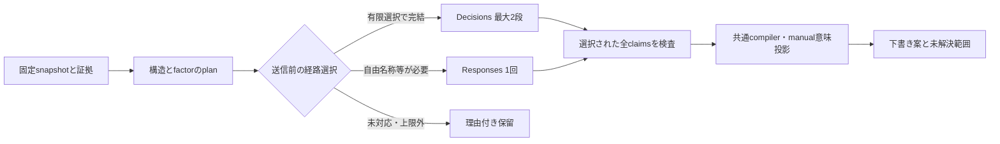

# AIテンプレート作成 フェーズ23：判断単位・名称・待ち時間の設計審査

専門家A（応答性能の観点・模擬分析）：表全体の全組合せ列挙と候補ごとの画像再生成を外す。ただしAPIを細分化すると往復が増える。依存質問は最大2段とし、自由名称が必要なら最初から一回のResponsesへ渡す。

専門家B（意味と対応関係の観点・模擬分析）：構造、列用途、読取、名称は異なる判断である。分割しても全claims・行・親・値所有・手動facetの検査を維持する。確率から未選択の組合せを作って整合性を取り繕わない。

専門家C（保守性の観点・模擬分析）：一つのfactor planと共通compilerを正本にし、DecisionsとResponsesは同じplanを埋めるadapterに限定する。製品保存の別経路は作らず、実装と性能評価を区切る。

客観的まとめ：**次の製品外試作は「構造を選択し、条件付きの小さな判断を埋めるv7」とする。自由名称が必要な場合は、送信前に一回のResponsesへ振り分ける。** 3観点は全組合せ列挙の廃止と共通保存境界に一致する。質問を分ける効果と追加往復の費用は実測まで確定できない。これは設計の採択であり、製品採用・高速化の合格ではない。

2026-10-11、作業対象は `C:\Users\hanam\Desktop\llm-ocr-deploy`。開発工程の指定はAstra / XHigh、APIモデルは引き続きGPT-6 Luna。API **0回、累計366/496、残130回**。旧checkout、通常コード/DB、Phase22までの結果は保持した。

## 1. Phase22の不合格をどう解釈するか

[Phase22](template-ai-phase22-2026-10-11.md)の候補上限は1質問32で、H2の52構造仮説＋保留2が上限外だった。これはDecisions全般の不成立ではなく、**表全体の意味を一つの完成候補へまとめる設計の不成立**である。上限を64へ増やしても列が増えた場合の組合せ増加は残る。32はAPI制限ではなく試作の上限。

一方、名称には別の欠落がある。H2の列見出しをつないだ「点検項目 判定記号 確認内容」は、手作成参照の「設備点検」と同じ文字列にはならない。有限選択だけで任意の短い名称を作れるという前提は採用しない。名前の不一致と誤結合は分けて記録するが、従来の完全manual投影を削除して合格へ変えない。

## 2. 今回、保存資料から確認したこと

実行前に外部`review-plan.json`へ診断を固定した。Phase22の65 artifact hash、Phase19の411実装/証拠hashを照合し、古い生成器・入力・上限・結果は一切書き換えていない。4scopeの保存oracle layoutと従来manual参照の投影も別途一致した。

### H2の組合せを、意味を失わず分解できる

変更していない生成器のreturn時に内部の列挙済み案を観測した。生成器の出力は従来どおり全保留・具体案0。内部の52案だけを審査用に分解した。

| 構造family | 元の完成案数 | 下位の主な判断 |
| --- | ---: | --- |
| records・position | 32 | 左列4択・中央2択・右列4択 |
| records・左列printed key | 8 | 中央2択・右列4択 |
| records・右列printed key | 8 | 左列4択・中央2択 |
| form・左列label | 2 | text / symbol |
| form・右列label | 2 | text / symbol |

構造選択は5＋保留2の**7択**、各下位質問は最大4＋保留2の**6択**になる。分解した値から元のraw proposalを**52/52で完全再構成**でき、元に存在しない組合せも追加していない。

ただし、これは完成案を後から分解した表現上の検証。geometry/evidenceから直接factorを作る汎用生成器はまだ存在しない。Phase24で、52案を先に作らず同じ意味を表現できることを要求する。新しい候補上限の成功やAIの選択成功とは数えない。

### 構造が正しい案でも、名前を分離しないと完全投影が一致しない

H2の正解構造に当たる一案を評価側が選び、共通compilerへ渡した。literal名のままでは完全manual投影が不一致。別のメモリ上のコピーの表名だけへ、固定参照の「設備点検」を与えると、全投影・manual変換・既存graph全ID/path込みno-op・physical identityが一致した。

これは**人為的な正解供給による診断**であり、モデルが名称を推定できた結果ではない。Phase22は4/5不合格のまま。未知帳票や名称生成の精度も未測定。

### ローカル待ち時間にも重複処理がある

変更していないT3のfreezeを一回profileした。13具体案の処理で、`check_pack`と`build_pack`は各40回、`compile_v5`は13回呼ばれた。`check_pack`は元画像からcrop/PNGを作り直す`build_pack`を呼ぶため、同じrunで画像を繰り返し再生成している。

Phase22の単回freeze観測はT1 1.204秒、T2 1.557秒、T3 2.462秒、H1 0.464秒だった。今回のprofileは呼出回数の診断であり、新しい速度比較ではない。画像パックを一回固定し、実際に選択された案だけcompileする設計上の根拠は得られたが、何秒短縮できるかはまだ分からない。

## 3. 選択肢と採否

判断基準は、最初の完全な案までの待ち時間、意味を表現できる範囲、競合時の挙動、実装責任の少なさとする。

| 方式 | 利点 | 費用・失敗条件 | 判断 |
| --- | --- | --- | --- |
| 32上限を増やして完成候補を維持 | H2の数だけは収まる可能性 | 列追加で再び増大。自由名称と全候補compileの費用が残る | 不採択 |
| 全列を同時に独立分類 | 一往復にしやすい | form/recordsやkeyの判断に依存する質問を同時に解けない。矛盾選択が増え得る | 無条件の採用はしない |
| 構造→条件付きfactor | 小さい候補集合を維持し、先行結果に質問を束縛できる | 最大二往復。初段の誤選択が後段を制約する | 有限の意味判断に採択 |
| 確率積・beam searchで整合する全体案を選ぶ | 組合せを自動補正できる | モデルが選ばない案の採用と、未校正joint scoreが生じる | 不採択 |
| 狭いResponses出力でfactor ID＋名称を返す | 自由名称と依存判断を一回で扱える | 生成時間と誤選択が残る。旧全体生成の成功を保証しない | 送信前に必要性が分かる場合だけ採択 |

[OpenAI公式Decisions資料](https://developers.openai.com/api/docs/guides/decisions)は独立質問の同一request化と、先行回答に依存する質問の別request化を説明している。任意JSONの生成にはResponses/Structured Outputsを使う設計である。この仕様が分担の根拠であり、このアプリでの速度優位は実測が必要。

## 4. 決定したアーキテクチャ

詳細正本は[v7設計契約](contracts/template-analysis-v7/README.md)、次の実装条件は[Phase24固定計画](contracts/template-analysis-v7/phase24-plan.json)。

単体欄の独立質問ならDecisions一回。表の構造に応じた質問は二段以内。自由名称を必要とする候補を含む場合は、そのfocused requestを最初からResponses一回へ渡す。失敗後の二重要求や裏での追加送信は作らない。

この保守的なrouteは、結果的に自由名称を選ばなかった場合にもResponsesを使う可能性がある。既存T1/H1には無表題recordsの競合候補、T2には列見出し連結の候補があり、**Decisionsが大半を担当するとは現時点で言えない。** Phase24で実際のroute一覧を固定してから性能を評価する。名称を捏造してDecisions利用率を上げない。

共通planはserver所有の構造/slot/choiceだけを公開する。ResponsesもそのIDと制限付き名称だけを返し、自由な座標・cell集合・保存先を生成しない。未知、参照不正、競合は保留又は拒否。確率から別案へ選び替えない。

パック検査は不変な内部objectへ集約し、境界で所有・revision・scope・同値の手動facet・内容hashを再確認する。製品OCRのcrop検査を省略する変更ではない。実際に選ばれた案を既存のv5変換、共通semantic/compiler、manual経路へ渡す。将来の製品接続でも「案を反映」→「確認して保存」と既存receiptを維持する。

## 5. 次のフェーズと終了条件

| フェーズ | 開発モデル・強度 | 作業と終了条件 | API |
| --- | --- | --- | ---: |
| 24 | GPT-6.1 Sol / High | 製品外v7生成・分岐・束縛・選択後compile。gold非参照生成で固定5scopeの完全oracle投影5/5、故障条件、旧証拠保持、ローカル処理各scope中央値500ms以下。未達なら送信前に停止 | 0 |
| 25 | GPT-6.1 Sol / High | 24合格後、5scope×2反復を事前routeで実測。最大2送信/trial、retry/修復/追加診断なし。品質・完全manual投影・準備から完成案までの時間を保存 | 最大20 |
| 26 | Astra / XHigh | 品質と実時間、名称の不一致・手直し量の未確認部分を審査。既知scopeの結果を未知帳票や実UI成功へ拡張しない | 原則0 |

Phase24の500msは、5秒目標に対するローカル処理の新しい事前目標であり、達成済み値ではない。各scopeをキャッシュなし3反復で測り、全値を残す。

Phase25の速度条件はPhase18を継承する。全重点正解・重点誤結合0を満たした上で、品質成立したscope-ready中央値5秒以下、5秒以内8/10以上、各scope最低1/2。自由名称の完全一致と、共通compilerからmanualへ意味を落とさず変換できたかは別に報告する。旧採点の削除や、unknownのignored加点、初段だけの完了時刻は許さない。

今回の審査でPhase24以降を実行していない。各区切りでモデル切替後の指示を受ける。現API残130回を保持し、20回を先に予約していない。製品接続、通常有効化、矩形生成、全ページplanner、実マイクは別工程。

## 6. 変更・検証と限界

repositoryの変更は本書、v7設計契約とPhase24計画、AGENTS/Safety Contractの現在地追記だけ。外部成果物は `D:\llm-ocr-archive\template-ai\20261011-phase23` の審査計画、診断スクリプト、結果、開始/終了監査。

実行した検証は`review_probe.py`、`audit_state.py before/after`、artifact整合検査、`git diff --check`。終了時に両checkoutのHEAD、各37テーブル、schema、設定、旧checkout全体、通常863ファイル、781 artifact、Phase11〜22の証拠の保持を確認した。staging/commit/pushはしていない。

製品のprovider/prompt/model/schema、物理セル、mapping/association/crop、受付snapshot、補正revision、確定・出力を変更しておらず、**既存OCR contractを維持した。** backend全件、frontend build、E2Eは文書・製品外診断のため実行していない。

v7 runtime、実endpoint受理、実モデルの新しい精度・速度、閾値校正、未見帳票、画面・保存・音声は未検証。名称を正解から供給した診断と、新方式の実用成功を混同しない。Phase23は設計審査完了、製品採用は不合格・通常未移行/無効のまま終了する。
