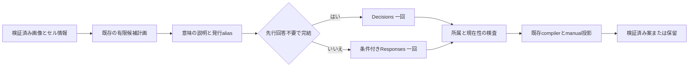

# AIテンプレート作成フェーズ27 修正設計

2026-10-12。**修正設計を完了しました。独立した有限判断はDecisions、構造・親・列用途・名称が連動する判断は条件付きResponsesで、一回の送信に収めます。** モデルへ提示する意味説明と内部の所有IDを分離し、全体画像の転送量を減らします。製品実装と実API比較は次工程です。

対象は `C:/Users/hanam/Desktop/llm-ocr-deploy`。工程指定はAstra / XHighであり、チャットの実モデル設定を検証した記録ではありません。実APIモデルは引き続きGPT-6 Luna。今回 **API0回、台帳376/496、残120回**。通常製品は未移行・無効の状態を継続します。

詳細仕様は[template-analysis v8](contracts/template-analysis-v8/README.md)、実装工程と判定条件は[計画JSON](contracts/template-analysis-v8/phase27-plan.json)に固定しました。

## 1. 問題と修正対象

[Phase26](template-ai-phase26-review-2026-10-12.md)で再確認した基準は、品質成立4/10、品質付き5秒以内0/10、重点誤結合4件です。T2中央値6.139秒のうちHTTP送受信は5.032秒でした。この結果を今回の設計で合格へ変更しません。

| 確認できた問題 | 固定した修正 | 維持する条件 |
| --- | --- | --- |
| H1は個別欄を繰り返し表として選択 | form/records、親と項目の関係を短い候補説明として提示 | 名称だけを埋めて誤結合を通さない |
| H2は行ラベルをキー、説明文を入力列として選択 | 行の名称・識別・入力・説明・記号の意味を明示 | 一意な印字というだけでキーに決めない |
| H2の別構造choiceが生成schemaを通過 | structureごとの必須factorと選択肢を回答形式へ固定 | 受信後の所属検査も維持。推測ID修復なし |
| T2の要求4.45MBの約99%が画像base64 | 詳細cropを保持し、全体画像だけ条件付きで圧縮 | 原本・寸法・範囲・read/write refsを保持 |
| T3の信頼度と保留率が未校正 | 閾値を維持し、校正用と評価用の帳票を分離 | 同じ14判断に合わせた閾値変更をしない |

原因箇所は製品外試作の`factor_plan.generate()`、`selected_adapter.answer_schema()`、`transport.content()/structure_questions()`です。画面の表示変更だけでは、送信内容と回答の組合せ制約を変えられません。製品のOCR認識器、矩形検出器、mapping・補正・保存を同時に変更する理由はありません。

## 2. 選択した構成

モデルには候補の意味と根拠を見せ、内部の保存pathや所有証明のJSONを繰り返し読ませません。短いaliasは、送信時のplan・scope・revisionに固定した対応表からだけ展開します。別の指示や別の構造の同じ見かけのIDを受理しません。

条件付きResponsesでは、選んだ構造に対応するfactorとname slotだけが回答できます。schemaに適合しても意味が間違う可能性は残るため、共通compiler、全claimsの競合検査、manual投影と人の確認は維持します。

専門家A（応答性能の観点・模擬分析）：二段化による入力削減より、まず一往復と転送量削減を優先します。接続再利用の効果は初回と継続利用を分けて測る必要があります。

専門家B（意味と対応関係の観点・模擬分析）：入力の根拠を省略せず、form/records・親・行ラベル・記号の誤解を測ります。条件付きschemaは所属違反を減らせますが、意味の正しさは実応答で判断します。

専門家C（保守性の観点・模擬分析）：既存候補生成と共通保存経路を再利用し、意味表示、schema、alias変換、画像転送、通信の責務を分離します。帳票名による分岐は追加しません。

客観的まとめ：三観点は内部の対応関係を維持する点で一致します。二段化の有効性と画像圧縮後の精度は未確定です。今回の合理的な試作は一往復を基本とし、品質と時間を同時に測る構成です。

## 3. APIを使わず確認した成立性

証拠は `D:/llm-ocr-archive/template-ai/20261012-phase27` に保存しました。ネットワーク接続を禁止した設計例であり、製品runtimeの実装ではありません。

**回答形式。** 保存planから作った5つのschema例に、既存oracleの回答形状をすべて表現できました。余分なpropertyとH2の別構造choiceを拒否しました。schemaは1788〜5720bytes、最大55 properties・61 enum値・深さ6で、今回定めた上限に収まります。OpenAIの実endpointが受理した証拠ではなく、意味精度の改善結果でもありません。

**画像転送。** 可逆WebPと、全体画像だけのJPEG quality85をコピー上で試算しました。可逆WebPはT2全体画像だけで符号化約586.58msを要し、他の3scopeではサイズが増えたため主案から外しました。JPEG候補は小さくなった場合だけ採用する仕様に固定しました。

| T2の項目 | 元 | 設計用コピー |
| --- | ---: | ---: |
| 全体画像 | 2871232bytes | 454978bytes |
| 画像変更だけを反映した要求 | 4447867bytes | 1226196bytes |
| 要求削減率 | — | **72.43%** |
| 詳細crop | 元PNG | bytes完全一致 |

JPEG符号化だけの一回値は7.65ms。全体画像は同じ1240×1754で、縮小していません。T1/T3/H1/H2はJPEGの方が大きく、元PNGを維持します。T2の原画像と候補を目視し、表の配置と見出しを確認しました。細部の網羅的な可読性、providerの画像解釈、通信短縮は未検証です。画素の一致を主張できるのは詳細cropと元PNGを選んだ画像であり、T2のJPEG全体画像は非可逆です。

この1.23MBは旧要求の画像だけを置き換えた値です。v8本文・schemaを含む最終サイズと、5秒達成はPhase28以降に測定します。

## 4. 次の工程と停止点

| フェーズ | 作業モデルと強度 | 作業 | API上限 | 完了条件 |
| --- | --- | --- | ---: | --- |
| 27 今回 | Astra / XHigh | 修正設計、形式と画像の成立性確認 | 0 | v8契約と受入条件を固定 |
| 28 | GPT-6.1 Sol / High | 製品外の修正実装、保存応答と短い境界検証、評価入力の固定 | 0 | 完全manual投影5/5、保護境界、全scopeローカル中央値500ms以下 |
| 29 | Astra / XHigh | 実装・保持・計測器の独立審査 | 0 | 欠陥を解消し実装manifestを凍結 |
| 30 | GPT-6.1 Sol / High | GPT-6 Lunaによる三条件比較30試行と別評価12試行 | 最大42 | 固定schedule、旧品質条件と5秒条件、別評価の正解/保留を確認 |
| 31 | Astra / XHigh | 実測審査と製品接続の採否 | 0 | 失敗・品質・初回/継続時間を分けて採否決定 |

各フェーズの区切りで停止し、モデル切替後の指示で次へ進みます。今回の42回は将来の計画上限で、予約・使用は0です。主比較はA=旧v7、B=v8＋元画像、C=v8＋新画像。各条件5scope×2回を同じcold条件で測り、CとBの差から画像変更の影響を分けます。

従来の全重点正解・誤結合0、品質成立中央値5秒以下、品質付き5秒以内8/10以上かつ各scope1/2以上を維持します。完全manual投影、名前・親・記号等の欠落も別記します。既知5scopeを未見精度へ読み替えません。12の別評価scopeは別familyで固定し、一意な10件の全意味一致と、情報不足2件の保留を要求します。

製品接続・通常データ移行・実マイク試験はこの比較の範囲外です。将来のテンプレート反映は「案を反映」→「確認して保存」と共通のDRAFT/revision/undo経路を利用します。局所録音、手動矩形、既存の連続音声編集を撤去しません。

## 5. 保持と検証

開始時にPhase26の30成果物hashを照合し、両checkout・DB・台帳・業務データのbaselineを取得しました。実行した確認は、deploy仮想環境のPython `-B`での`audit_state.py before/after`、`design_probe.py`、`overview_probe.py`、設計文書の参照・数値整合検査、`git diff --check`です。

repositoryの変更は、この報告、v8 README、計画JSON、AGENTS/Safety Contract/v7 READMEの現在地追記の6ファイルです。製品コード、両DB各37表、台帳376行、schema、設定、旧checkout、863業務ファイル、781 artifact、旧証拠と既存差分を保持しました。製品provider/prompt/model/schema、mapping/association/crop、補正・revision・確定・出力を変更しておらず、**既存OCR contractを維持しました**。

実装変更がないため、全体unit・frontend build・実UI・実音声・実APIを実行していません。今回の完了は修正設計と限定的なオフライン成立性確認です。実モデル品質、runtime安全性の再検証、通信の速度改善、製品採用は後続工程の判定です。

公式仕様との対応と参照元は[v8契約の公式仕様節](contracts/template-analysis-v8/README.md#11-公式仕様の照合)に記載しました。設計例と計測値の詳細は外部証拠の`design-probe.json`、`overview-probe.json`、`preservation.json`、`result-hashes.json`に保存します。
