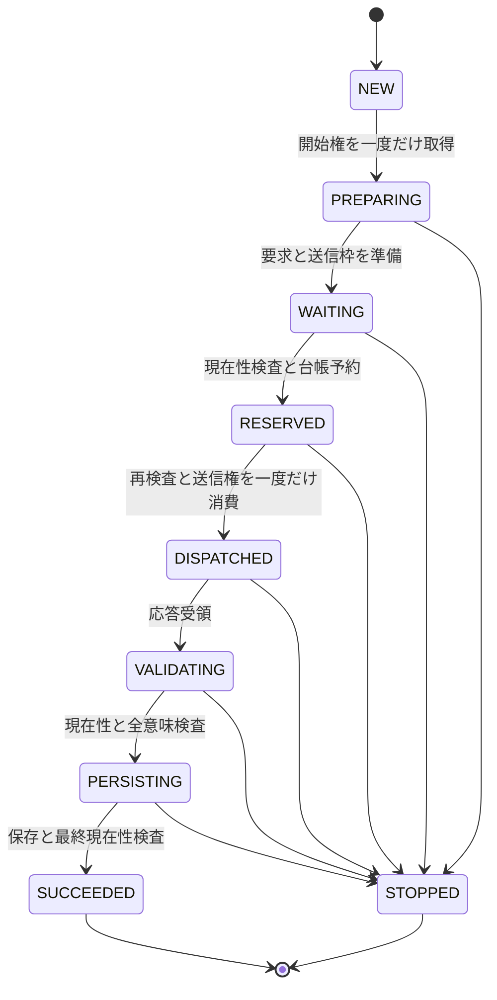

# AIテンプレート作成 Phase30 開始条件の修正設計

2026-10-12。Phase30の開始準備として、Phase29で差し戻された送信処理3件とT2時間超過の修正設計を固定しました。**今回は30-Aの設計までです。修正実装と実API比較は未実施です。** 当初のPhase30比較を、未修正の実装で開始したことにはしません。

対象checkoutは`C:/Users/hanam/Desktop/llm-ocr-deploy`、修正対象の原本は`D:/llm-ocr-archive/template-ai/20261012-phase28`です。設計証拠は`D:/llm-ocr-archive/template-ai/20261012-phase30-readiness`へ保存しました。[Phase29審査](template-ai-phase29-review-2026-10-12.md)、[v8契約](contracts/template-analysis-v8/README.md)、[実装用計画](contracts/template-analysis-v8/phase30-readiness-plan.json)を併用します。

## 工程とモデル

工程番号30と元の実API比較計画を保持し、受入前提の修復を先行させます。モデル・推論強度は担当の推奨指定です。現在のチャットで選択されているモデルは確認できていません。

| 区切り | 内容と終了条件 | 作業モデル | 実API |
| --- | --- | --- | --- |
| 30-A 今回 | 原因・責務・失敗条件・修正順序の設計を固定 | Astra / XHigh | 0 |
| 30-B 次回 | 別ディレクトリへ修正実装。送信境界と全5scopeの500ms条件を確認 | GPT-6.1 Sol / High | 0 |
| 30-C | 凍結した修正版と証拠の独立再審査。未達があれば差戻し | Astra / XHigh | 0 |
| 30-D 当初の比較 | 審査通過した版で元のA/B/C固定比較と評価集合を実行 | GPT-6.1 Sol / High | GPT-6 Luna、最大42送信 |
| 31 | 当初どおり精度・時間・採否を審査 | Astra / XHigh | 原則0 |

各区切りで停止し、次の指示を受けて進めます。30-DのResponses推論強度low、Decisions経路、retry/warmup/補修要求0、元の採点分母・5秒条件を変更しません。E11がローカル保留なら送信0であり、42回を埋める追加呼出しは行いません。

## 確認した原因

| 項目 | 現在の欠落 | 修正対象 |
| --- | --- | --- |
| R1 P1 | `Run.execute()`は終了済みだけを検査し、実行中の再入を拒否しない。Phase29では同じrunで2予約・2送信 | 開始権の原子的取得と一回だけ消費できる送信権 |
| R2 P2 | HTTP workerにキャンセルが渡らず、呼出し元がキャンセルを返した後に初期化を終えたworkerが送信 | 実行所有者と待機者の分離、初期化完了後の再検査 |
| R3 P2 | 台帳予約の前にしか対象を検査しない。予約中のepoch変更後も送信 | 予約後・送信開始前の現在性検査 |
| T2 | Phase28中央値625.34ms、Phase29再測定634.55ms。500ms未達 | 不変画像bytesの重複ハッシュ、元画像の重複decode |

R3は応答後に古いdraftの返却を拒否できています。通常DBの誤更新を再現した指摘ではありません。R1〜R3の再現証拠はPhase29の`independent-probes.json`です。

今回、Phase28を変更せずT2を一度だけcProfileで診断し、oracle選択から完全manual投影が一致することを確認しました。実APIは使用していません。

| 診断箇所 | 呼出し回数 | 診断時累積ms |
| --- | ---: | ---: |
| `EvidenceSnapshot.assert_current` | 8 | 156.40 |
| 元packの`_digest` | 9 | 114.80 |
| 元pack内の`digest` | 39 | 125.82 |
| `evidence_context.sha` | 16 | 81.95 |
| 実装全体の`source_state` | 2 | 137.46 |
| schema自身の`check_schema` | 2 | 104.85 |
| Pillow `ImageFile.load` | 7 | 95.28 |

この表の累積時間は入れ子で重複し、計測器の負荷も含みます。足し算して削減量を予測したり、受入時計の625/635msと差し引いたりしません。`ImageFile.load`の7呼出しを7回の独立したdecodeとは扱いません。元pack生成後に転送packで元画像を開き直していることはコードで確認しています。実装全体とschema自身の検査を計時外へ移す設計は採りません。

## 送信処理の責務

現在の「呼出し元がguardを所有し、別workerが送信だけを継続する」分割を廃止します。**一つのrunの準備・予約・送信・検査・証拠保存・終了処理を、一つの実行所有者が直列に担当**します。UIや呼出し元は結果を待つか中止を要求するだけで、所有者のguardを閉じません。

製品外の新しい`run_execution.py`に開始権、停止理由、一回送信権、実行終了の状態を置きます。`run_transport.py`は経路と時計の調整を担当し、HTTP接続poolは共有します。共有HTTPにowner、scope、guard、DB session、可変planを保存しません。HTTPだけの入れ子executorは廃止し、最大2つの実行所有者が共有poolを使います。

### 開始権と送信権

`execute()`の入口で、短いlock内のNEW→PREPARING遷移を一度だけ行います。失敗した重複呼出しは`RUN_ALREADY_STARTED`を返し、元runのguard、停止flag、metrics、台帳、permitへ触れません。重複拒否を元runの`finally`へ流しません。終了後の再実行も拒否します。利用者が新しい指示を出した場合は新runです。

さらにdispatch時に、そのrunの予約receipt・要求bytes SHA・owner/scope/epoch・実装pinへ束縛した送信権を一度だけ消費します。`reserveAttempts <= 1`、`dispatchAttempts <= 1`を独立して守ります。公開された可変`sent`配列の長さを防止条件にはしません。台帳予約が曖昧な失敗となった場合も再予約・再送信しません。

### 所有者と中止

実行所有者にguardと可変状態を限定します。準備済みctxを渡す既存の試作入口は置換し、現在状態を取得する所有者側adapterと不変の入力指定から、所有者がctxを生成します。外部へ渡すものは不透明なrun handle、結果snapshot、中止要求です。

呼出し元は中止要求を立てて待機を終了できますが、これを「worker停止済み」や「通信されていない」の証明にはしません。`cancelRequestedAt`、`dispatchCommittedAt`、`workerFinishedAt`を区別し、HTTP処理が残る場合は所有者が終了するまで接続枠を保持します。中止通知後の遅延結果を成功として公開しません。

送信開始前の中止・期限切れは未送信終了です。開始後はネットワーク上の要求を取り消せたとは保証せず、可能な読取り中止と応答後の拒否を行います。実装は有限deadlineを持つ現行HTTPを利用し、client初期化やreadが止まらない場合にも共有client全体をcloseして別runを巻き込みません。

### 待機境界と現在性

順序を次のように固定します。

1. 要求開始から時計を開始し、不変入力・plan・schema・要求bytesを作る。未解決・上限超過は送信0。
2. 同期検査区間を閉じ、接続枠・client初期化を待つ。中止・deadlineを引き継ぐ。
3. guardを新しい区間として取得し、現在のowner、scope、revision、手動facet、epoch、画像、実装を照合して閉じる。
4. 一送信分の台帳予約をcommitする。中止・失敗でも払戻しはしない。
5. 予約後に新しい区間で同じ現在性と実装を照合する。失効なら未送信終了。
6. request構築等の送信前準備を終え、最後の中止・期限・現在性照合と送信権の消費を行う。直ちに一度だけtransportへ渡す。
7. 応答後に新しい区間で再照合し、既存alias展開・全claims・compile/manualを実行する。証拠保存前後にも現行の現在性検査を維持する。

送信開始の線形化点は、最後の検査に合格した送信権の消費です。中止とdispatch権の取得を同じ短い同期機構で直列化し、中止が先ならtransportを呼びません。owner側のepoch更新も同じ所有調整機構を通し、更新が先なら古い送信権を発行しません。DB transaction・ファイル全読取り・接続待ちをこのlock内へ入れません。重い照合後、lock内では所有adapterが発行する状態世代の一致を確認します。

この線形化点の後に発生した中止・編集では、要求が既に通信処理へ渡っている可能性があります。bytes送出完了とは別に記録し、遅延結果の破棄を必須とします。短い事前確認だけで、競合窓が完全になくなったとは報告しません。共有pool以外の隠れた待機を追加する場合は、送信権をどこで消費するかも再審査します。

試作の所有adapterは、既存の`current()`が返す全stateの比較を維持し、epochだけを信用する方式へ変更しません。同値手動編集・元値への復帰・別owner・別scopeを引き続き失効させます。製品の保存口を増設せず、実装は製品外コピーに限定します。

### 計数と後始末

台帳予約、dispatch開始、HTTP要求body送出完了、応答受領、成功公開は別計数です。予約済み未送信は予算消費1・dispatch0となります。`sends`の定義を曖昧な配列追加から変える場合はartifact versionを更新し、旧記録を新定義へ書き換えません。

permitの所有権は取得から所有者終了まで一意とし、例外・中止・submit失敗・response読取り失敗の各出口で一回だけ解放します。run終端も一回だけ設定します。`scopeReadyMs`は依頼受領から検査済み証拠の永続化完了までとし、追加する検査・初期化・待機・台帳・後処理を除外しません。

## T2の修正設計

500ms条件を維持したまま、不変の画像内容の再計算を減らします。factory発行のrun内証拠と、毎回取り直す現在状態を分けます。

### 不変bytesの所有証拠

新しい`run_image_evidence.py`が、画像の実bytesからSHAを計算し、元画像、元crop、転送画像と各metadataをrun leaseへ束縛します。受け付けるデータは厳密な`bytes`、固定文字列、固定tupleです。`bytearray`、可変view、外部指定のhashだけから証明を作りません。

同じ同期区間内で同じ所有bytesを再利用する際は、factoryのprivate registryに保持した強参照、実bytes objectの同一性、metadata・pack fieldの一致、run leaseを検査します。object IDだけのキャッシュは作らず、値を書き換えられるdataclassの`frozen=True`だけにも依存しません。`object.__setattr__`でcontent/metadata/digestを交換した場合も保持した原本参照との不一致で拒否します。proofのコピー・別run・別scopeへの持出しは無効です。

待機をまたぐ再取得時は画像を含む所有内容を再検証し、新しい区間の証拠を発行します。同じ区間の中で8回確認しても、大きい同じbytesのSHAを8回計算しない方式です。段間の無検査再利用は導入しません。既存保存packや外部からの復元には完全な内容・binding検証を行い、旧artifactへ新しい証拠を後付けしません。

現在状態のowner/revision/scope/facet/epoch/catalog検査は従来の各確認位置で実行します。現在画像が既知の所有bytesそのものならその区間の内容証拠を使用できますが、別のbytes objectへ替われば内容検査なしに同一と扱いません。現在状態の可変dict全体をrun開始時の値で代用しません。

### 元画像の一回decode

元pack生成と転送pack生成を、同じ同期区間内の画像factoryへ集約します。元画像を一度decodeし、そこから既存と同じcrop PNGとJPEG候補を作ります。元cropのPNG bytes、canonical座標、許可ref、detail、JPEG設定と小さい場合だけ採用する規則は維持します。生成JPEGのdecode検査も残します。

Pillowの可変画像はfactory内部に限定し、処理終了時にcloseします。待機や別runをまたいで共有せず、外へ返すのは不変bytesと検証記録です。cropを作り直して結果が変わった場合は高速化成功とせず、既存bytes一致の受入で拒否します。旧v7対照arm Aの実装は変更しません。

### 今回変更しない費用

実装399ファイルの内容照合、schema自身の検査、応答のschema検査、全claims、共通compiler/manual、現在性の確認位置は削減しません。schema検査の起動時への移動、ファイルmtimeだけへの置換、goldに合わせた候補削減、計時からoracleを除外する変更も行いません。

この設計だけで500msを達成するかは未確認です。未達の場合は当該版と計測値を保存し、さらに大きな実装変更へ自動拡張しません。R1〜R3の修正で増える待機境界の検査費用は、統合したmock runでも別途測ります。

## 実装の変更範囲

| 対象 | 変更の責務 |
| --- | --- |
| 新 `run_execution.py` | 開始権、所有者、中止、dispatch権、終端、permit所有 |
| `run_transport.py` | 一度だけの要求実行、待機後再検査、予約receipt、時計、共有HTTP |
| 新 `run_image_evidence.py` | 同期区間内の不変bytes・decode証拠 |
| `evidence_context.py` | 状態比較と不変画像証拠の接続 |
| `image_transport_pack.py` | 同期区間内factoryからの転送bytes構築 |
| コピーの `runtime/evidence_pack.py` | 同じfactoryで元pack/cropを構築する明示的な入口 |
| `run_guard.py` | 新モジュールを実装lockへ追加し、区間証拠の失効を管理 |
| `answer_adapter.py`等の呼出し元 | 型と所有入力の接続に必要な変更だけ |

branch schema、意味prompt、候補生成、採点、coverage、閾値、alias所属、既存DTO、保存・出力、通常DB schema、音声UIは対象外です。実装のコピー先は30-B開始時に未使用の製品外ディレクトリを用意し、Phase28/29と今回の診断原本は保持します。新証拠と計数の契約version・実装lockを更新します。

## 30-Bの受入条件

最初にPhase29の3ケースを、同じ待機位置を使って修正前のコピーで再現します。続いて最小の故障条件を追加し、実装後に結果を比較します。単にコードが増えたことを理由とするunit追加は行いません。

| 条件 | 必須結果 |
| --- | --- |
| 同一runを同時開始、永続化待機中に再入、終了後に再入 | 元runだけ最大1予約・1dispatch。重複呼出しは元runを中止・失敗させない |
| 初期化中・pool待機中・予約完了後に中止/期限切れ | dispatch前なら送信0。予約済み分の払戻し0。後で待機を解放しても送信0 |
| 予約/初期化/pool待機中にowner/scope/revision/facet/epoch/画像変更 | 古い要求のdispatch0。現在性の検査を飛ばさない |
| 中止とdispatch、編集とdispatchの競合 | barrierで双方の順序を固定し、先に確定した順序の結果になる |
| 通信開始後の中止、遅延応答、保存中の対象変更 | 古い成功結果を返さず、permitを二重解放しない |
| 別対象2run、片方の中止、第三run待機 | 対象/回答が混線せず、動作中の接続を早期解放しない |
| 画像proofのcontent/metadata交換、偽造、別run、復元 | 旧proofで受理0。画像・crop・元座標・元PNG armの一致 |
| 実装変更・module reload・同値手動編集 | 従来どおり失効し、軽量化で通過させない |

最後に既存201境界、保存40応答の35受理/5拒否・旧採点、合成24scopeの固定期待DTO/投影、既知5scopeの完全manual投影を再確認します。期待値と原応答を書き換えません。

性能は変更前/後を同じ環境・同じfixture・交互の順序で各scope3反復測定します。キャッシュなしの従来ローカル時計で**5scopeすべて中央値500ms以下**を必須とします。区間内の再計算削減は許容しますが、前runの入力・検査結果の持越しは行いません。初期化・追加送信検査・台帳stub・証拠書込を含む統合mock時計も保存し、ローカル合格を実通信の5秒達成と混同しません。重い回帰は変更後の最終段階へまとめます。

## 今回の検証と保全

Phase29の封印476成果物を開始時に照合し、共有API台帳が376/496・残120であることを確認しました。`profile_t2.py`をdeployのPythonで`-B`付き実行し、ネットワークを禁止したままT2の完全manual投影を確認しました。これは修正実装や性能受入の通過ではありません。

変更したrepoファイルは本設計、計画JSON、AGENTS/Safety Contract/v7・v8 READMEの現在地追記だけです。両checkoutの製品ソース、両DB各37表、設定、既存業務データ、Phase28/29を含む旧証拠の保全を`audit_state.py`で確認します。製品のOCR/mapping/crop/補正/出力を変更せず、既存OCR contractを維持します。全件unit/E2E、実UI、マイク、実APIは実行していません。

OpenAI Docsは、retryを使う場合に回数と全体時間を制限し、アプリとSDKのretryが重複しないよう管理する方針です。本比較では既定のretry0を維持します。[公式のrate limitsとretry](https://developers.openai.com/api/docs/guides/rate-limits) 中止と一回dispatchの具体的な責務は本アプリの契約であり、公式APIが自動保証する条件とは扱いません。

今回の実API使用は0回です。30-Aの設計を完了し、次は**30-B・GPT-6.1 Sol / High・API0**の修正実装です。30-Dの有料比較は30-Cの受入後に開始します。
