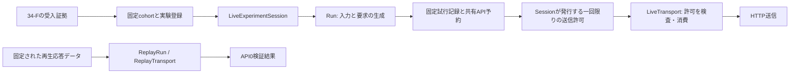

# Phase34-D 修正設計 — 2026-10-12

**34-CのR1〜R4を、送信権限の集約、試行記録の固定、資料の派生管理、意味に基づく正解の再定義で修正します。** 今回は設計のみです。34-Bの実装、画像、正解データ、製品ソースは変更しません。実API使用・予約は0回です。34-Cの差戻しは、34-Fの独立再審査まで維持します。

開発先は `C:/Users/hanam/Desktop/llm-ocr-deploy`、審査対象の原版は `D:/llm-ocr-archive/template-ai/20261012-phase34b` です。34-Eは原版から新しい製品外コピー `D:/llm-ocr-archive/template-ai/20261012-phase34e` を作ります。既存ディレクトリは上書きしません。今回の証拠は `D:/llm-ocr-archive/template-ai/20261012-phase34d` に保存します。

根拠は[34-C独立審査](template-ai-phase34c-review-2026-10-12.md)、[34-A設計](template-ai-phase34a-design-2026-10-12.md)、現行実装です。[計画JSON](contracts/template-analysis-v8/phase34d-plan.json)に機械検査可能な条件を併記します。

## 1. 原因と変更境界

| 指摘 | 確認できた原因 | 今回の設計判断 |
| --- | --- | --- |
| R1 | `OfflineTransport` が任意の `exchange` を転送し、外側の型だけでAPI0と判定する | 再生用は固定応答データだけを扱う。実HTTPの入口でSession発行の一回限りの送信許可を検査する |
| R2 | 同じtrialでも呼出元が `journal_root` を変更できる | liveの記録先を固定し、実験ID/phase/trialで一回性を管理する。Run作成時に保存先を受け取らない |
| R3 | family名とファイルSHAを変えれば、名称・座標だけを変えた資料も独立と扱える | 出典と派生の台帳、構造の類似検出、独立した意味審査を組み合わせる |
| R4 | 空欄に何を書くかの知識不足を、欄の意味設定不能と扱った | 値を推測せずに有効な設定が作れるかを先に確認する。文脈欠落の負例は、設定を区別できない根拠を要求する |

候補policy `template-analysis.factor-plan.v7.prototype2`、回答v8、32選択肢/64質問/8MiB、一scope一送信、GPT-6 Luna、Responses low、X/Y/Z、D0/D1、P0〜P4と順位は維持します。物理セル・全claims・同値手動変更・現在性・revision・共通compiler/manual・通常保存経路は変更しません。製品UI、音声、DB schema、OCR provider、prompt、画像圧縮policy、候補生成の追加修正は対象外です。

実験用のPython入口と成果物契約は非互換に変更します。旧API0ラッパーや任意rootを受ける入口へ互換層を残しません。旧応答は旧固定runtimeで歴史的に再生します。保守性を理由とする周辺の一般化は行いません。

## 2. R1：送信できる経路を限定する

### 2.1 公開入口と責任

- `open_live_experiment()` は固定の受入証拠・保存先・共有台帳を開き、受入済みのSessionだけを返す。`accepted=true`、任意ledger、任意transport、任意journal rootを受け取らない。
- `LiveExperimentSession.create_run(trial_id, evidence_sink)` は発行済みの割付から入力・設定・Runを作る。`evidence_sink` は許可された製品外ディレクトリに保存する型付きの出力先とし、送信処理の差替えに使用しない。
- `ReplayRun` はmock cohortと不変の `ReplayFixture` を使用する。応答bytes、要求照合値、既定の失敗種別をデータで受ける。任意callback、`exchange` を持つオブジェクト、live client、属性転送を受け付けない。`__getattr__` による能力の転送を廃止する。
- `Run` は現在の一owner、cancel/deadline、StateSourceのepoch/commit、pool上限2を維持する。接続資源だけを共有し、編集状態・送信許可・応答の所有権はRunごとに持つ。
- `SharedHTTP` の任意公開construct/exchangeと旧 `transport.Run` の無制限callback入口は現行の実行経路から退役させる。旧契約の再生は旧固定コピー＋通信拒否で行う。

### 2.2 送信許可

Sessionが発行する `DispatchPermit` は通常のdictや呼出元の自己申告では作れない。Session内の発行記録との同一性、一回性、Run所有thread、許可された接続先を検査する。以下を固定する。

`experimentId / phase / trialId / cohort digest / implementation digest / selection digest / configuration digest / input digests / evidence pin / answer binding / endpoint / exact wire SHA / ledger reservation ID / attempt claim / Run identity`

許可は、現在性検証と共有台帳の予約成功、予約IDの永続記録が済んだ後に発行する。`before_dispatch` callbackの成功だけを送信権限としない。HTTP入口自身が検査し、欠落・別Run・別要求・mock許可・使用済みなら実clientのsendに到達させない。URL、Authorization、modelを呼出元が差し替えられる構造にしない。接続先は既存のOpenAIの2経路に限定し、再試行0とする。

送信前は実際のwire bytesを再照合し、既存の `StateSource.commit(ticket, ...)` 内をdispatchの確定点とする。その直前に送信試行記録を永続化し、commit内で許可消費と一回限りのdispatchを確定する。確定後の編集・取消は既存どおり公開を拒否し、予約を返却しない。確定後に新たな送信workerを作らない。

応答はこの送信許可と要求SHAに結び付け、compile前と公開前に同じtrialと現在性を確認する。HTTP初期化の成功、接続poolの取得、応答JSONの形だけで許可を代替しない。

これは信頼された検証プログラム内の誤配線・未審査入口・並行実行を防ぐ契約であり、任意のPython実行や管理者による資格情報・コードの改変に対するOS sandboxではない。API0検証では引き続き資格情報を読み込まず、socket接続も拒否する。

### 2.3 API0での故障検証

34-Cの `OfflineTransport(SharedHTTP(...))` を再現入力として保持し、新入口では予約0/HTTP初期化0/send0で拒否する。callable wrapper、proxy、subclass、Sessionなしの直接exchange、mock許可、別Run許可も同じ結果を要求する。

liveコードの正常・異常経路を確認する試験だけ、別検証processで固定registryの読取り先と内部HTTP clientを試験用へ置換する。socket拒否と `httpx.MockTransport` を併用し、本物の34-F受入ファイルや共有台帳に書かない。この置換機構を通常Runの引数や環境変数へ追加しない。成功した試験用受入が、本物のlive許可を発行することも認めない。

## 3. R2：実験と永続記録を結び付ける

### 3.1 固定identityと保存先

新しい比較系列の設計IDを `template-ai-compare-v3-20261012` とする。34-Fの受入証拠がこのID、cohort、実装、資料・採点版、phase上限を固定する。34-Dの計画JSONは実行許可ではない。

live記録の唯一のrootは `D:/llm-ocr-archive/template-ai/live-experiments-v1`、実験ディレクトリは `<root>/<experimentId>` とする。CWD、出力先、起動時刻、nonce、コピー先の絶対path、phaseの結果保存先からrootや実験IDを生成しない。

試行キーは `(experimentId, phase, trialId)` とする。cohortや実装のdigestは一致条件であり、変更時に別キーを生成して再送する理由にしない。別実装・資料・設定が同じ実験IDで提示された場合は停止する。新しい実験IDの発行は次の明示的な比較計画・受入でのみ扱い、起動時に自動発行しない。

実装content digestは相対path＋ファイル内容SHA＋依存versionで計算する。絶対path入りlockは各checkoutの現在性確認に残すが、コピー先を変えて試行identityを増やさない。34-Fは本番比較元のlockとcontent digest、審査コピーとの内容一致を併記する。

live Sessionは既存の登録を開くだけとし、root/実験登録が無ければ拒否する。初回登録は34-F合格後のPhase35準備で、固定registryと台帳を照合した一度だけの明示処理として行う。Runからの `mkdir` による自動復旧はしない。参照する祖先・登録・trial記録へのreparse/symlink、root外path、登録不一致、破損記録を拒否する。復旧は証拠を保存した調査工程で扱い、再送権を復活させない。

Replay用の一時rootは別型の `ReplayAttemptStore` だけが持ち、live Sessionへ渡せない。同一Replay実験の一回性試験では同じstoreを共有する。新しい独立したテストsandboxを作ることと、live試行を再発行することを区別する。

### 3.2 一回性とクラッシュ

`AttemptStore` はtrialごとのディレクトリ内に、次の小さな記録を排他的に作る。既存記録を上書き・truncateしない。全コホートの走査は行わず、該当trialと実験登録だけを確認する。

| 記録 | 作る時点 | 中断時の扱い |
| --- | --- | --- |
| claim | 入力読込み前。`O_EXCL`＋flush/fsyncで一ownerを確保 | 同一trialの並行・再起動は拒否。失敗してもclaimを消さない |
| reservation-intent | 共有API予約の直前 | 予約の成否が不明なら台帳照合までphase停止。自動再予約しない |
| reservation | 共有予約ID取得後、送信許可発行前 | IDが永続化できなければ送信0、予約は消費済み |
| dispatch | 最終現在性確認後、dispatch確定直前 | 送信済みか不明でも自動再送しない |
| terminal | 検証結果の保存と最終現在性確認後 | 成功/保留/失敗を区別。記録が無い・不完全なら未完了として停止 |

内部状態は `CLAIMED → RESERVED → DISPATCH_COMMITTED → TERMINAL`。途中から新しいRunへ権限を渡すresumeは設けない。入力不適合、local held、取消、期限切れも元のtrialの結果として残し、穴埋めtrialや返金を作らない。不確定試行があれば当該phaseを止め、未完了結果を選定へ混ぜない。

### 3.3 共有台帳との接続

現行 `ApiCallLedger.purpose` は20文字、共有上限は496である。DB schemaと `ApiBudget` 本体を変更せず、製品外の `ExperimentLedger` で固定台帳への接続・trial照合・phase上限・予約IDとの対応を管理する。任意の `reserve` callableはlive ledgerと認めない。

用途tagは `t35-` / `t36-` / `t37-` とtrialキーSHAの先頭16桁を合わせた20文字とする。全予定70キーについて重複と既存台帳との衝突を事前に検査し、衝突時は停止する。短縮SHA単体で同一性を認定せず、完全なキーと予約IDの対応を実験記録へ保存する。

予約処理は固定の実験単位のprocess間lockで直列化し、既存予約・上限を照合してから既存 `ApiBudget.reserve()` を一度だけ呼ぶ。予約から対応記録保存までlockを保つ。DB commit後にprocessが落ちた場合はpurpose tagから照合し、0件/1件/複数件を区別して停止報告する。見つからない場合も同じtrialを自動予約し直さない。DB lock、ordinal競合、接続エラーでretryしない。

`ApiBudget.client()` の自動予約hookと併用して二重予約しない。HTTPの応答状態更新は記録済みの予約IDだけを対象とする。別アプリの台帳利用で残枠が減った場合も共有上限を優先し、古い「残79」を固定値として実行しない。

## 4. R3：資料の版と出典を作り直す

cohort契約を `template-analysis.experiment-cohort.v3`、新しいcase IDをK3-01〜12、V3-01〜18とする。knownのT1/T2/T3/H1/H2/E12、校正12、評価18の合計36は維持する。caseの版と元資料familyは別の情報であり、case名変更でfamilyを増やさない。

34-Bの全画像・入力・意味仕様・gold・旧評価記録は固定したまま残す。指摘済み資料を元familyの開発資料として登録し直す場合は、新しい出典台帳に記録する。旧manifestを上書きしない。明確な名称と空欄を持つK2-11/V2-14の正しい意味は、34-Cの反例を根拠にした**新版の正例回帰**として別名で保存し、旧負例の採点結果を成功へ書き換えない。

### 4.1 出典台帳

`source-catalog.v1` は各caseについて、元family ID、原版/設計artifactとSHA、直接の派生元case、変更内容、利用上の意味、構造上の相違、再利用した部品、用途（開発/校正/評価）を記録する。自己参照を `derivativeOf` とする旧表現を廃止し、caseへの明示的な `derivedFromCaseIds` と固定family IDで系譜を表す。

3組（K2-09→V2-12、K2-08→V2-16、K2-12→V2-15）は既知の派生として明記する。未知の元資料名を付け直すだけで評価へ戻さない。元資料・設計から作る派生関係の連結成分は、校正と評価へ分割しない。

34-Eで以下を別々に検査し、34-Fで画像・意味仕様と照合する。

1. 元artifact、コピー元、生成specの明示的な系譜。
2. ID・ラベル名・平行移動・一様拡大を除いたセルの隣接/包含/行列構造、選択肢の形、親候補構造の類似。文言置換、記号の字体置換、余白/無関係な装飾追加、コード上の別分岐だけで独立としない。
3. 実際に変わった利用上の意味と判断課題。類似検出は審査対象の抽出であり、hashが違うことも、類似が無いことも単独で独立性の証明にしない。

照合対象は新しい校正/評価同士だけでなく、known、Phase28/33の旧資料、34-Bの退役revision1と現revision2、34-Cが指摘した回帰資料も含む。残り14評価資料を無条件で再利用しない。由来が説明できないものは未認定とする。

### 4.2 差替え対象

| 新case | 扱い | 新資料に要求する違い・根拠 |
| --- | --- | --- |
| K3-05 / K3-11 | 文脈familyの正負2件を新しく設計 | 実際の項目名が示される版と、外部参照しか残らず設定対象を区別できない版。同じ元familyで対にする |
| V3-12 | V2-12を差替え | 単独□pairの複製を避け、複数欄と選択肢の対応そのものが欠けた別の帳票構造を使う |
| V3-14 | V2-14を差替え | 値の分類基準ではなく、項目/親/読取方法のいずれを設定するかが区別できない資料を使う |
| V3-15 | V2-15を差替え | 別の表構造と用途で、所有セルの画像と抽出文字が意味上衝突する資料を使う。単独ラベルの置換だけにしない |
| V3-16 | V2-16を差替え | 2つの同幅見出し＋1pairの複製を避け、異なる構造の帰属関係の曖昧さを使う |
| その他K3 10件 / V3 最大14件 | 再利用候補 | 元assetとfamily/派生を維持し、全出典審査を通ったものだけ再利用する。追加差替えが必要なら記録する |

この表は資料の準備完了を意味しない。単に形を複雑にするのではなく、根拠に基づく正解を先に定義する。正例のmanual到達や負例の経路条件を満たせない場合は資料受入を失敗とし、候補生成・gold・分母を都合よく変更しない。候補ロジックの追加変更が必要なら設計へ戻す。

## 5. R4：負例の成立条件

判断対象は「この物理セルにどの意味を設定するか」であり、空欄へ入れる値を決めることではない。ラベルに「指定値」「分類値」と書いてあり、隣の欄へtextを設定できるだけなら、業務知識が無くても有効な設定になり得る。

負例ごとに採点側の `semantic-spec.v3` に次を先に記述する。

- 見えている根拠と、設定に不可欠なのに欠けている根拠。
- 区別できない意味の候補と、それぞれが変えるlabel/value/parent/reading/行列用途。単なる表現形式の違いは曖昧さに数えない。
- 印字ラベルをそのまま使う、親なし、text、既存値保持といった最小設定では、なぜ目的を満たせないのか。
- 文書全体画像、詳細crop、抽出文字、scope外の可視contextにも不足を補う情報がないこと。
- 判断可能な別componentがないこと。合法な部分案が作れる資料に全scope操作0を強制しない。今回の固定比較で全体保留を要求する負例には、そのような資料を採用しない。

K3-05/K3-11の作成案は、正例では項目名「配送先」などを明示し、負例では「別紙指定の項目」という参照しか残らない帳票とする。scopeは対象label/value、説明は読取り専用のcontextとする。負例では別紙の名称・凡例がoverviewにもcropにも無く、参照文を実際の項目名として採用すると意味を捏造することを仕様で示す。K3-05とK3-11は同じ元familyに含め、family除外では一緒に除く。具体的な画像・候補への到達は34-E/34-Fで検証し、成立を先取りしない。

校正は6元family×正負2件、全12件Decisions適格を維持する。5familyの再利用候補はsingle/parent/check/symbol/image-text、文脈familyは新しいreference familyとする。単なる任意の名称変更で6familyを成立させず、出典審査を必要とする。

評価は正10（form3、records3、単独/mark4）・負8、負例の送信適格6以上/Decisions4以上/local held2以下を維持する。正例完全manual10/10、負例保留8/8、誤った非空案0の条件を緩めない。新しいgoldが成立しない場合は比較を始めない。

goldの正負をIDの数字から推測しない。現 `choose_policy()` の `case > 6` 判定は、採点側で検証済みのgold manifestの明示ラベルに置換する。family除外、P0〜P4の閾値、順位 `D0/P0 → D1/P0 → D1/P1 → D1/P2 → D1/P4 → D1/P3` は変更しない。今回の修正をモデル正答に合わせた閾値調整にしない。

## 6. 資料の受入と実験再開

送信側は入力bytes、scope、元familyの識別子、描画/出典のhashだけを保持する。正負、保留理由、正解DTO、曖昧さの説明、予想roleをmodel inputへ入れない。出典審査とgold審査は採点側で行い、その審査済みhashを受入証拠へ固定する。

資料仕様→画像/入力→意味の独立照合→共通manualによる期待DTO/投影→候補到達性→割付、の順に進める。候補に合うように意味仕様を書き換えない。モデル応答を見る前に資料と正解を固定する。評価を使って候補や採点を調整した版は開発用へ移し、評価版を再準備する。担当者が事前に画像を見たという意味で完全盲検ではなく、閾値調整と分離した事前固定評価であると報告する。

34-Fの受入ファイルを `docs/contracts/template-analysis-v8/phase34f-result.json` に新設する。34-Cのrejected JSONは変更しない。新loaderは34-Fのphase/status、experiment ID、cohort v3、source review、semantic/gold/scoring manifest、実装content digest、実行元lock、保存先policy、phase上限、封印を照合する。34-Dの計画、34-Eの自己申告、旧34-C形式、mock受入を代用しない。

後続試行は既存の順序・件数を維持する。

| 工程 | 固定試行 | 予約上限 | 開始条件 |
| --- | --- | ---: | --- |
| 35 | known6×X/Y/Z、既存の交互順序 | 18 | 34-F受入＋固定実験登録 |
| 36 | K3-01〜12×D0/D1、奇数D0先/偶数D1先 | 24 | 35の正確な結果集合とInputSelection |
| 37 | known5×2反復＋V3-01〜18 | 28 | 36の正確な結果集合とPolicySelection |

Selectionには実行種別、experiment ID、trial集合、設定、実装、入力、採点版、結果hash、元のtrial完了証拠を結び付ける。mock結果、未完了、別cohort、重複、外部の自己申告結果をliveの後続工程へ使わない。選定ルール自体は維持する。

## 7. 速度と測定

34-Cで確認したT2中央値は477.3ms、500msまでの余裕は約22.7msです。これは今回の修正後の保証ではありません。

全出典/資料/gold/実装contentの重い照合は実験開始時に行い、不変bytesへ固定する。trialごとは自分の入力・claim・設定・送信許可・予約IDを確認し、全36資料や全出典を再走査しない。既存RunGuardの実装現在性を省略しない。新しい内部API/HTTP往復、モデル呼出し、画像再描画、全候補展開を増やさない。

新しいclaim、永続化、許可の発行/消費、trial/公開検証の費用を測定外へ出さない。実装の反復後、他の審査処理を止めて5scopeを新規processで3回測る。従来と同じローカル区間に今回の追加処理を含め、全中央値500ms以下を要求する。開始時の資料確認費用と各永続化段階を別記し、失敗した試行も保持する。

加えてAPI0の完全なRunのscopeReadyを記録し、局所計測との違いを説明する。この追加値へ後付けの合格閾値は設けず、既存の500ms条件と混同しない。実ledger/HTTP/model/証拠保存を含む応答5秒条件は35〜37の実比較で判断する。34-E/34-Fで実応答時間やモデル精度を成功扱いにしない。

## 8. 34-Eの実装単位

| 順序 | 対象 | 完了条件 |
| --- | --- | --- |
| E1 | 原版固定、短い故障再現、受入条件 | R1/R2の旧失敗、R3の3派生、R4の2意味反例を元の証拠に固定 |
| E2 | `experiment_contract.py`、`experiment_session.py`、新 `live_transport.py` / `replay_transport.py`、`run_transport.py` / `transport.py` | 入口分離と送信許可。旧callback経路を退役。pool/cancel/現在性を維持 |
| E3 | 新 `attempt_store.py` / `experiment_ledger.py`、Session接続 | 固定root/実験ID、別process競合、再起動、予約途中停止を防止 |
| E4 | 資料authoring、出典台帳/類似検査、semantic/gold v3 | 校正12・評価18と独立性/意味を検証。原版不変 |
| E5 | `experiment_runner.py` / `preflight.py` / `dataset_factory.py` / `run_guard.py`、採点側truth loader | v3受入、34-F証拠、正確な18/24/28割付、60要求、gold非流入 |
| E6 | 関連回帰、時間、保全、報告 | 必要な保護境界と同じ入力の比較を最後に実行。未達なら34-Fへ合格扱いで渡さない |

`pair_candidates.py` / `factor_plan.py`、共通runtime、保護対象のmanual/compiler、prompt/schema/画像policyは変更しない。新依存は実装lockへ含める。`run_execution.py` の現在のJSON状態コピー・epoch/commitは維持し、今回さらに変更が必要なら理由と設計差分を先に示す。

短い受入検証を先に定義し、重い関連回帰は最後に行う。旧入口の廃止でテストAPIが変わる場合は、検証していた故障条件と新入口を対応表へ残す。既存335項目、pair23、契約41、旧独立5、reader6の件数だけを合わせず、意味上の保護条件を維持する。退役済みの旧2段階経路は旧runtimeの歴史的検証と区別する。assertion弱体化や失敗例削除はしない。製品全体のunit/E2Eは既定で追加しない。

## 9. 34-E/34-Fの受入条件

| ID | 失敗入力または確認内容 | 合格条件 |
| --- | --- | --- |
| D1 | R1旧再現、HTTP/proxy/callableを再生入口へ渡す | 予約0、HTTP初期化0、send0。通常コードに属性転送・任意transport注入を残さない |
| D2 | permit欠落/偽造/別Run/別wire/使用済み/取消/期限切れ | direct HTTP入口でもsend0。既存予約は維持。不正な公開0 |
| D3 | R2旧再現、別CWD/コピー先/出力先、同一trialを2processで起動 | canonical claimは1個。全起動を合算して予約/sendは各1以下。任意rootの引数を拒否 |
| D4 | 入力/予約直前/DB commit後/dispatch前後/公開前で停止・破損 | 既存claimを維持、再送0、返金0。不確定結果でphase/選定を止める。台帳purpose衝突・二重hookも拒否 |
| D5 | 34-D/34-E/旧34-C/mock/改変した34-F受入、実装pathだけ変更 | 正式受入を代用できない。path変更で新試行を作れない。新実装・資料は同一実験IDでは拒否 |
| D6 | 全資料の出典照合と3既知派生 | 元familyの校正/評価混在0。名称/位置/字体/装飾変更を新familyと数えない。保留になった由来は受入しない |
| D7 | K2-11/V2-14の新版正例回帰と新しい文脈負例 | 明示ラベルのtext設定を過剰保留しない。新負例は具体的な意味の不足を示し、合法な最小/部分案を誤採用と採点しない |
| D8 | 校正/評価の意味仕様、画像、DTO、候補 | 校正6family/正6負6/全Decisions、評価正10負8/経路比率、manual/物理対応と全画像の文字所属を満たす |
| D9 | 不完全・重複・別trial・mock由来の35/36結果 | 後続Selectionを発行しない。明示goldラベルを用い、順位・閾値・family除外を維持 |
| D10 | 旧保護境界と保存response | 現在性/同値手動修正/全claims/no-op/物理対応の後退0。旧30/10/42応答と旧DTOは旧runtimeで再生 |
| D11 | 5scope×3新規process、要求量 | 全ローカル中央値500ms以下、32選択肢/64質問/8MiB/一送信以内。追加処理を含み、開始時費用と完全Runを別記 |
| D12 | 原版・通常データ・台帳・差分 | 元画像/gold/証拠と製品/旧checkout/DB不変、API使用・予約0、文書整合とdiff check通過 |

新しい条件の動作確認は未実施です。今回の設計照合をD1〜D12の実装合格と扱いません。34-Fでいずれか未達なら差戻し、実API比較は開始しません。

## 10. フェーズ・モデル・予算

| フェーズ | モデルと強度 | API上限 | 区切り |
| --- | --- | ---: | --- |
| 34-D | Astra / XHigh | 0 | 今回の修正設計と受入条件を固定 |
| 34-E | GPT-6.1 Sol / High | 0 | 上記設計の製品外実装とAPI0検証 |
| 34-F | Astra / XHigh | 0 | 送信経路・永続性・出典・gold・時間の独立審査 |
| 35 | GPT-6.1 Sol / High | 18 | 入力X/Y/Zを比較しInputSelectionを固定 |
| 36 | GPT-6.1 Sol / High | 24 | 校正とfamily除外、PolicySelectionを固定 |
| 37 | GPT-6.1 Sol / High | 28 | 固定評価と実応答時間を測定 |
| 38 | Astra / XHigh | 0 | 実証結果と採否の独立審査 |

本工程の割当モデルは計画値であり、アプリの実際のモデル設定を検証したという意味ではありません。次工程はモデル切替後の指示で開始します。

共有台帳は開始時417/496、残79。35/36/37は計70回、未割当9回を保持します。上限の工程間流用、warmup、失敗補充、retry、返金は0です。現在はいずれも未予約です。APIのモデルは引き続きGPT-6 Lunaです。

合成資料の実帳票family資格は0です。実帳票4familyの条件が未達なら、38で比較が通過しても合成条件での評価に限定し、製品採用を認定しません。今回の修正で通常データの外部送信範囲を追加しません。

## 11. 今回の検証範囲

開始時に34-Cの封印1,910成果物を照合しました。R1/R2の再現証拠、R3/R4の資料/意味反例、現行Run/Session/割付/台帳APIを静的照合しました。今回追加するのは設計書・計画JSONと、AGENTS/Safety Contract/v7 README/v8 READMEの現在地追記です。設計検査scriptと保全監査は製品外へ保存します。

終了時は、実コード参照、R1〜R4とD1〜D12の対応、ID/件数/予算、文書のリンク、旧本文保持、差分を検査します。製品ソース、34-B/C原版と審査コピー、両DB全table、通常データ、設定、API台帳が開始時と同じであることを `preservation.json` に記録し、成果物を `result-hashes.json` に固定します。

実装、資料生成、実行用registry/claim作成、実API、重い回帰試験は行いません。製品のOCR/補正/revision/出力経路を変更しないため、既存OCR contractを維持します。
