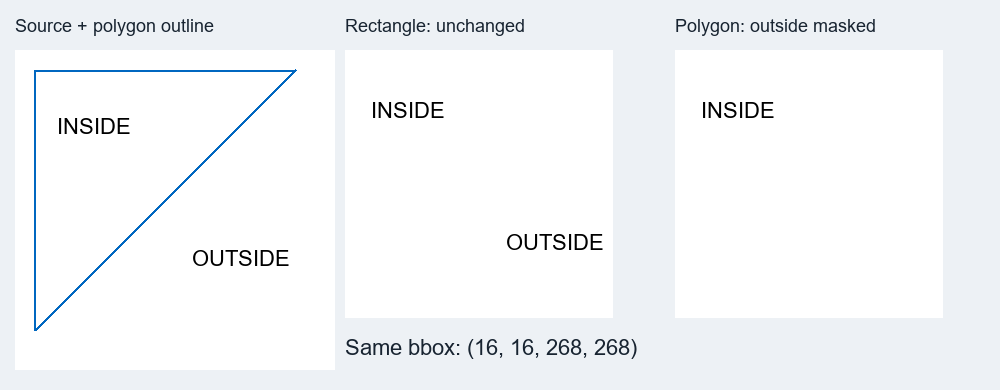

# テンプレート手動編集の拡張

2026-09-10。作業開始時HEAD: `b613c11a72b20d4c7cafc7ec3dd7ddf9adf52b55`。
開始時のworktreeはclean。commit / pushは行っていない。

## 実装

### 2026-09-12 見出し接続線のホバー表示

見出し階層、relationの親接続、繰り返し群への親接続は通常時に線を表示しない。
見出し・接続項目・繰り返し帯のホバー中だけ直接関係する線を表示し、選択状態だけでは残さない。
重複するcell/relationの同一親接続は1本にまとめて描画する。元の接続データは統合しない。
斜めの線は緩やかな3次ベジェ曲線、水平・垂直の線は直線とする。
接続作成中のガイドと、消しゴムのホバー・ドラッグ中の対象線も同じ曲線を使用する。
消しゴムの当たり判定は曲線に追従し、従来の斜め直線上だけでは接続を消さない。
ページ変更・ツール変更・カーソル離脱でホバー表示を解除する。繰り返し帯そのものの表示は維持する。

変更はfrontendの`LayoutEditor.tsx`、`headingConnections.ts`と追加テスト2ファイルのみ。
保存形式、接続作成規則、cell ID・targetPath・OCR領域・backendは変更していない。
ホバーでdirty状態・保存要求が発生しないこともcomponentテストで確認する。
既存OCR contractを維持した。実Chromeでの目視確認とbackend全体の再実行は今回行っていない。
検証: frontendで`npm.cmd test`は340 passed / 31 files、`npm.cmd run build`は成功
（既存chunkサイズ警告あり）。rootの`git diff --check`も通過。外部API呼出し0回。

### 2026-09-12 結合前の矩形の重ね描きを非表示化

通常・ページプレビューとも、結合親の外枠と既存の「結合」バッジを表示し、
結合前の各partsを破線で重ね描きしない。ページ表示ではpartsのcanonical座標が
そのまま描かれていたため、位置がずれた矩形として見える条件もあった。
`cellMerges.parts`の保存情報、結合・解除・選択・意味づけ・OCRの処理は変更しない。
元の帳票画像に含まれる罫線は保持する。

### 2026-09-12 操作改善（項目2・3・5）と区分変更調査（項目4）

- 手動項目追加と項目名の文字候補の手編集では、前後の入力空白を除いた項目名の完全一致だけで
  登録済みと判定する。部分一致・aliases・NFKC・大小文字・OCR誤字補正では吸収しない。
  保存キーから記号を除いた結果が衝突するときは、新項目に別キーを採番する。
  OCRからの自動候補照合は従来どおりとし、手動追加の照合と分離する。
- ハンドアイコンを押した場合だけCanvasの枠をドラッグ移動できる。説明文・チュートリアル・
  toastは出さず、ボタンの選択状態と手形カーソルで示す。もう一度押すと通常選択へ戻る。
  ドロップまで保存データを変えず、Escape / pointer cancelでは変更しない。
  矩形・多角形・仮想見出し・結合枠のIDと意味づけを保ち、多角形の頂点と結合partsも平行移動する。
  所属行の外接矩形は明示的なメンバーIDから更新する。元Excelセルの移動や並べ替えではない。
  現在のXLSXページ投影画面では元Excelセルの任意座標保存を許可しない。
  手動の多角形追加は未対応だが、仮想見出しはページ専用規則により追加・移動できる。
- ステップ2・3の見出し接続は繰り返し群（列上または帯の線上）を認識する。
  群のparentLabelCellIdを設定し、先端の1列だけに親接続を付けない。既存の同一collectionの
  複数帯連動を保持し、別collectionは変えない。見出し同士のネストと群を含む循環拒否を共用する。
  relation ID・targetPath・行所属・セル座標は親接続によって再生成しない。
- 区分変更の調査：`LayoutEditor.setRoles`は項目名から別区分へ変えたセルを
  relation.labelCellIdsから外すが、記入欄のrelationとtargetPathは保持する。
  結果は「ラベルなしの直接意味づけ」であり、保存・再取得・mapping生成でも残る。
  見出しへ意味づけが移るわけではない。記入欄自身を見出しに変える場合はinputCellIdのrelationを除く。
  項目4は調査のみの依頼なので、この保持仕様は変更していない。

変更・検証の詳細は[操作改善の検証報告](template-authoring-2345-report.md)を参照。

### 同名項目

意味づけの作成時に現在のLayoutDefinition内で保存先の使用状況を確認する。
別の記入欄ですでに使用している単独項目には、新しいlabelPool項目と保存先を作成する。
例は `漢字 → 漢字2 → 漢字3`、保存・再読込後の次は `漢字4`。
既存の帳票文字 `text` / `printedLabelText`、既存relationのID・targetPathは変更しない。
別テンプレートの候補は連番の根拠にしない。既存の繰り返し配列の行割当ては維持する。
保存時の既存重複修復ロジックに依存して、古い項目をリネームする方式ではない。

### 多角形

「欄の種類」→「枠を追加」で四角形／多角形を選択する。初期値は四角形。
頂点を順番にクリックし、始点クリックまたは「多角形を確定」で閉じる。
最後の頂点の取消し、作図キャンセル、Escapeによる終了が可能。

LayoutCellに任意の `shapeType` とcanonical座標の `vertices` を追加した。
旧データの省略値はrectangleと空の頂点列。外接矩形と頂点範囲の一致、
3〜100頂点、重複・自己交差・面積0の拒否をフロント／バック双方で検証する。
クリックはpoint-in-polygonで判定する。描画・区分変更・意味づけ・削除・
保存・再読込に対応する。

**通常の単一ページOCRまで対応する。** 頂点はmapping API、保存config、受付snapshot、
RegionConfigへ引き継ぎ、既存RegionCropperの切り出し後に領域外を白くする。
ink_differenceだけは領域外を0にする。印刷ラベル文字候補OCRも同じ形状でマスクする。
矩形では従来の切り出しをそのまま使用し、config/snapshotに空のverticesを追加しない。
既存画像や隣接セル、providerのmodel・prompt・association処理は変更しない。

### 見出し階層

「読み取る内容」または「繰り返し部分」の「親項目を接続」で、
見出しから子の見出し・項目名・記入欄・選択欄へ接続できる。
役割は既存の `parent_label` のまま。LayoutCellの `parentLabelCellId` に接続を保存し、
意味づけ済みの項目名では既存relationの親情報も整合させる。
新しい接続でtargetPath・relation ID・cell ID・mark sets・結合を作り直さない。
既存の親relationも参照して自己参照と循環を拒否し、単一親を維持する。
消しゴム・意味づけを戻す操作でもセルとrelationの親情報を整合させる。

### 繰り返し群の任意名称

「繰り返し部分をまとめる」で列ラベルを接続しても、名称入力を自動表示しない。
接続済みの帯を単クリックすると列ラベル群を選択し、帯上のセルをダブルクリックすると
そのセルだけを選択する。選択した繰り返し群の右サイドバーで「名前を付けない」または
「名前を付ける」を選び、名前を付ける場合だけ入力欄を表示する。

名前を付けない場合は `displayName=null` とし、`parentLabelCellId` の帳票見出しがあれば
その見出し名を画面上の識別に使用する。見出しもなければ名称なしとして表示する。
既存の名称、section ID、collectionPath、列ラベル・行グループ、targetPath、mappingは変更しない。
旧データで `displayName` 自体が未定義の場合は、従来のtitle表示を維持する。

### 仮想見出し

「仮想見出し」ツールで設置位置をクリックし、表示された矩形へ名前を直接入力する。
Enterまたは仮想見出し外のクリックで名前と配置を確定し、ツールバーには名称フォームと配置ボタンを置かない。
配置済みの仮想見出しをクリックすると同じ矩形内入力を再表示し、既存ID・位置・親子関係を保持したまま名称だけを変更する。
配置された見出しからドラッグして対象を囲う。項目名・記入欄・選択欄だけが直接の子になる。
他の見出しは囲い込みに含めず、通常の親項目接続で接続する。

仮想見出しは `virtual=true`、`source=manual`、`role=parent_label` の名前付きノード。
配置用の座標は持つが、見出し自身のfield mappingを作らず、ラベル文字候補OCRからも除外する。
囲った範囲は選択手段であり、確定後は明示的なcell IDの親子関係を保存する。
現在の論理セル一覧から選ぶため、結合済みセルは1項目として扱い、partsから作り直さない。

## 同名項目の追加修正（2026-09-10）

複数の記入欄へ一括接続する経路では、同名なら使用済みのcustomFields保存先を
再利用するため、2組目の接続が競合して拒否されていた。
`createAutoRepeatedLabelPoolEntries`へ現在の使用済み保存先を渡し、
新しい組だけ別のキーと表示名（例: `備考2 1行目`）を採番するよう修正した。
既存の接続・セル・原文は変更しない。従来のsaleCalves/calvingsの行割当ても変更しない。

変更ファイルは `frontend/src/components/LayoutEditor.tsx`、
`frontend/src/components/LayoutEditor.authoring.test.tsx`、本書。
単独接続は漢字に加えて住所・電話番号・備考・氏名・年月日・担当者・所在地・
施設・事業所名の9例、複数欄接続は備考・住所・電話番号の3例で、
保存・再読込後の採番継続と既存接続の保持を確認する。
項目名に依存する分岐は追加していない。実帳票で報告された操作そのものは未確認。

本修正の検証結果は下記の初回実装結果とは区別する。
OCR契約は変更前後とも194 passed。frontend全体は282 passed。
backend全体は791 passed、既存1 skipped（604.01秒）。
コマンドは下記と同じで、backend全体のbasetempのみ
`.pt-increment-regression-20260910`を使用した。`git diff --check`も通過。
build成功（既存のchunkサイズ警告あり）。外部API呼出し0回。
backend・OCR認識・crop・provider・Google・印刷ページ処理の追加変更はなく、
既存OCR contractを維持した。

## 後方互換性と制限

- DB migrationや過去版・過去jobの一括変換はない。DRAFT制約、版分離、logicalFieldIdの継承を維持する。
- 新metadataはLayoutDefinitionの任意フィールド。パッケージJSON Schemaも更新し、従来の厳密なfield制約を保持する。
- 既存矩形の画像画素とpadding込みbbox、単一ページjobの従来snapshot形式を回帰テストで比較する。
- 多角形の新規追加は従来のプレビューで行う。ページ単位編集では物理枠追加不可の制限を維持する。
  pageDisplayCellsの頂点変換は表示投影のみであり、保存するgeometryやページidentityを変更しない。
- 2026-09-12追加: 保存ページ上でも仮想見出しを追加・接続・ハンド移動できる。
  仮想見出しだけにpageRangeとページ内表示座標を保存する。元Excelセルの座標・ID・出力先は動かさない。
  保存・再表示・ページ設定変更の制約は[ページ単位の目視編集](page-authoring.md)を参照。
- 多角形・仮想見出し・新しい見出し接続を含むセルの結合は拒否する。
  先に結合した論理セルを仮想見出しの子にする操作は可能。
- 別形式のAI汎用TemplateDefinitionは新しい形状・明示的階層を保持できないため、
  `GENERIC_DEFINITION_AUTHORING_UNSUPPORTED`で生成・承認による変換を拒否する。
  通常の手動レイアウト保存・mapping OCRとは別の制限である。
- 多段見出しはテンプレート編集・保存で扱う。ReviewPageの多段ツリー表示を追加したものではない。
  過去OCR結果・補正・confirmed状態は変更しない。
- 初回実装ではXLSX印刷ページ設定、reference renderer、qualification、本番gate、Google連携は変更していない。
  後続のページ仮想見出し対応でもrenderer、qualification、本番gate、Google連携は変更しない。
- 外部OpenAI / Google APIは使用しない。新しい多角形の実帳票での認識精度は未実測。
- 稼働中のポート8000のバックエンドは `--reload` なしで起動している。
  今回は再起動していないため、稼働中アプリへの変更反映にはバックエンド再起動が必要。

## 検証

自動テストでは、同名項目の連番と保存後の再開、形状の保存・再読込・内外判定・
区分変更・削除・意味づけ、見出しの自己／循環参照、仮想見出しと結合／意味づけの保持、
OCR除外、mapping APIの往復、旧版・logicalFieldIdの保持、版fork時の親ID変換を確認する。

多角形cropは同じ固定画像から内側画素の一致と外側のマスクを検査する。
同時に矩形の全variantを元のsliceと完全一致比較し、入力画像SHAが変わらないことも検査する。
これは保存fixture／mockによる検証であり、実手書き認識率の測定ではない。

実装したRegionCropperの出力を別の生成画像でも目視確認した。
同一bbox `(16, 16, 268, 268)` で矩形は両文字列を保持し、多角形は外側だけをマスクする。
下図の青線は説明用の重ね描きであり、入力画像には含めていない。

目視確認サンプルのRGB画素列SHA-256:

| 対象 | SHA-256 |
| --- | --- |
| 元画像 | `68bb9327b8a0b6e8b8abd74c04cedc0f647d181094d0e4c6fe673de1f23fde4e` |
| 矩形crop | `a0e79b2ac3a9ed32a9ec0fd119b90dbf6621bfc45dff2b5cd7e41abcb9a3b3fc` |
| 多角形crop | `56609c1fe79989d681539b95aa6f6be23b71b3507e685149b085371050b7867b` |

実ブラウザーではlocalhostの一時的な検証用帳票を使い、三角形の作図、
仮想見出しから3欄への接続、通常見出し同士・通常→仮想の接続、
保存後のreload表示、同名の「漢字2」作成を確認した。
本番DBの帳票を操作した検証ではなく、保存は検証用localStorageを使用した。

検証コマンドと結果:

| 検証 | 作業ディレクトリ / コマンド | 結果 |
| --- | --- | --- |
| 変更前・変更後のOCR契約 | root: `backend\.venv\Scripts\python.exe scripts\verify_ocr_contract.py` | 両方194 passed |
| フロントエンド全体 | frontend: `npm.cmd test` | 変更前260、変更後271 passed |
| フロントエンドbuild | frontend: `npm.cmd run build` | 成功。500kBを超えるchunk警告あり |
| 拡張の境界・保存・既存版・schema・受付snapshot | backend: `.venv\Scripts\python.exe -m pytest tests/unit/test_layout_authoring_extensions.py tests/unit/test_template_package_contracts.py tests/integration/test_template_versioning.py tests/ocr_contract/test_phase3_job_submission_contract.py --basetemp=.pt-authoring-final-focus` | 49 passed |
| バックエンド全体 | backend: `.venv\Scripts\python.exe -m pytest --basetemp=.pt-authoring-regression-clean` | 791 passed、既存の1 skipped、577.56秒 |
| 対象Ruff | backend: `.venv\Scripts\python.exe -m ruff check`（下記の変更Pythonファイル） | 全件通過 |
| パッケージschema | backend: `.venv\Scripts\python.exe -m app.template_packages.schema_export --check` | 通過 |
| 対象型検査 | backend: `.venv\Scripts\python.exe -m mypy --follow-imports=silent`（変更したapp配下8ファイル） | 既存エラー1件。下記参照 |
| 差分 | root: `git diff --check` | 通過 |

途中の契約検証で検出した矩形snapshotへの空vertices追加は、既存期待値を変えず実装側で修正した。
途中のbackend全体実行では790 passed、1 skipped、renderer共有tempのstale ownershipテストが
1 failedとなった。`clean_stale`が古い所有ディレクトリを1件回収し、空配列を期待したassertionと
異なったものである。rendererコードとテストは変更していない。
`tests/integration/test_renderer_process.py` の再実行は6 passed。
古い一時領域を回収した後のbackend全体再実行は791 passed、1 skippedとなり、失敗は残っていない。
初回の全体実行は生成schemaの更新時期との不一致も検出したため、変更前の固定baselineには数えていない。

型検査の残件は `LayoutService._composite_target_path` の既存
`custom_field_key(parent_target_path).strip()` に対する `str | None` の指摘。
開始時HEADと同じ処理であることを照合し、依頼範囲外として修正していない。
OpenAI / Google API呼出しは0回。実APIでのassociation mismatch・mapping誤対応・
schema error・recognition-only errorの件数は未実測。

既存矩形について既存OCR contractを維持した。多角形の入力マスクは今回明示的に追加した
拡張であり、provider・認識設定・既存の矩形認識精度を変更する処理は含めていない。
既存テストの期待値変更・削除・skip追加はない。

## 変更ファイル

- UI・型: `frontend/src/components/LayoutEditor.tsx`、`layoutAuthoring.ts`（同ディレクトリ）、
  `frontend/src/types.ts`、`frontend/src/pageAuthoring.ts`
- データ・切り出し: `backend/app/domain/polygon.py`、`backend/app/domain/template_config.py`、
  `backend/app/layout_analysis/models.py`、`backend/app/extraction/region_cropper.py`
- 保存・境界: `backend/app/api/v1/routes/templates.py`、`backend/app/services/layout_service.py`、
  `backend/app/services/label_cell_ocr_service.py`、`backend/app/services/template_definition_service.py`
- パッケージ: `backend/app/template_packages/schemas/template-v1.schema.json`
- テスト: `frontend/src/components/layoutAuthoring.test.ts`、
  `frontend/src/components/LayoutEditor.authoring.test.tsx`、
  `backend/tests/unit/test_layout_authoring_extensions.py`、
  `backend/tests/integration/test_template_versioning.py`
- 文書: `AGENTS.md`、`docs/ocr-safety-contract.md`、本書
- 検証図: `docs/verification/template-authoring-crop.png`
