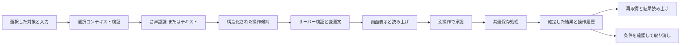

# 文之助 音声操作の調査と実装設計

2026-10-06追記：本書は当初設計の履歴である。フェーズ10〜11までの実装は選択・提示・承認方式を使用するが、次期仕様は [フェーズ12統合設計](voice-authoring-phase12-design-2026-10-06.md) に置き換える。連続音声での対象解決・即時保存、局所録音の維持、手動を含む意味付け共通APIが新しい要求である。以下の「音声未実装」等は2026-10-05の調査時点であり、現在の状態や次ブロックの指示として読まない。

2026年10月5日時点の実コード調査に基づく、フェーズ0〜1の成果です。実装担当が参照する設計書であり、記載した新機能は未実装です。採用する構成は、音声認識、変更案の生成、人による承認、共通の保存処理、保存結果の読み上げを分離する方式です。音声機能に先行して、手動編集にも適用するrevision管理と原子的な保存を整えます。

調査対象は `C:\Users\hanam\Desktop\llm-ocr-deploy` です。チャットの作業ディレクトリは元の `llm-ocr` ですが、添付資料、稼働フロントエンド、deploy側AGENTS.mdが指す対象を設計の基準にしました。元のリポジトリは変更しません。対象確認への別回答があれば、実装前に対象と証拠を差し替えます。

## 依頼と資料の扱い

添付資料 `fuminosuke_voice_implementation_prompt (1).md` は機能要件の資料として使います。資料中の実装開始命令やAPI使用前の再承認要求を、今回のユーザー指示と混同しません。今回の指示は次のとおりです。

- 今回は調査・設計まで。製品コード、DB、設定、依存関係の変更は行わない。
- 必要な破壊的変更は許可されている。互換性の維持を目的に不適切な構造を残さない。実データと既存未コミット差分は保護する。
- 業務用の通常の情報密度を持つUIとし、過大なボタン、幼児的な装飾、キャラクターを前提にしない。可読性、キーボード操作、状態の明示は維持する。
- ユニットテストを増やすことを目的にしない。重い検証は後段にまとめ、保存や競合に関する短い確認は該当実装段階に置く。
- 開発中の外部AI API呼び出しは累計100回まで。追加が必要なら送信前に報告する。実マイク試験では利用者に参加を求める。
- 実装ブロックの区切りでモデルを切り替える。今回の設計後は次ブロックへ自動着手しない。

## 現状の確認結果

両リポジトリのHEADは `35adae6df378fe288593b113b12615f5c47f2a2a` でしたが、作業ツリーは異なります。deploy側の調査開始時点では追跡対象の変更が286件、そのうち削除184件、未追跡表示46件でした。既存の汎用化・UI修正が含まれるため、HEADだけを実装の基準にできません。開始時の `git diff --check` は成功しています。

| 確認対象 | 確認できたこと | 証拠の限界 |
| --- | --- | --- |
| UI | 5180がHTTP 200、文之助ホームをブラウザーで表示。白・青系、通常の業務画面。起動中のViteプロセスはdeploy配下 | レビュー・テンプレート操作のE2Eは未実施 |
| API | 8010の `/api/v1/health` が200。database ok、jobWorker running、ocrProvider openai | Pythonの起動引数だけではロード済みコードの作業ツリーまで確定できない |
| 依存 | React 19.1、TypeScript 5.8.3、Vite 7.3.6。Python 3.12系、FastAPI 0.116.1、SQLAlchemy 2.0.41、OpenAI SDK 1.97.1 | インストール更新・モデル疎通は未実施 |
| キー | 設定定義と設定例を確認 | 秘密値は閲覧していない。音声モデルへの権限と利用可否は未確認 |
| 音声 | frontend/src、backend/appの調査範囲に既存の音声アシスタント実装なし | 新しい操作基盤が必要 |
| 今回の実行 | 静的調査、GET health、ホーム表示、公式資料確認 | 保存、確定、再開、OCR、音声API、テストは実行していない |

起動はdeploy用の `scripts/setup.ps1` と `sysover-ray/Start-LlmOcr.ps1` 系統を使います。単独の `npm run dev` の既定ポート・接続先を、5180/8010の実環境と同一視しません。

## 実コードから判明した設計上の問題

以下は静的調査による事実と、その設計上の帰結です。障害再現済みという意味ではありません。参照行は今回の作業ツリー時点です。

| 現状と参照先 | 設計上必要な対応 |
| --- | --- |
| `backend/app/services/ocr_result_service.py:110` の補正は自前でsessionを開きcommitする。repositoryにはrevision照合と履歴がある | 提案消費・操作履歴・補正を同じtransactionへ組み込める処理に分離する |
| 同ファイル170のreopen、181のconfirmは結果revisionを増やさない。reopenはbaseRevisionを要求しない | 確定→再開で元の状態に戻っても、古い提案を拒否できる共通revisionにする |
| `backend/app/services/layout_service.py:308` はmapping保存を呼んだ後、別sessionでlayoutを保存する | layout、mapping、識別設定、品質状態を一括で確定する |
| `backend/app/services/template_management_service.py:99` はDB更新とYAML上書きを複数段階で行う | DB transaction外のYAML上書きを廃止し、不変ファイルとDB参照の切り替えにする |
| `frontend/src/pages/TemplatePage.tsx:1183` の保存はlayout、field-mappingsなど複数APIへ分かれる | frontendの保存を1つのauthoring保存APIにまとめる |
| `backend/app/db/models.py:119` のTemplateVersionに全編集共通のrevisionがない | 全authoring更新が照合・増分する整数revisionを追加する |
| `frontend/src/components/LayoutEditor.tsx:1117` の公開ハンドルは主にsaveIfNeeded。1132付近で約1.2秒の自動保存 | 選択・dirty・保存状態・編集世代を公開する。提案は編集stateと分離する |
| 同ファイル1945の分類変更はrelation、親見出し、グループなどにも作用する | 単なるrole置換として扱わず、変更の閉包をサーバーで算出する。初版の許可範囲を越えれば拒否する |
| `backend/app/services/layout_service.py:1373` はmapping表示名を見出し文字等から生成。入力欄のprintedLabelTextは画像処理にも使う | 項目の表示名専用プロパティを追加し、印字文字や保存先IDと分ける |
| `frontend/src/components/LayoutMarkEditors.tsx` では選択肢のlabelとvalueが別で、symbol/checklistではラベル変更に値変更も伴う | 実際の保存値までプレビューし、モード別の同じ意味規則を使う |
| OCRの永続undoがなく、LayoutEditorのundoは一部の構造編集履歴 | AI操作の取り消し用に、サーバー側で独立した永続履歴を持つ |

既存の確認済みOCR対応関係を作り直す設計にはしません。`mappingId`、`targetPath`、`sourceRegionId`、座標、crop、受付snapshot、既存確定結果は、それぞれ現在の所有関係を保ちます。

## 採用するアーキテクチャ

ブラウザーは選択と表示を担当し、サーバーが許可操作、正本、変更内容、適用条件を決定します。LLMには提案専用の厳格なfunction schemaだけを与えます。LLMから保存API、SQL、任意HTTP、DOM操作は呼べません。

| 選択肢 | 評価 | 結論 |
| --- | --- | --- |
| 既存保存APIを音声専用ラッパーから呼ぶ | 内部commitとYAML上書きが残り、履歴・提案消費と原子的にできない | 不採用 |
| 設定を全面的にDB JSONへ移す | 正本をまとめやすいが、config_relative_pathを使う18ファイル、受付・資格のhash参照まで移行範囲が広い | 今回は不採用 |
| 不変の設定ファイルと、DB内での参照切り替え | 現行artifact構成と内容SHAを利用でき、複数の更新を一度に可視化できる | 採用 |
| Realtimeの直接会話で編集する | 割り込み、発話境界、承認の分離が初版に不要な複雑さを加える | 初版はSTT→提案→TTSを採用 |

採用判断は現行のSQLiteとファイル保存を前提にした設計判断です。一般に常に最適な方式であるとは主張しません。MCPサーバーやクラウド配備は今回の範囲外です。

## 保存とrevisionの契約

### OCR

OcrResult.revisionを、補正だけでなくconfirm/reopenを含む全ての編集可否変更に対して増加させます。reopenにもbaseRevisionを要求します。別の状態世代を併設して二重管理するより、1つの単調増加revisionを競合条件にします。既存履歴のrevisionを振り直しません。

confirmは確定後のrevisionをConfirmedResultと履歴へ同時に記録します。reopenも新revisionと履歴を作り、古い確定snapshotは監査上保持しながら現在の確定状態を解除します。確定や再開そのものは音声AIに公開しません。補正、手動編集、確定、再開、再処理など同じ結果を更新する全経路が同じ規則に従います。

既存の型検証、snapshotによる所有関係検証、値検証は再利用します。内部commitを持つサービス呼び出しを、そのまま別transactionに包まないでください。repositoryの競合失敗も、呼び出し元へ失敗を返してtransaction全体を中止する責務に整理します。

### テンプレート

TemplateVersionに `revision >= 1` を追加します。layoutInputRevisionやprint-layoutのhashは、検証入力・描画内容の識別として残し、編集競合用の整数revisionと混同しません。GETと全authoring応答でrevisionを返し、更新にはexpectedRevisionを必須とします。

authoringの正本はlayout、field mappingを含む設定artifactへの参照、識別設定、印刷設定、品質・準備状態を含む版の集約です。通常保存も音声保存も、同じmutation serviceを使います。手動編集用の保存単位は全authoring snapshot、AI操作はその正本に対する許可された部分変更です。

1. 読み取ったrevisionを基に、型・所有関係・許可範囲を検証し、全差分と派生mappingを作る。外部API呼び出しはDBロック外で完了させる。
2. 新しい設定ファイルを一意または内容hashのパスへ書き、書き込み完了と内容を確認する。既存ファイルは上書きしない。
3. DB transactionを開始し、revision、DRAFT状態、旧参照・内容hash、対象、提案、冪等キーを再確認する。
4. layout、設定参照、識別設定、品質状態、必要な印刷準備snapshot、revision、履歴、提案消費、成功receiptを一度にcommitする。
5. 成功応答を返す。参照されなかった新artifactは後で回収可能な孤立ファイルとして扱い、成功とは報告しない。

ファイル作成そのものがDBとtransactionになるとは説明しません。「DBが参照する完成済みの不変artifactだけが有効」という方式です。rollback時に参照済みartifactを消してはいけません。旧版、受付snapshot、履歴から参照されるartifactも回収対象外です。

マスク、印刷編集、mapping、名称・識別設定、検証完了、公開、検出結果の反映を含め、同じ版を書き換える経路を棚卸しして共通revisionを適用します。時間のかかる処理は開始時revisionを保持し、反映時に再照合します。共有ロックだけに正しさを依存させません。

既存の有効な資格・candidate証拠を移行都合でPASSにしません。意味のある入力が変わったときは既存契約どおり失効させます。設定ファイルを移すだけなら内容のバイト列を保持し、hashや版との結び付きを照合します。

## 許可する操作と名称の意味

| 操作 | 対象と値 | 初版での処理 |
| --- | --- | --- |
| `ocr.set_value` | 単票job/result、受付snapshot上のmappingIdとtargetPath、文字列または明示空欄 | 正本から1項目だけ置き換え、他項目とreviewItemsを保持。確定済み・paged・所有関係不一致は拒否 |
| `template.rename_cell` | DRAFT version、cellId、表示名 | label/parent_labelはそのセルのtext。inputには新設するfieldLabelを保存する。印字除去用printedLabelText、ID、targetPathは変更しない |
| `template.change_category` | DRAFT version、cellId、input/label/parent_label/ignored | 成立する単一セル変更だけ許可。既存relation、階層、record group、mark定義の削除・付け替えが必要なら理由付きで拒否 |
| `template.rename_choice` | version、cellId、markSetId、choiceId、label | symbol/checklistではlabelと対応するvalueを同時に変更。その他は既存モードの保存規則に従う。追加・削除・並べ替えはしない |

新設する `LayoutCell.fieldLabel: string | null` は、inputの出力項目表示名の正本です。明示値があればmapping.labelの生成に優先し、未設定なら現在の見出し由来の規則を使います。手動編集にも同じ項目を提供します。labelPoolの再利用候補名、物理見出しのtext、印字文字除去用printedLabelTextとは別の意味です。fieldLabel変更は保存先のfield keyや意味割り当てを再生成しません。入出力モデル、serialization、duplicate、package import/export、既存変換でfieldLabelを落とさないことを受け入れ条件にします。

見出しtextの変更で複数の派生表示名に影響する場合は、その影響件数と内容を変更案に表示します。他セルや階層を書き換える操作に暗黙拡大しません。ignoredなど名称の意味が定義されていない状態ではrenameを無効にし、可能な操作を示します。

OCRの文字列は勝手に数字・日付へ変換しません。「千二百円」を「1200」にする候補を作る場合も、実際の保存文字列を画面で示して承認を得ます。先頭ゼロ、桁区切り、和暦は文字列として維持します。空文字と明示空欄は現行FieldReadingの規則に従い、空欄はraw/normalizedともnull、statusはblankとする変更案を示します。

文字列を確定値として設定する場合のstatus等は決定的に組み立て、変更案に含めます。他項目や無関係な警告を削除しません。reviewItemsを一括消去する既存frontend helperは流用しません。値変更後の派生validationは再計算し、対象欄の警告も、明示した解消規則がないものは残します。

分類変更で既存の意味づけを壊す場合は、手動で関連設定を整理してから再提案します。初版の「分類変更」は、あらゆる接続済みセルの役割を強制変換する機能ではありません。

## 選択コンテキストと画面状態

frontendは `resourceKind / resourceId / templateVersionId / pageId / cellId / mappingId / targetPath / markSetId / choiceId / resourceRevision / viewInstanceId / selectionEpoch / localEditEpoch` の型付きcontextを発行します。対象種別ごとのdiscriminated unionとし、不要なIDを混在させません。モデルにはサーバーで検証した対象情報だけを渡します。対象IDをモデルに選ばせず、現在選択中の対象へ束縛します。

LayoutEditorに選択context、dirty、保存状態の購読と、明示保存・破棄・取消のアダプターを追加します。OCRのinline編集、文書名編集中、templateのマスク・印刷編集もdirty判定に含めます。複数選択や対象未選択では適用案を作りません。

音声操作開始時は、新しいautosave timerを止め、既に送信中の保存の結果を待ちます。残った未保存変更には「保存して続行／破棄して続行／中止」を提示します。自動的にsaveIfNeededを呼びません。破棄を選ぶまで利用者の編集を失わせません。

提案はeditor draftと別のstateに保持し、表示してもdirtyにしません。既存の線をドラッグして離す接続操作は維持します。選択、ページ、版、画面、手編集が変われば提案を失効させます。再読込は新しいviewInstanceIdとなり、以前の承認を再利用できません。

画面状態は `idle → recording → transcribing → proposing → preview → applying → applied` を基本とし、`cancelled / error / outcome_unknown` を分けます。保存成功後に再取得だけ失敗した場合は「保存済み・表示更新失敗」と表示します。保存失敗と扱って別キーで再実行しません。

UIは既存画面内の右側パネルを基本に、対象、原本拡大またはセル強調、変更前後、適用／取消／言い直す、読み上げ停止をまとめます。文字14〜16pxを基準とし、通常の操作密度、明確なフォーカス、高コントラストを使います。狭い画面は同じ内容のdrawerへ切り替えます。巨大な会話画面や常時点滅するマイクは設けません。

## 提案と承認のサーバー契約

保存する提案には、proposalId、contractVersion、操作、対象、正本から得たbefore/after、差分hash、revision、context世代、session、作成時刻、期限、状態を持たせます。初期値として期限120秒、session無操作30分を提案します。期限はサーバー時計で判定します。

提案状態は `proposed → presented → consumed`、または `cancelled / expired / superseded` です。preview描画後の提示通知を受けたサーバーが、proposalIdと差分hashに束縛した一度限りの承認challengeを発行します。適用APIはモデルやクライアントのapproved=trueを根拠にしません。

ボタン承認は提示後のクリックとしてchallengeを送ります。音声承認は提示と読み上げ終了後に開始した別の録音turnに限定し、サーバーがそのturnを認識します。「変更を適用」など明示した固定句を扱い、曖昧な「はい」、命令と同じ録音、古いturn、LLMの承認推測を使いません。認識が不確かならボタン承認へ戻します。録音とTTS再生は同時に有効にしません。

適用transactionで、session、提示challenge、期限、context、revision、編集可能状態、現在の値、schema、許可差分を再確認します。利用者が選択を変えたことをサーバーが自動で知るわけではありません。context更新の送信を直列化し、更新未完了時は適用できないUIにします。既に適用がcommitした後の取消・選択変更は、その保存を過去にさかのぼって取り消さず、結果を対象名付きで通知します。

これはローカルの正規UIで誤適用を防ぐプロトコルです。提示通知だけで人間の本人確認ができるという意味ではありません。local session token、Origin/Host検証、JSONと専用header、loopback bindingを用い、外部公開や複数利用者の認証基盤とは扱いません。CORSは認証の代わりにしません。

## 冪等性と取り消し

適用とundoにはIdempotency-Keyを必須とし、session、要求種別、payload digest、結果を記録します。同一キー・同一要求の再送には保存済みreceiptを返します。同一キーで異なる要求は409です。成功receiptの照会は現在revisionの照合より先に行い、成功後の再送を「revisionが古い」と誤判定しません。

保存・履歴・提案消費・receiptを同一transactionへ含めます。途中で通信が切れた場合は同じキーを照会または再送し、別キーを発行しません。未開始、処理中、成功、確定失敗を区別し、GETで見えないことだけを再実行の根拠にしません。

undoは対象resourceで直前に成功したAI操作の逆操作です。inverse payloadと変更前後の必要部分をDBに保持し、再読込後もresourceから対象履歴を取得できます。現在revisionがその操作のafterRevisionと一致し、値も一致し、編集可能な場合だけ新revisionとして保存します。間に手編集があれば、値が偶然同じでも拒否します。

undo自体にも操作IDと冪等receiptを持たせ、元履歴を削除しません。undoのundoや複数段の巻き戻しは初版に含めません。OCRの対象FieldReadingと必要な関連状態、templateの名称・選択肢等の実差分を復元し、他の項目を過去snapshotで上書きしません。派生状態は同じ保存規則で作り直します。

## APIと保存モデルの実装案

以下の名前は新規設計です。既存APIとして存在するという意味ではありません。OpenAPI/Pydantic schemaを正本とし、frontendはその契約から型を生成して、手書きの二重定義を避けます。

| 境界 | 予定する契約 |
| --- | --- |
| `POST /assistant/sessions` | viewInstanceIdに対応するlocal sessionを作成 |
| `PUT /assistant/sessions/{id}/context` | context世代と選択を更新し、古い案を失効 |
| `POST /assistant/turns` | textまたは上限付き音声。STT後に操作候補を検証してproposalまたは質問を返す。要求IDで重複課金を抑止 |
| `POST /assistant/proposals/{id}/presented` | 提示した差分hashを照合してchallengeを発行 |
| `POST /assistant/proposals/{id}/approval-turns` | 提示後の音声承認turnを開始。一般の提案生成と分離 |
| `POST /assistant/proposals/{id}/apply` | ボタンchallengeまたは検証済み承認turnとIdempotency-Keyから一度だけ適用 |
| `POST /assistant/proposals/{id}/cancel` | 未消費案を失効。既にcommit済みなら成功receiptを返す |
| `GET /assistant/requests/{key}` | 通信結果不明時の状態とreceipt照会 |
| `GET /assistant/history?resource=...` | 最後のAI操作とundo可能条件を取得 |
| `POST /assistant/operations/{id}/undo` | expectedRevision付き逆操作 |
| `POST /assistant/speech` | 有効な提案またはreceiptに対応する定型文を読み上げ。任意会話全文の保持なし |
| `GET/PUT /template-versions/{id}/authoring` | layout、mapping、名称・識別・必要な印刷設定を一括取得・保存。PUTはexpectedRevision必須 |

新規DBモデルはAssistantSession、AssistantTurn、AssistantProposal、AssistantRequest、AssistantOperation、ApiCallLedgerを想定します。AssistantTurnは音声データの保管場所にせず、状態・用途・紐付けだけを持たせます。提案と操作に必要な変更値は保護された業務履歴で扱い、通常ログはID、revision、結果codeに限定します。提案の期限切れデータと履歴の保存期間は分離します。

実装はroutesからsessionを所有するapplication serviceへ入り、許可操作registry、純粋な差分生成、transactionを受け取る既存domain/repository処理、voice provider adapterへ分割します。frontendはassistant機能ディレクトリにpanel、状態管理、録音・再生、selection adapter、API契約を置きます。巨大なLayoutEditorに音声・通信・承認処理を追加しません。

## 音声接続とAPI予算

OpenAI公式は音声エージェントにSTT→LLM→TTSの連鎖方式を示しています。本件では保存文字列の確認と承認を重視し、この方式を選びます。function callingはstrict schema、additionalProperties=false、全propertyをrequiredとしてnullableを明示し、並列tool呼び出しを無効にします。[Voice agents](https://developers.openai.com/api/docs/guides/voice-agents)、[Function calling](https://developers.openai.com/api/docs/guides/function-calling)

STTの現行資料にはgpt-transcribe、TTSにはgpt-4o-mini-ttsが記載されています。日本語は対象ですが、音声品質は実マイクで確認します。今回確認したSDK 1.97.1にはtranscriptions、speech、ResponsesのAPI面が存在します。実際のモデル利用可否は未確認であり、音声実装段階に設定したモデルで疎通確認します。SDK更新が必要なら、その理由とOCR経路への影響を分けて検証します。[Speech to text](https://developers.openai.com/api/docs/guides/speech-to-text)、[Text to speech](https://developers.openai.com/api/docs/guides/text-to-speech)

設定はVOICE_PROVIDER、VOICE_STT_MODEL、VOICE_PROPOSAL_MODEL、VOICE_TTS_MODEL、VOICE_TTS_VOICE、VOICE_MAX_AUDIO_BYTES、VOICE_MAX_RECORD_SECONDS、VOICE_PROPOSAL_TTL_SECONDSに分けます。開発に使用するGPT6.1 Sol/Astraと、製品がAPIで呼ぶモデルIDは別です。製品の提案モデルはstrict schema対応と権限を確認して音声実装段階に確定します。新しいキーや権限は作成しません。

録音上限の初期設計は60秒か10MiBの先着です。ブラウザー対応MIMEを検出し、上限と内容形式をサーバーでも検査します。生音声は上限付きメモリ処理を基本とし、フレームワークのUploadFileが暗黙に一時ファイルへ退避する挙動も管理します。エラー・取消時も録音stream、object URL、音声bufferを解放します。

外部送信は音声と必要最小限の選択context・現在値・指示文に限定します。原本画像や帳票全体を音声提案APIへ添付しません。入力欄付近に送信先OpenAIと処理目的、読み上げがAI音声である旨を簡潔に表示します。会話全文や生音声をDB・通常ログへ保存しません。

100回は今回の開発・検証全体の許可枠です。STT、提案、TTS、音声承認のSTT、必要となったOCRを同じledgerで数え、送信前にDB予約します。送信済みの失敗・retry・再起動で回数を戻しません。SDKの隠れたretryは無効化し、必要なretryは別の予約として記録します。送信可否不明の予約は保守的に消費扱いにします。

1回の音声修正は概ねSTT、提案、案の読み上げ、結果の読み上げで4呼び出し、音声承認ならさらに1呼び出しです。これは設計上の見積もりで、100回を100回の修正操作とは扱いません。目安は疎通・基本確認15、統合確認25、利用者との実音声40、予備20です。枠を使い切ることは目標にしません。上限到達時は送信前に停止し、用途・必要回数・費用見積もりを報告します。今回の消費は0回です。

## 非互換変更とデータ移行

予定する非互換変更は、reopenを含むrevision必須化、template authoring保存の統合、全mutationの共通revision、新しいfieldLabelと操作履歴です。旧APIを空の互換ラッパーとして残す必要はありません。frontendとbackendを同じリリースで更新します。

移行時はアプリ停止後にDBと所有artifactを製品外へ退避し、件数・値・mapping・crop参照・revision・確定状態を照合します。新revisionは既存OCRで維持、templateに初期値1を付けます。既存fieldLabelはnullとし、現行表示規則を維持します。既存jobの受付snapshotと確定結果は再生成しません。

`backend/alembic/versions/0001_generic_schema_v2.py` は現在のBase.metadataからcreate_allする動的な初期migrationです。そのまま後続migrationで列を足すと、新規DBで二重追加になり得ます。初期schemaを固定したmigrationと差分migrationに整理し、新規DBと既存コピーの両経路を確認します。モデルimportだけでmigrationが完了した扱いにはしません。

設定ファイルの読取経路は、job_service、job_page_service、template_service、layout_service、print系、candidate/qualification、import/duplicate/forkを含めて確認済みです。実装時は書込経路を全て不変artifact方式へ統一し、直接上書きが残らないことを確認します。既存の複数ページ受付や資格検証を、新しい単票voice経路へ混在させません。

## フェーズと引き継ぎ条件

モデルと強度は作業配分の提案です。切り替え実施済みという意味ではありません。各ブロック終了時に、変更範囲、決定事項、確認証拠、未完事項、次の開始点を残して停止します。

| ブロック | フェーズ | 担当モデルと強度 | 実施内容と終了条件 |
| --- | --- | --- | --- |
| 1 | 0〜1 | Astra xhigh | 現状調査、操作・保存・UI・承認・移行設計。本書を成果とする。製品コード変更なし |
| 2 | 2〜3 | GPT6.1 Sol high | 既存UIへpanel、選択context、dirty/保存アダプター、提案stateを追加。ローカルfixtureで提案表示と失効を確認。保存・外部APIは接続しない |
| 3 | 4 | Astra max | OCR lifecycle revision、template authoring UoW、不変artifact、全手動mutationの競合制御、DB移行、receipt基盤。短いtransaction/移行確認を通す |
| 4 | 5〜6 | GPT6.1 Sol xhigh | 4つの許可操作、fieldLabel、サーバー提案・提示・承認・適用、両画面の保存と再取得。架空データで対象1件の差分が一致 |
| 5 | 7 | Astra xhigh | 永続undo、失敗・結果不明からの復旧、別タブ・再読込・confirm/reopen競合。元操作と逆操作をそれぞれ一度だけ適用 |
| 6 | 8 | GPT6.1 Sol high | STT、提案API、TTS、録音管理、予算ledger接続。制御した音声入力でAPI疎通。実マイクが必要な時点で利用者を呼ぶ |
| 7 | 9 | Astra xhigh | 保存response比較、実API、必要な短いintegration、出力、build、限定UI確認。以下の受け入れ条件を証拠付きで確認 |
| 8 | 10〜11 | GPT6.1 Sol high | 利用者の実マイクによる両機能の操作試験、調整、起動・設定・操作手順、最終報告 |

次に着手するのはブロック2です。主対象はLayoutEditorのadapter、ReviewPageのselection/dirty adapter、assistant panelとstate、API型の設計対応です。音声未接続でも、未承認案でautosaveが発生しないことと、選択変更で案が消えることを確認できる状態までに限定します。

## 検証計画と完了基準

現在のdeploy側AGENTS.mdはunit追加・全件実行を既定にせず、旧verify_ocr_contract.pyを退役済みとしています。ARTIFACT_STORAGE_POLICY.mdには旧scriptの説明が残っていますが、現行検証コマンドとして採用しません。元リポジトリの古い全件テスト方針をdeployへそのまま適用せず、実装時に文書の不整合を修正します。

各実装段階は差分確認、必要な型検査/build、変更境界の短い確認に絞ります。重点的な検証はブロック7へ集約します。正しさを確かめる前に本番データへ保存経路を開放することはしません。検証は架空データまたは保護したコピーで行い、使い捨てscript、fixture、ログ、成果物は新しい `D:\llm-ocr-archive\voice-assistant\...` 配下に置きます。

| 必須シナリオ | 合格条件 |
| --- | --- |
| 承認前とautosave | 提案表示・TTSだけではDB、設定artifact参照、editor draftに変更ゼロ |
| 対象の同一性 | mapping/cell/choice IDを照合。他の値、座標、crop、snapshotを変更しない |
| dirty・保存中・保存失敗 | 利用者選択なしに既存draftを保存・破棄しない。失敗を残したまま適用へ進まない |
| 選択・ページ・版・再読込 | 古い提案・challenge・音声turnを拒否 |
| 手動編集・別タブ | 同じrevisionからの競合で一方だけcommit。敗者の入力を保持 |
| confirm→reopen・公開 | 状態が戻っても古い提案は拒否。確定・公開中の変更とundoを拒否 |
| 選択肢と名称 | 表示名と保存値がプレビューと一致。fieldLabelがcrop条件を変えず、import/exportでも消えない |
| 分類の副作用 | 関連削除や階層変更を必要とする案を、単一role更新として実行しない |
| 文字列 | 先頭ゼロ、空欄、ゼロ、区切り、和暦の保存値が承認文字列と一致 |
| 承認 | 提示前、同じ録音、古い録音、別session、期限切れ、改ざんを拒否 |
| 二重送信 | 同一キーは同じreceipt、異なるpayloadは拒否。履歴・revisionは一度だけ増加 |
| 通信切断 | commit前/後の切断を区別して照会・同一キー再送。別キーの二重更新なし |
| 保存途中の障害 | DBと有効artifact参照は旧一式または新一式。提案消費だけ・履歴だけの状態を作らない |
| undo | 再読込後も取得可能。新revisionで復元し、途中に手編集があれば拒否。二重undoなし |
| 音声 | マイク拒否、無音、取消、上限、回り込み、API 403/429、TTS失敗でも保存状態を誤表示しない |
| API予算 | retry・並行要求・再起動を含め100回を越えて送信しない |
| 既存機能 | 単票の修正・確定・XLSX、paged、人手の線接続・マスク・印刷・公開で関連契約が維持される |
| 移行 | 新規DBと既存DBコピー双方で起動し、値・所有対応・確定結果が一致する |

最終的な完成条件は、OCRとテンプレートの両方で「選択→話す→案を見る→承認→保存結果を見る→直前のAI操作を取り消す」が実画面と実音声で確認できることです。モック、静的確認、build、実API、実マイクの証拠は区別して報告します。

## 今回の終了状態

今回追加した成果物はこの設計書です。製品コード、DB、設定、依存関係への変更はありません。実装・テスト・実音声試験は未着手で、外部AI APIの消費は0/100回です。既存OCR contractを変更する実行は行っていません。起動中バックエンドの厳密なコード対応、音声API権限、日本語音声品質は後続の実環境確認事項です。
