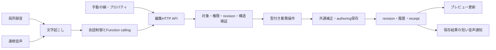

# 文之助：連続音声・局所録音・手動意味付けの統合設計

2026-10-07追加変更：[欄名自動補正の追加フェーズ1](voice-target-autocorrection-phase1-2026-10-07.md)が
現在の近似対象解決と通知契約である。一候補なら正式対象へ補正して保存し、画面で確認する。
複数/無候補や値不足は保存しない。連続入力/局所録音はTTSを呼ばず、欄とパネルの短い強調で通知する。
本書の不足情報の音声質問、自動TTS/再生割込み/反響条件は、この追加契約により画面通知へ変更する。
実装・独立レビュー・最終検証の3段階で進め、全体フェーズ19と通常切替は完了していない。

2026-10-07の[フェーズ19進行記録](voice-authoring-phase19-2026-10-07.md)に、実STTの名称表記差、近い対象の具体的質問、旧write19 routeの閉鎖を記録した。対象質問への一候補・同世代の回答だけを元指示へ結び付け、通常の変更承認は導入しない。実TTS等と通常切替は未受け入れ。

2026-10-06 / フェーズ12 / 設計契約 `editing.v1`

本書はフェーズ12で確定した**次期実装の契約**である。製品コード、DB schema、音声動作はこのフェーズでは変更しない。現行実装はフェーズ10〜11の「選択→提案→提示→承認→保存」。新方式が稼働済みであるとは扱わない。

2026-10-06追記：[フェーズ13の実装記録](voice-authoring-phase13-2026-10-06.md)に、共通型・catalog/session・基本9操作・batch/receipt/undoの段階到達点を記載した。ResourceOperationの新metadataは、一対一の`editing_operations`テーブルへ格納する。通常DBを移行する前に既存ORMのSELECTが新しい列を要求しないための実装判断であり、履歴本体と旧receiptの保持、フェーズ19の一斉切替は維持する。新APIはdefault無効、実DBは未移行、UI/音声は未接続。ここから先の全操作・連続音声仕様を実装済みとは解釈しない。

対象は `C:\Users\hanam\Desktop\llm-ocr-deploy`。元の `C:\Users\hanam\Desktop\llm-ocr` は変更しない。添付プロンプトは参考資料とし、直近の利用者指示と合意した統合計画を優先する。破壊的変更と旧API互換性の廃止は許可済みだが、既存業務データ・未コミット差分・過去の受付snapshotを破棄する許可とは解釈しない。

フェーズ14追記：[意味付け操作の実装記録](voice-authoring-phase14-2026-10-06.md)の通り、操作型は22種類まで実装した。通常利用は引き続き無効。手動UI・会話controller・連続音声はフェーズ15以降で接続する。§5のmark上限と識別labelの扱いは、現行authoringの保存契約に合わせて同フェーズで確定した。

フェーズ15追記：[手動接続の実装記録](voice-authoring-phase15-2026-10-07.md)の通り、手動editor・操作終了autosave・resource queue・receipt復旧を接続した。通常切替と連続音声は未実施。既存の有効な未完成DRAFTを保つため、recordsの空行/columnLabels/名前なし、markの未割当を同じ有限操作へ明示追加した。モデルに手動snapshotや自由なgeometryを渡す変更ではない。

## 1. 決定事項と到達点

フェーズ16追記：[会話controllerの実装記録](voice-authoring-phase16-2026-10-07.md)の通り、Function calling・無選択対象解決・不足情報の質問・訂正・共有履歴を接続した。HTTPの解釈応答`READY`をfrontendが同じresource queueで直ちに保存する。これは元要求のjournal/通信復旧を確保する分割であり、承認待ちではない。音声取得の並行buffer、STT/TTS、VAD、割込み、新UIは17、全体回帰18、実マイク/通常切替19に残す。実APIは累計31/100回、残り69回。

フェーズ17追記：[連続音声と編集画面の実装記録](voice-authoring-phase17-2026-10-07.md)の通り、VAD/固定assets、streaming proxy、発話順序/保留/割込み、保存通知、局所録音を接続した。制御音声とコピー実API/Chromeで検証し、外部AI追加0回。全体回帰18、実マイク/応答時間/通常切替19へ進む。通常DBと新API無効状態は維持する。

1. 連続音声は開始後、セルを選択せずに指示できる。対象が特定できれば直ちに保存し、プレビューを更新して「受付番号を変更しました」のように結果を知らせる。定型の承認句、適用ボタン、毎回の録音終了を要求しない。
2. 選択したセルへの局所録音は残す。録音開始・終了送信で区切り、選択対象内だけを変更する。通常は変更後の通知のみとする。
3. OCR値だけでなく、テンプレートの意味付け全体を音声から操作する。手で線を引く操作、通常のプロパティ編集、矩形・多角形の手動作成は残す。
4. 手動意味付けと音声意味付けを同じ型付き業務APIへ接続する。手動操作終了時に自動保存し、同じ永続履歴から取り消す。描画途中の座標や入力途中の文字を逐次確定しない。
5. 一発話の複数変更は一つの原子的な操作群。どれかが曖昧・不正・競合なら全体を保存しない。不足情報だけを音声で質問する。
6. 「違うよ」は直前の取り消し可能な保存群を取り消す。「違う、00124」は直近の対象に訂正値を適用する。「受付番号ではなく申請番号」は誤った欄の復元と正しい欄への適用を一つの操作群にする。
7. OpenAI Function callingをアプリ内部で使用する。ChatGPTアプリからの外部接続、MCPサーバー公開、汎用HTTP/SQL/DOM操作ツールは今回の範囲に含めない。
8. 通常の業務用プレビューを主画面とする。常設する音声操作は連続会話の開始/停止、局所録音の開始/終了送信を中心とし、巨大ボタン・キャラクター・常時承認画面を設けない。

### 対象範囲

| 領域 | 対象 | 境界 |
| --- | --- | --- |
| OCR補正 | 現行の単一OCRレビューの値、空欄、直前訂正 | 未確定・編集可能な結果のみ。確定、再編集、OCR再実行は既存の明示操作 |
| テンプレート | 分類、項目名、意味の作成/接続/解除、見出し/仮想見出し、繰り返し表、マーク/選択肢、識別・書類名 | DRAFTのみ。物理枠の生成/分割/結合/座標変更は手動操作 |
| 複数ページテンプレート | 保存済みページidentityに束縛した意味付け | 既存のページ別制約を適用。ページ追加、renderer、候補準備、ACTIVE化を音声に公開しない |
| ページ別OCRレビュー | 共通APIへ将来接続できるadapter境界を設ける | 今回のOCR値編集adapterは既存単一結果まで。`PagedReview`を単一`OcrResult`として扱わない |
| 同期・出力 | 既存の確定revisionと対応関係を維持 | 音声編集で確定や出力条件を迂回しない |

## 2. 現行コードの確認と変更理由

| 現行の根拠 | 確認した挙動 | 次期設計で変える点 |
| --- | --- | --- |
| `backend/app/assistant/contracts.py` | 4操作、選択context、proposal・presentation・challenge | 選択が任意のcatalog、型付き操作群、発話に束縛した実行権限へ置換 |
| `backend/app/assistant/voice_provider.py` | STT→4操作の構造化解釈→TTS、対象選択不可 | 検索・操作Function calling。保存成功文はモデルの自由文から作らない |
| `frontend/src/components/LayoutEditor.tsx` | `setRoles`、`finishLink`、`createRecordsFromColumnLabels`等が業務構造を変更 | 業務構造の正本をbackend command handlerへ移す。UIは操作入力とpreviewに集中 |
| 同 `save` と自動保存effect | 条件付き1200ms debounce、未保存入力の保護、アシスタント中は停止 | 手動自動保存は既存機能。新規に必要なのは操作単位の保存、共通queue、共有履歴 |
| `backend/app/services/template_authoring_service.py` | prepare/persist、revision、immutable config、field identity reconcile | 共通の保存基盤として使用。準備中に外部AI待ちや長時間DB lockを置かない |
| `backend/app/services/mutation_receipt_service.py` | PENDING/SUCCEEDED/FAILED、同一キー再送、業務変更とreceiptの同時commit | 再利用。新契約のpayload/versionを区別し、手動操作も履歴へ記録 |
| `backend/app/db/mutation_models.py` | ResourceOperationにbefore/after/inverse、undo_of_id | 操作群の型、由来、schema versionを付与。古い履歴を新形式として解釈しない |
| `backend/app/ai/api_budget.py` | HTTP送信前の100回予約、失敗非払い戻し | WebSocket接続・発話の予約、音声時間制限を追加する必要がある |

**backend変更が必要な理由**：手動とAIが同じ意味付けを再現し、他タブの変更と競合し、再読み込み後にも構造を戻せるようにするため。Reactだけのgraph変換や履歴ではAPI利用者との同値性、原子的な保存、権限検査を保証できない。OCR provider/prompt/schemaの最適化はこの理由に含まれない。

### 調査で固定した注意点

- `readingMode="number"` は**自動採番**であり、画像の数字を転記する設定ではない。`LayoutService`は位置順の`sequenceNumber`を生成する。新APIでは`sequence`という明示値を使う。「数字を読む」は通常の文字読取であり、識別欄の`valueType=digits`とも別である。
- 未完成DRAFTは保存できるが`layoutFinalized=false`となり、過去の派生mappingsが保持される場合がある。catalogは現在のlayoutを正本とし、その保持データを現在使える意味・識別欄として提示しない。
- 現行の線接続でrelation IDが再生成される箇所がある。relation IDとOCR mappingIdを混同しない。次期APIは同じ接続の再送・名称変更でrelation IDを維持する。意味の所属変更を伴う操作は変更した対応を明示的に記録する。
- ページ別テンプレートのマークは現行§13で許可されたchecklistを扱う。他のsymbol/automatic/manual複合マークを、API追加だけでページ別OCRへ開放しない。
- 書類識別はテンプレートで決める番号・氏名・日付等または組み合わせであり、DB主キーの一意性や一律10桁とは別である。

## 3. 責務と依存方向



- `app/editing/contracts`：Pydanticの閉じた型、operation registry、JSON Schema/TypeScript/tool schemaの生成元。任意のdictを変更payloadとして受けない。
- `app/editing/catalog`：現在resourceの読み取り専用投影。所有関係、対象handle、名前、位置、capabilities、draft readinessを返す。
- `app/editing/commands`：role/meaning/heading/records/mark/identityとOCRの業務操作。UI・OpenAI SDK・HTTPに依存しない。
- `app/editing/service`：batch検証、prepare、transaction、revision、receipt、inverse。既存authoring/補正serviceを呼び出す唯一の新編集入口。
- `app/assistant`：音声turn、対象検索、確認質問、Function calling、通知の制御。SQLやlayout全体を書き換えない。
- frontend：共通editing client/store、保存queue、既存previewへの反映。手動操作からのAPI入力生成は可能だが、targetPath・mapping ID・意味graphの最終生成はbackendが行う。
- geometryの手動保存は既存authoringへ接続した別command adapterとし、同じresource queue/revisionを使う。モデルにはgeometry adapterを公開しない。

HTTPとtoolを別々に手書きで増やさない。共通の型定義から外部形式を生成し、schema変更には`editing.v1`の版管理とmigration判定を伴わせる。schema生成自体はフェーズ13の実装であり、本フェーズでは行わない。

## 4. 対象catalog・session・実行context

### 4.1 型の正本

| 型 | 必須情報・制約 |
| --- | --- |
| `ResourceRef` | `kind: ocr \| template`, `id`。一session一resource。OCRはjob ID、templateはversion ID |
| `EditingSession` | server生成ID、token hash、resource、viewInstanceId、世代、期限。tokenはmodelへ渡さない。非操作30分で失効 |
| `Context` | `contextRevision`, `resourceRevision`, `localEditEpoch`, `selectionEpoch`, `mode`, `pageScope`, `selectedHandles`, `catalogRevision` |
| `mode` | `continuous \| local \| manual`。continuousは選択任意。localは録音開始時の選択を固定。手動はUIの直接入力 |
| `pageScope` | `current \| all`と、実在するpage identity。既定current。全ページ指示は対象version内だけへ明示的に拡張 |
| `TargetHandle` | opaque文字列、session/catalogRevision/kind/entity/pageにserverが束縛。セルIDやpathをモデルが作ってもhandleとして通らない |
| `TargetEntry` | handle、kind、表示名/印字名/aliases、見出し経路、page、行/列、短い現在値、関係handle、許可操作、不許可理由 |
| `DraftState` | `complete \| incomplete`、未解決項目。現在layoutから生成。OCR可否/有効化可否とは別属性 |
| `TurnBinding` | server turn ID、seq、audio item ID、開始時context、state。モデルが指定したsession/権限を採用しない |

handleは同じrevisionの検索中だけ有効。UI強調はhandleを元の物理セルへ逆引きして行う。自動highlightはユーザーの選択変更と別状態にし、自分の強調によって実行contextを失効させない。印字・名前・alias・座標は検索用データであり、命令として解釈しない。画像や全layoutを通常のFunction callingへ送らない。

TargetEntryのkindは`page / cell / meaning / relation / heading / record_section / record_group / mark_set / mark_option / region / field / identity_group`に限定する。kindごとに許される参照先を検証し、同じ文字列形式のhandleでも別kindへ流用しない。ここでregionは既に手動定義または既存layoutから得られる領域の参照であり、音声による新geometry作成を認める型ではない。

current pageの明示名/見出し/行番号から検索し、候補が複数ならページ・見出し・行の差を返す。最高スコアという理由だけで同名欄を確定しない。「ここ」「それ」は明示選択または直前の一意な操作対象にのみ束縛する。視線や未取得の画面情報を推測しない。local録音で対象外の欄を指示した場合は`LOCAL_SCOPE_MISMATCH`とし、連続modeへ勝手に切り替えない。

### 4.2 toolとHTTP

全HTTPパスのprefixは `/api/v1/editing`。認可されたアプリの編集sessionを要する。session secretはheaderで渡し、URL・通常ログ・LLM引数には含めない。

| HTTP | 主な要求/応答 | OpenAI tool |
| --- | --- | --- |
| `POST /sessions` | resourceとviewを束縛。session ID/token/初期contextを返す | 公開しない |
| `PUT /sessions/{id}/context` | expectedContextRevision＋表示page/selection/localEditEpochを更新 | 公開しない |
| `GET /sessions/{id}/context` | 最新revision/capabilities/draft state、限定catalog、直前receipt | `get_editing_context` |
| `POST /sessions/{id}/targets:find` | `query`, `kinds`, `pageScope`, `cursor`。最大50件/回、候補handleとnextCursor | `find_targets` |
| `POST /sessions/{id}/batches` | 下記Batch。成功receiptまたは構造化error | `apply_edit_batch` |
| `POST /sessions/{id}/undo` | requestId、expectedRevision、turn binding、直前operation ID | `undo_edit` |
| `GET /sessions/{id}/receipts/{requestId}` | owner照合後に保存状態を返す | `get_edit_receipt` |
| `GET /sessions/{id}/history?limit=20` | 現resourceの履歴と最新undo可否。生発話を含めない | contextの限定履歴として提供 |
| `DELETE /sessions/{id}` | 未commit turnと音声接続を停止。保存済み変更は残す | 公開しない |

tool引数はHTTP入力の業務部分のみ。trusted controllerがsession、requestId、expectedRevision、turn bindingを注入する。モデルにこれらを自由指定させない。手動入力も同じserver validationを通る。`find_targets`のcursorやhandleはresourceを越えて再利用できない。

## 5. 型付き操作カタログ

下表の`ref`はTargetHandleまたは同一batchの既出`localRef`。新しいentityを作る操作は`localRef`を必須とし、後続操作だけが参照できる。永続IDはserver生成、receiptの`createdTargets`で対応を返す。未定義・前方参照・重複localRefは拒否。フィールドの省略とnullを同義にしない。HTTPの型ごとの必須項目を定義し、toolでは省略可能な項目もnullableなrequiredへ変換する。

| operation | 業務引数 | 保存意味と制約 |
| --- | --- | --- |
| `ocr.set_value` | target、`value: string \| null` | 文字列をそのまま保存。nullは明示空欄。最大500字、先頭ゼロを保持。OCR判定の更新は既存補正service |
| `cell.set_role` | cells[]、`role` | input/label/parent_label/mark/record_key_cell/column_key_cell/ignored。依存変更も同じbatchで明示。既存接続を暗黙に全削除しない |
| `cell.rename` | cell、`name: string \| null` | fieldLabelという表示名。nullはoverride解除。物理印字、ID、pathを変えない |
| `cell.set_reading` | cells[]、`reading: text \| sequence` | 通常転記/自動採番。sequenceはinputだけ。markの読取はmark.configureで設定 |
| `meaning.create` | localRef、name、aliases[] | 汎用意味を作成。field key/pathの衝突回避はserver。名称は1〜100字、aliasは各100字まで |
| `meaning.update` | meaning、name、aliases[] | 名前とalias更新。既存path/意味IDを再生成しない |
| `meaning.delete` | meaning | 未使用だけを削除。使用中なら同batchでunbindや置換が必要 |
| `meaning.bind` | meaning、inputCells[]、labelCells[]、`axis: horizontal \| vertical \| direct` | 明示したセルに接続。サーバーが各relation/適切なmappingを生成。単一値への衝突は拒否 |
| `meaning.unbind` | relations[] | 指定接続だけを解除。物理欄・他relation・意味辞書を削除しない |
| `heading.create_virtual` | localRef、name、page、anchor | 物理cropを持たない仮想見出し。anchorは同pageの既存対象handle、表示位置はserverが決定 |
| `heading.update` | heading、name | 仮想見出し名または物理見出しの表示名。物理印字を上書きしない |
| `heading.attach` | heading、children[] | label/heading/sectionへの親接続。親一つ、循環不可、page越え不可 |
| `heading.detach` | children[] | 指定親接続だけを解除。子孫の意味pathを再生成しない |
| `heading.delete_virtual` | heading | virtualのみ。子があれば同batchで移動/解除が必要。物理枠削除へ拡張しない |
| `records.define` | localRef、name、columns[]、rows[]、options、columnLabels | 明示セル配列で繰り返し表を作成。空行は未完成DRAFT。columnLabels=nullは列から導出 |
| `records.replace_rows` | section、rows[] | 行所属の変更。既存group参照を保持し、追加行のみlocalRef。行削除は意味上の所属解除 |
| `records.configure` | section、name、options、columnLabels | displayName（nullは名前なし）、列ラベル、行キー、空行設定。collectionPathは維持 |
| `records.dissolve` | section | 表の意味構造を解除。物理セル保持。必要な単一値への再接続は同batchで明示 |
| `mark.configure` | cell、sets[] | 現行のmark定義を型付きで更新。set ID/meaning参照、mode、selectionMode、optionsを検証 |
| `mark.clear` | cell | mark設定の解除とinputへの移行。既存意味の移し先が一意なら保持、それ以外は同batchで明示 |
| `identity.configure` | entries[] | 識別設定全体を置換。空配列は明示解除。mapping/pathは対象handleから導出 |
| `document_name.configure` | `rule: NameRule \| null` | 書類名のfield順、separator、prefix、suffix。nullは解除。入力中の書類名/過去jobは変更しない |

配列上限はbatch 50操作、展開対象セル合計1000、意味alias 20、mark optionsは1set 50、検索返却50件。markの上限はフェーズ14で現行保存契約に合わせて訂正した。上限超過を複数batchへ自動分割しない。大きな変更は指示の分割を求める。全payloadは256KiB上限。silent truncationは禁止する。

### 5.1 表・選択肢・識別設定の詳細型

- `columns[]`：`meaning`と`labelCells[]`。列順は配列順、既存meaning参照または先行localRef。
- `rows[]`：既存`group`または新規`localRef`のどちらか一つ、`cells[]`（列順）、`rowKeyCell: ref | null`、`rowKeyValue: string | null`。行ごとの列数一致、セル重複禁止。bboxは参照セルから計算し、番号や配列indexを永続identityにしない。
- `RecordOptions`：`rowKeyStrategy: printed | position`、`includeEmptyRows: boolean`。printedは各行の明示keyを要求し、欠損・重複の扱いを既存検証に合わせる。order変更で別行のgroup IDを使い回さない。
- フェーズ15：recordsのrowsは空配列で未完成の表を保存できる。columnLabelsは現在の項目名handle配列またはnull。表のmeaning.bind/unbindで行ID・所属を再生成しない。同じ既存pathへのラベル変更はrelation IDを保持する。意味解除後は接続状態を再計算する。
- `MarkSetSpec`：既存set refまたはlocalRef、meaning、`recognitionMode: automatic | manual | symbol | checklist`、`selectionMode: single | multiple`、`options[]`。複数setも既存対応範囲で扱う。compositeSubfieldsとの共存は現行validatorを適用し、削って成功させない。
- フェーズ15：meaning=null、options=[]は既存UIが保存する未完成の選択肢群。未指定の意味を推測で割り当てず、未完成をOCR可能と扱わない。非空optionsの領域・所有者・modeの検証は維持する。
- `MarkOptionSpec`：既存option refまたはlocalRef、`label`、`value`、`region: existing-region-ref | whole-cell | null`。geometryの必要なmodeで領域がなければ`GEOMETRY_REQUIRED`。モデルにbboxを捏造させない。既存領域の名前/値変更、欄全体のsymbol/checklist、既存領域を使う選択肢設定を音声から行える。新しい位置の作成は手で描く。
- symbol/checklistは欄全体の既存規則を使う。checklistはmultiple。pagedはchecklistだけを公開し、禁止modeを選べるschemaをそのsessionに渡さない。保存済みcompositeを通常欄へ黙って変換しない。
- `FieldRef`：既存field handle、または`{cell: ref, meaning: ref}`。後者は同batchで新しく結び付けた意味を識別/書類名へ使うための指定で、全graphをcompileした後にserverが一意な有効mappingへ解決する。mappingId/pathをモデルが先に作らない。対象が0件/複数なら全体を拒否する。
- `IdentityEntry`：`field: FieldRef`、`valueType: text | digits`、`exactLength: integer | null`、`matchRole: primary | confirmation`、`displayRole: title | subtitle | none`、`group: ref | localRef | null`、`groupLabel: string | null`、componentOrder。group用localRefは設定内で同名を共有しserverがIDを割当てる専用namespace。フェーズ14では現行authoringと同じく識別labelをmapping表示名から導出する。保存されない独立label引数は設けず、表示名の変更にはcell.renameを使う。
- 識別は現在有効なtext mappingを要求する。digitsのexactLengthは1〜100、textではnull。個別式とgroup式の混在禁止、個別式はprimary一つまたはconfirmation二つ以上、title一つ/subtitle最大一つ。group式は現行validatorに従い名称/順序を保持する。
- `NameRule`：`fields[]`（順序付きFieldRef、解決後の重複不可、1〜20件）、separator（20字まで）、prefix/suffix（各100字まで）。AIから自由なtargetPathを受け取らない。

### 5.2 構造・identityの不変条件

既存のセルID、page/range identity、sourceRegionId、crop、mapping identity、logical fieldの対応を保持する。名称だけの変更で出力pathを作り直さない。新しい意味・表所属への明示変更がpath/対応を変える場合は、変更対象をreceiptへ記録し、受付済みjobに遡及しない。異なる行に同一単一値pathを再利用する指示は拒否し、表または別意味を要求する。

role変更の結果に依存関係が残る場合、`DEPENDENCY_CONFLICT`と依存handleを返す。意味解除、親解除、表所属変更等を同じbatchに含めれば実行できる。曖昧なcategory変更で既存graphを消す挙動は採用しない。

一方、意味が未接続等の**有効な未完成DRAFT**は保存可能とする。graphの循環、所有者不一致、範囲外geometry、重複path、表列数不一致は不正構造として保存拒否する。未完成DRAFTを成功保存しても、OCR可能/有効化可能になったとは通知しない。識別・書類名を設定するbatchは最終状態の有効mappingを必要とする。

## 6. 保存・履歴・取り消しの契約

### 6.1 Batch envelope

HTTP入力は`contractVersion, requestId, expectedRevision, contextRevision, localEditEpoch, origin, turnId, correction, operations`。originは`manual | continuous_voice | local_voice`であり、sessionの許可modeと照合する。manualのturnIdはnull、voiceは現在実行可能なturn IDが必要。非同期voiceのoperationsだけを、古いcontextのまま現在の選択へ付け替えない。

`correction`は通常null、対象の言い直しでは`{"kind":"retarget_previous"}`。これが指定されたときだけ、serverが直前の非undo操作群を現在revisionで照合し、保存済みinverseをoperationsの前に加える。モデルに逆patchや任意の履歴IDを渡させない。初版では直前群が一つの対象への操作で、移し先と値が一意に定まる場合に限定する。複数対象群のどれを移すか不明なら`CORRECTION_SCOPE_AMBIGUOUS`とし、質問する。受付番号の値の移し替えや一つのセルの名称変更が対象となる。

以下は架空のcatalog handleを使う設計例であり、実DBへ送信しない。

```json
{
  "contractVersion": "editing.v1",
  "requestId": "00000000-0000-4000-8000-000000000001",
  "expectedRevision": 41,
  "contextRevision": 8,
  "localEditEpoch": 3,
  "origin": "continuous_voice",
  "turnId": "00000000-0000-4000-8000-000000000002",
  "correction": null,
  "operations": [
    { "op": "ocr.set_value", "target": "target_receipt_number_r41", "value": "00123" }
  ]
}
```

処理順は、(1)owner/request hashと既存receipt照会、(2)turn/context/capabilities/revision照合、(3)全操作をメモリ上で適用して最終状態を検証、(4)immutable config等をprepare、(5)write transaction内で元revision/設定bytes/turn世代を再照合、(6)業務データ・新revision・履歴・inverse・turn消費・receiptを一度にcommit。

操作途中の未完成構造をDBへflushしない。group全体でrevisionは一回だけ進む。物理保存前のAI応答やpreviewを成功とは扱わない。成功再送は現在revision/期限検査より前に元receiptを返す。同じrequestIdの別payloadは`IDEMPOTENCY_KEY_CONFLICT`。処理結果不明時に別キーを作らない。prepareで生じた未参照artifactは既存の回収方針に従い、DBと混同しない。

### 6.2 Receiptと保存結果

| 項目 | 契約 |
| --- | --- |
| state | `PENDING \| SUCCEEDED \| FAILED`。通信timeoutや表示取得失敗はFAILEDの根拠ではない |
| result | 成功時`requestId, operationId, beforeRevision, afterRevision, outcome, changedTargets, createdTargets, draftState, canUndo, notification` |
| outcome | `CHANGED \| NO_CHANGE`。同値要求はSUCCEEDED/NO_CHANGE、operationId=null、beforeRevision=afterRevision、revisionを進めず履歴も積まない |
| changedTargets | serverが計算したtarget/page/変更前後の業務値。モデル指定のdiffを信用しない |
| notification | serverが確定した短い通知文。CHANGEDのみ「変更しました」。NO_CHANGEは「既にその内容です」 |
| failure | `code, message, retryable, fieldErrors, candidateHandles, currentRevision`。生音声/全文を含めない |

テンプレートはcommit後の正本layout、OCRは正本補正結果を取得してpreviewへ反映する。表示取得が失敗したら「保存済み・表示更新待ち」とし、再保存を促さない。TTS失敗でもcommitを失敗に戻さず、同じ通知を画面に表示する。

### 6.3 履歴と訂正

- `resource_operations`、`mutation_requests`を再利用する。次期migrationで履歴に`contract_version`、`origin`、`turn_id`を追加する。操作群のbefore/after/inverseは型を持つJSONとして記録し、`editing.batch`または`editing.undo`と区別する。
- `editing_sessions`、`editing_turns`を新設する。sessionのresource/owner/token hash/世代、turnの順序/状態/開始context/consumed requestを保存する。生音声と発話全文は保存しない。request digestと型付き業務変更は記録可能。
- undo対象は現在resourceの直前に成功した取り消し可能な操作群。手動意味付け・音声を区別しない。再読み込み後も取得できる。最初のreleaseでは一段のみ、undoのundo/redo/任意の過去への巻き戻しは提供しない。
- 現revisionと元afterRevision、現在値/graphと保存後snapshot、編集可能状態を照合する。inverseはserverが記録した意味graph・関係・識別設定を復元する。新revisionを割当て、元履歴は消さない。
- undoで過去の品質確認・renderer資格・ACTIVE状態・confirmedを復活させない。現在必要なquality invalidationを再計算する。
- geometry変更、確定/再編集、有効化、別タブ変更等が入った場合は、その境界を越えるundoを拒否する。部分的な逆patchや暗黙リベースはしない。geometryのundoは既存手動機能の契約を維持する。
- 「違う、00124」は直前の一意なfieldへの新しいset。「受付番号ではなく申請番号」は直前変更のinverseと新しい対象への値設定を一括compileする。この訂正群には`supersedesOperationId`をserver記録する。曖昧なら全体を保存しない。
- bare「違うよ」「今のを戻して」はundo。既にundo済み、別編集が介在、複数候補なら理由だけを通知する。未commit中なら該当turnをcancelし、commit済みか不明ならreceipt解決後に取り消す。成功を推測しない。

### 6.4 故障と並行操作

| 条件 | 結果/回復 |
| --- | --- |
| `TARGET_AMBIGUOUS` / `MISSING_ARGUMENT` | 保存0。候補を強調し不足項目を質問。回答は保留group全体に再適用 |
| `TARGET_STALE` / `CONTEXT_STALE` / `REVISION_CONFLICT` | 保存0。最新catalogを取得。解釈済みの変更を自動で再実行しない |
| `INVALID_GRAPH` / `DEPENDENCY_CONFLICT` / `DUPLICATE_PATH` / `ROW_SHAPE_MISMATCH` | 保存0。該当する構造を返す。都合のよい要素削除で成功させない |
| `RESOURCE_NOT_EDITABLE` / `CAPABILITY_UNAVAILABLE` / `LOCAL_SCOPE_MISMATCH` | 保存0。別resource/別page/ACTIVE/確定済みへ迂回しない |
| `GEOMETRY_REQUIRED` | 保存0。対象の手動領域設定を案内。AI座標生成で補わない |
| `TURN_CANCELLED` / `TURN_ALREADY_CONSUMED` | 重複変更0。元receiptがあれば返す |
| timeout/切断/PENDING | 入力とrequest journalを保持。元キーで照会/再送。新しい保存は解決まで保留 |
| 保存後TTS/表示失敗 | commit維持。画面通知/正本再取得のみ再試行 |
| API枠/時間上限 | 次の外部送信前に停止。手動編集、保存結果照会、既存履歴のundoは引き続き利用可能 |

保存queueは一resourceにつき一つ。手動のドラッグ中/文字入力中は未確定draftとして保持し、音声の取得は続けるが変更実行は待機する。手動commit後はそれ以前の音声contextを失効させ、必要なら短く再指示を求める。保存待ちの手動操作を上書きせず、先行保存が失敗した場合は後続を止める。前の成功revisionを使うqueue更新は、同じclientが先行操作を明示的に積んだ場合だけとし、他者変更への暗黙リベースと区別する。

## 7. Function callingと会話制御

`get_editing_context`、`find_targets`、`apply_edit_batch`、`undo_edit`、`get_edit_receipt`だけを公開する。capabilitiesに応じoperation schemaを絞る。モデルが選べるのはcatalogのhandleと許可された業務引数であり、認証、revision、物理ID生成、保存時刻、成功文を制御させない。

strict schemaを使用し、全objectに`additionalProperties=false`、全propertyをrequired、任意値はnullで表す。`parallel_tool_calls=false`とする。ただしこれは一response内の制限であり、**一発話一mutation群**はcontrollerが別途強制する。read toolを必要に応じ逐次呼べるが、mutation成功後はモデルloopを終了しreceiptを直接通知する。[OpenAI Function calling](https://developers.openai.com/api/docs/guides/function-calling)

解釈モデルは既存設定の`gpt-6.1-sol`、reasoning lowを初期値とする。開発担当のAstra/xhigh等と製品内model設定を混同しない。通常は最初に現在contextの要約を渡し、一度のモデルresponseでbatchへ到達させる。対象検索が必要なら限定追加する。一発話のモデル要求は最大4回、読み取りtool呼出は合計6回まで。上限時は保存せず短い指示への分割を求め、無限再試行しない。

会話状態は`LISTENING → RESOLVING → COMMITTING → NOTIFYING`を基本とし、`CLARIFYING / RECOVERING / STOPPED`を加える。ただしmic取得、TTS再生、保存queueは別状態機械とする。通知中も入力を受け、新発話開始で再生を止める。

保留した解釈はメモリ内、最大60秒。同じresource/世代の回答だけで補完する。手動変更・page変更・session終了・期限切れで破棄する。利用者への質問は「上段と下段のどちらですか」等の不足情報に限定し、「変更してよいですか」は通常フローに置かない。雑談や曖昧な肯定は保存命令に変換しない。

## 8. 音声取得・通知・割り込み

### 8.1 連続音声

採用経路はブラウザーmic → client VAD → アプリbackend WebSocket proxy → streaming STT → 共通会話controller → 共通編集API。OpenAIの常設キーをブラウザーへ渡さない。serverの接続認証、origin、session、予算検査を先に行う。

STTは`gpt-live-transcribe`、transcription session、PCM 24kHz、`turn_detection:null`、`languages:["ja"]`、`delay:"low"`を初期設定とする。このmodelはserver/semantic VADを使わない。deltaは字幕専用、completedだけを命令候補にする。完了順を仮定せずitem IDとclient turn seqで束縛する。STT confidence/speaker labelが得られる前提を置かない。[OpenAI Realtime transcription](https://developers.openai.com/api/docs/guides/realtime-transcription)

client VADはSilero/ONNXを使う`@ricky0123/vad-web`を採用候補として固定し、フェーズ17で依存version・model assetsを同梱固定して確認する。無音700msで区切り、先頭250msをbufferに含める。実際のVAD入力rateとSTTの24kHzは別々に適切にresampleする。一発話最大30秒、保留音声は最大2発話かつ計60秒。超過時は捨てて成功扱いにせず取得停止と再指示を通知する。設定値は実マイク評価後に調整する。[VAD API](https://docs.vad.ricky0123.com/user-guide/api/)

音声beginをbackendへ通知し、未commit turnの実行を一時保留できるようにする。新発話が訂正/中止なら該当turnをcancelし、別の追加指示なら先行群を処理してから次を解釈する。新しい発話が始まっただけで先行指示を破棄しない。DB transactionに入った変更は勝手にrollback済みと表示せず、receiptで結果を確定してから新しい訂正を処理する。後着のcancel済みSTT/LLM応答はturn世代で拒否する。STTの並行取得と業務指示の実行順序を分離する。

TTSは既存`gpt-4o-mini-tts`を継続し、server通知だけを読ませる。保存通知は原則一文。再生中もechoCancellation/noiseSuppressionを有効にmicを維持し、発話検出で即時再生停止する。TTS文字列の完全一致除外だけに依存しない。残留音声が新命令を生成しないことを実機で確認し、成立しなければ連続modeを受け入れ完了にしない。局所録音への手動切替は残すが、無断で半二重にして要件達成としない。

### 8.2 局所録音と手動操作

局所録音は現在のファイルSTT経路を再利用し、取得の開始/終了送信を残す。選択対象を開始時に固定、無音/形式/長さをserver検査して同じ会話controllerへ渡す。定型承認句は新方式では要求しない。連続micと局所録音は同時起動しない。

手で線を引いた場合、ドラッグ終了を一操作としてAPIへ送る。プロパティ文字列はEnter/blur、選択肢toggleは一回の変更、複数セルへの一括指定は一群。入力途中のIME変換で保存しない。線の既存の直接hit優先/8px吸着/2px曖昧/多角形外への拡張禁止は維持する。hover previewと確定対象を同じ計算結果にする。

通常UIはプレビュー、控えめな選択強調、短い字幕/保存状態、連続開始/停止、選択時の局所録音を配置する。復旧ボタンは故障時だけ。連続開始は明示クリックを要し、reload・別画面・session失効でmicを自動再開しない。手動ドラッグの開始/終了は音声の保存待機状態に反映する。

## 9. API回数・時間・データ保存

フェーズ12開始時の実DB台帳は25/100回（STT 9、proposal 4、TTS 12）、残り75回。フェーズ12で追加送信しない。予約失敗・送信失敗・成否不明・再起動による払い戻しはしない。

HTTPは現行どおり実送信前に1枠予約する。WebSocket追加時は上限の迂回を避けるため、次を**保守的な使用枠**として同じ100枠へ計上する。実HTTP件数、WS試行数、音声turn数、時間を別欄で報告する。

- WS接続試行ごとに1枠。再接続も1枠、SDKの暗黙retryは使用しない。
- 音声発話ごとに、最初のaudio frameを上流へ送る前に1枠予約。append frame単位では数えない。予約済みturnのcommitを同じ枠で行う。
- Responses要求・TTS要求は各HTTP送信ごとに1枠。read tool実行そのものは外部APIではないが、追加モデルresponseは1枠消費する。
- 1接続最長5分、開発の連続音声接続累計20分。送信音声時間も別計測する。serverの永続leaseで時間を予約し、異常終了で未照合分を無料にしない。上限前に新規受付停止、残る結果を解決して接続を閉じる。
- 境界で枠不足なら音声を上流へ流さない。変更保存後にTTS枠がなくなった場合は画面で保存済みを通知する。手動編集はAI枠を必要としない。

目安の追加枠はフェーズ13〜15:0、16:最大12、17:最大18、18:最大6、19:最大24、予備15。これらは新たな許可枠ではなく残り75内の配分。必要数が増えたら以降の配分を調整し、100を超える前に利用者へ報告して追加許可を求める。

生音声・STT全文・会話全文はメモリのみ。通常DB/log/ブラウザー永続領域に保存しない。request journalには再送に必要な型付き業務操作、request ID、owner credentialを期限付きで保持し、終了時にcredentialを除去する。業務上の値・graph・receipt・inverseは永続履歴として必要であり、会話全文とは区別する。診断はturn ID、状態、エラー分類、文字数、duration/latencyのみとする。プロンプトに添付画像や全帳票を自動追加しない。

## 10. 非互換移行

| 項目 | 現行 | 次期と移行方法 |
| --- | --- | --- |
| 編集入口 | frontend graph変更＋全layout保存、選択4操作assistant | 型付き共通command。geometryだけ別adapter。意味付け用の旧全layout書込を無制限に残さない |
| 承認 | proposal/presented/challenge/固定句 | 明示指示turnで即時保存。旧proposalを自動承認して引き継がない |
| API | 旧assistant write routes | 新editing routes。切替後の旧writeは410 `EDITING_CONTRACT_REPLACED`。古いブラウザーは再読込を要求 |
| 履歴 | 4操作のinverse | 型付きbatch inverse。旧履歴はversion 0で読取保持、未変換の旧inverseを新undoで実行しない |
| データ | 既存layout/config/mapping/実OCR | 原則そのまま読み込み。entity identityの一括再採番や過去jobの再構築はしない |
| local draft | 旧layout snapshot | 手動で正本との差を確認できる状態で保持。新commandへ推測変換して自動送信しない |
| API台帳 | HTTP予約25件 | 全件保持。WS/時間用metadataとleaseを追加。旧ordinalをリセットしない |

フェーズ13で新migrationを追加する。既存0001〜0004を編集しない。まず隔離コピーDBで適用/再実行拒否/再読込を確認し、新commandの無効状態を通常環境に維持できるようにする。schemaは追加型、旧JSONはversionを明示する。製品コードの互換layer維持を優先せず、移行用一回限りの道具はDドライブへ置く。

フェーズ13〜17の開発・結合では新契約を明示した隔離環境で検証する。通常利用のhandとvoiceを半分ずつ新旧へ切り替えない。フェーズ19の受け入れ後、以下を一回の切替として実施する。

1. 旧音声sessionを停止し、新規write受付を止める。実行中transactionを解決し、PENDINGは元receipt機構で照会/回復する。
2. 未送信draftを保護し、旧proposal/challengeを失効させる。成功履歴・receiptは保持する。
3. 新schema/backend/frontendを同じ契約版で起動。旧write APIを拒否、新hand/voice入口を同時有効化する。
4. 正本の再取得、現行の手動操作、receipt再読込を確認する。micは停止状態から始める。

戻す場合は新規writeを止め、問題発生後の変更を記録する。古いDBへ単純に上書き復元してその変更を消さない。migrationの退避・停止/再開・差分報告を先に行う。互換性廃止とデータ喪失を同一視しない。

## 11. フェーズ別の実装境界と完了条件

| フェーズ | 使用モデル・強度 | 実施範囲 | 完了条件/次への引継ぎ |
| --- | --- | --- | --- |
| 12 | Astra / xhigh | 本統合設計、typed API、移行・受け入れ契約 | 現行sourceとの照合、文書整合、保存。製品変更0/API0で停止 |
| 13 | GPT-6.1-Sol / xhigh | editing schema/catalog/session、共通batch/receipt、OCR/basic cell/meaning接続 | 孤立DBで一群保存・同値・重複・revision競合・rollbackを短く確認。実装済みcapabilityだけ公開 |
| 14 | Astra / xhigh | heading/records/mark/identity/name、依存検証、graph inverse | 複合意味付けとundoで物理対応を保持。不正/未完成の区別、ページ制約を確認 |
| 15 | GPT-6.1-Sol / high | 手動editorをcommandへ移行、操作終了autosave、queue/復旧 | 手動とAPIの保存結果同値、未保存文字保護、drag previewと保存対象一致。frontend build |
| 16 | Astra / xhigh | Function calling、無選択対象解決、曖昧質問、訂正、hand/voice共通履歴 | text/保存応答fixtureで会話の契約を確認。必要な最小実APIだけ枠内実行 |
| 17 | GPT-6.1-Sol / xhigh | streaming STT/local録音/通知/割込み、VAD、WS予算と時間、UI結合 | 制御音声で音声順序・cancel・上限・mic lifecycleを確認。実マイク時は利用者を呼ぶ |
| 18 | Astra / xhigh | 必要なunit/integration/full回帰、競合/故障、OCR/XLSX比較、build | 下記受け入れmatrix、実装影響の必須検証を完了。失敗をskip/弱体化で隠さない |
| 19 | GPT-6.1-Sol / high | 利用者の実マイク、応答時間、表示/音声調整、通常環境切替と利用手順 | 実測と限界を記録し、新旧切替後の業務保存・再読込を確認して完了 |

各フェーズ末尾で停止し、モデル切替を待つ。フェーズ12の完了はフェーズ13の着手許可やモデルの自動切替を意味しない。重いテストを先行して消化せず、各実装フェーズは保存境界に必要な短い確認を行う。フェーズ18に契約の変更前baselineと変更後比較が必要なため、実装前のfixture/保存応答/ID対応の採取を後回しにしない。

## 12. 受け入れmatrix

2026-10-07のフェーズ18実行結果は [回帰検証記録](voice-authoring-phase18-2026-10-07.md) に記載した。現行契約の重点検証は通過したが、backend全件には旧仕様の23失敗と34収集エラーが残る。A19の旧write拒否は切替前のphase19で実装・検証する。実マイクと通常切替の受け入れは未完了であり、全matrix完了・全件回帰成功とは扱わない。

期待結果を先に固定する。後からテストを現在実装に合わせて弱めない。実環境と隔離コピー、保存fixtureと実API、制御音声と実マイクを区別して報告する。

| ID | 操作/故障条件 | 合格条件 | 主担当phase |
| --- | --- | --- | --- |
| A01 | 無選択「受付番号を00123」 | 正しい欄だけ保存、ゼロ保持、確定receipt後の通知、承認操作0 | 16/19 |
| A02 | 同名欄/「ここ」の根拠なし | 変更0、候補強調と不足情報の質問、回答後一括適用 | 16/19 |
| A03 | 複数欄指示の一つが曖昧/不正 | 全欄変更0、revision/履歴に部分保存なし | 13/18 |
| A04 | 「違うよ」「違う00124」「欄AでなくB」 | cancel/undo/set/復元＋再適用を区別、各一群、無関係欄保持 | 16/19 |
| A05 | 局所録音で選択欄を変更/対象外指定 | 開始終了で区切れる、選択外は変更0、承認句不要 | 17/19 |
| A06 | 手動で線接続/同じAPI指示 | cell/meaning/relation/mapping/pathの構造が同値、操作ごと保存 | 15/18 |
| A07 | physical/virtual headingの入替・循環・page越え | 有効親接続のみ保存、物理crop不変、不正時0 | 14/18 |
| A08 | 3行以上の表作成・行入替・列不足 | groupを物理行へ保持、追加IDだけ新規、列不足の部分保存0 | 14/18 |
| A09 | 同名意味、mark mode/選択肢、複数set | 独立pathまたは明示表、option ID/領域保持、未対応mode拒否 | 14/18 |
| A10 | 「数字を読む」対「自動採番」 | 前者は通常読取、後者のみsequence。digits識別設定と混同0 | 14/19 |
| A11 | 識別group/書類名/識別欄を含む構造変更 | 設定の整合、先頭ゼロ/表示役割保持、未知mappingを拒否 | 14/18 |
| A12 | 未接続のDRAFT保存 | 保存成功と未完成を両立、旧派生mappingでOCR可と偽装しない | 13/18 |
| A13 | hand→voice→undo→reload | 直前共通履歴から正しいgraph復元、新revision、再読込一致 | 15/18 |
| A14 | 同キー再送/通信切断/commit前後の停止 | 高々一回変更、成功receiptの復元、未知状態で新キー発行0 | 13/18 |
| A15 | 他タブ/手動/確定/有効化後に古いturn到着 | 古い保存0、最新操作の上書き0、入力保護 | 15/18 |
| A16 | 通知の途中に訂正、古いSTTが後着 | 発話先頭を失わない、古いturn実行0、TTS自己実行0 | 17/19 |
| A17 | 枠尽き/時間超過/失敗再接続 | 上限前予約、無断送信0、再起動で枠復活0、hand利用可能 | 17/18 |
| A18 | OCR保存応答/crop/出力/過去jobの前後比較 | 対応ID/物理領域/確定snapshot保持、補正以外の値/判定不変 | 18 |
| A19 | 旧画面/旧proposal/旧snapshot write | 切替後の新方式迂回0、旧提案自動承認0、履歴読取保持 | 18/19 |
| A20 | 有効化/ページ制約/資格のundo | 保存booleanや過去qualityから資格を復活させない | 14/18 |

応答時間の暫定目標は、短い一欄指示で**発話終了から保存完了通知開始まで中央値3秒以内、p95 5秒以内**。VAD待ち、STT、LLM、DB、TTSを別計測する。少数試験のp95を一般性能保証と扱わず、試行数・失敗数・機材・ネットワークを併記する。3発話程度の確認を性能評価とは呼ばない。API残枠と両立する代表試行をphase19で定め、不足すれば追加枠を使う前に報告する。

## 13. フェーズ12の成果と証拠

開始時の比較対象はGit対象/未追跡957ファイル、`backend/data`のDB本体等を除く860ファイル、実DB31テーブル。HEADは`35adae6df378fe288593b113b12615f5c47f2a2a`。`git status --porcelain=v1 -uall`は486行であり、既存の大きな未コミット差分を含む。これらを今回の変更と扱わない。

証拠保存先は `D:\llm-ocr-archive\voice-assistant\20261006-phase12`。`baseline.json`と`before/`に開始時のSHA/DB内容digest/編集前文書、`verification.json`に終了時比較、`documentation-check.json`に参照と契約例の検証を保存する。検証用scriptは製品外に置く。

本フェーズの確認は静的調査、公式API仕様との照合、文書参照/JSON例/操作表の整合、`git diff --check`、開始前後のsource/data/DB照合まで。音声modelへの接続可否、ブラウザーmic、実際の遅延、new schemaの受理は未検証。実装、build、unit/E2E、実APIは実行しない。文書のみを変更するため、既存OCR contractの実行挙動は維持する。

実行した文書検証は `backend/.venv/Scripts/python.exe D:\llm-ocr-archive\voice-assistant\20261006-phase12\check_documentation.py`、保持照合は同ディレクトリの `verify_phase12.py verify`。双方成功し、文書5件、ローカル参照84件、操作22種、受け入れ20項目、フェーズ8区分とJSON要求例を確認した。`git diff --check`も成功。全体の`git diff`には既存差分が含まれるため、今回分だけの差分を`phase12-only.diff`に別保存した。

採取対象860ファイルには稼働ログも含む。`backend/data/logs/dev-backend.out.log`のhealth GET追記だけを観測したため、業務ファイルの保持とログのバイト一致を区別する。全ファイル一致とは報告せず、変更pathを`verification.json`へ記録した。DB31テーブルの内容とschema版、API台帳は開始時と一致した。変更対象は予定した文書5件のみ、実API追加0回だった。

フェーズ13への着手点は、隔離DBでの新schema追加と共通型/operation registry。最初に既存のreceipt/authoringを再利用し、基本operationの原子性を確認してからUI・音声へ進む。
